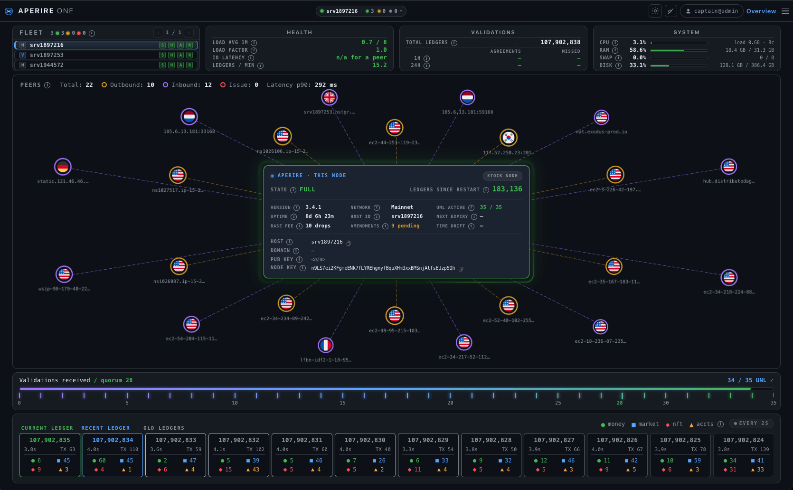
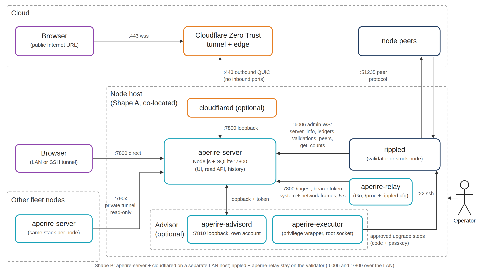
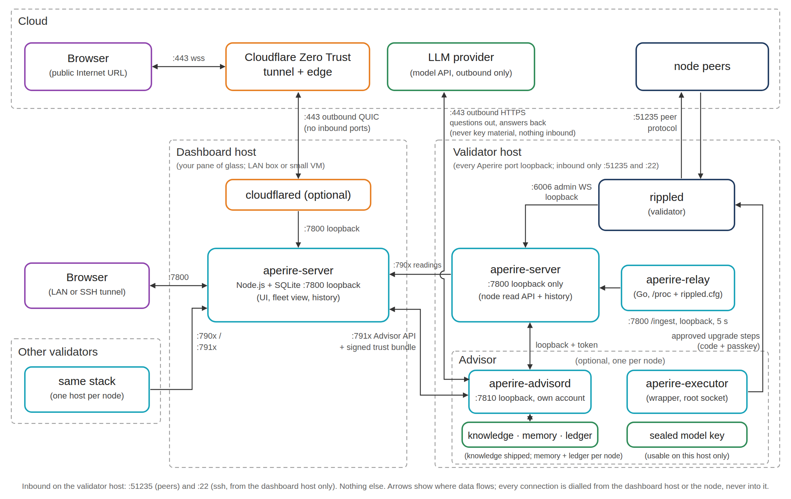
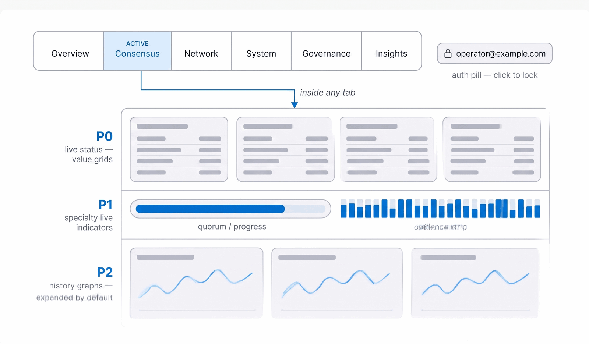
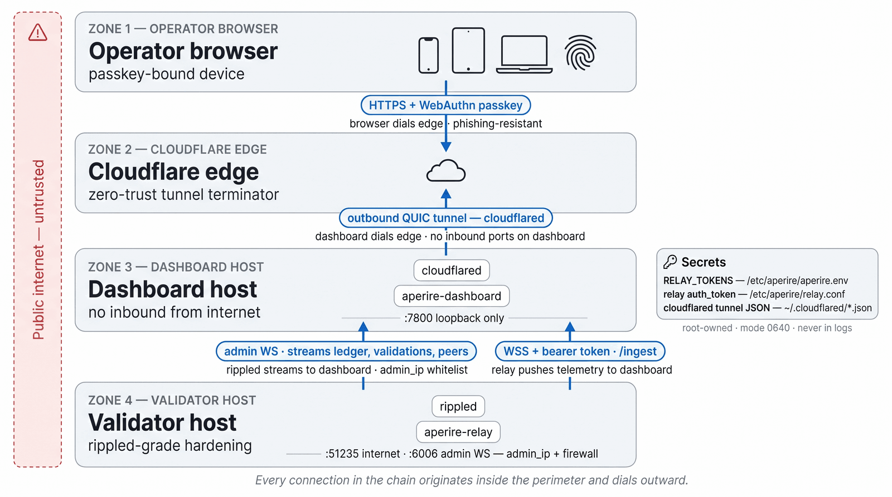
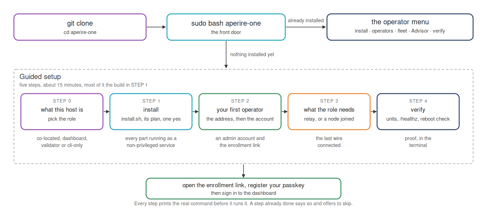

#  Aperire One: XRPLD Dashboard

Purpose-built monitoring for XRPL validators and stock nodes (`rippled`, `xrpld`, and the forks that share their wire). **Aperire** (pronounced *ah-peh-REE-reh*) is the Latin verb *to open* or *to reveal*: opening up what a node is doing, in real time. TypeScript, live WebSocket data, interactive graphics, and an optional Advisor that can run an approved upgrade for you.

<!-- hero:start -->
https://github.com/user-attachments/assets/e4e4a4cb-8123-4d43-80be-1929cdc2acfb
<!-- hero:end -->

<details><summary>Still preview</summary>



</details>

## What this is

A single pane of glass for every node and validator you run. You sign in to one dashboard and see all of them: state, consensus, peers, host health, alerts, and the Advisor's view of what needs you, node by node or fleet-wide.

Each node feeds it two ways. `aperire-server` runs beside the node and reads it live over rippled's admin WebSocket: `server_info`, ledgers, validations, peers, amendments, `get_counts`. `aperire-relay`, a small Go binary on the same host, reads what rippled can't tell you (`/proc` CPU, memory, disk, pressure, network counters, per-port connections) and pushes it outbound to that dashboard service. The pane of glass reads every node's `aperire-server` over a private tunnel; nothing dials in. History lives in a local SQLite file for 30 days, and alerts reach you by email, push or webhook when something drifts. It only ever reads: it never signs, never submits, and never opens an inbound port on your validator.

It succeeds my earlier [XRPL Validator Dashboard (Classic)](https://github.com/realgrapedrop/xrpl-validator-dashboard), which was Python + Grafana. Aperire One is a ground-up rebuild with a native UI.

## Feature highlights

- **Real-time node monitoring** across seven tabs: Overview, Consensus, Network, System, Governance, Insights, Advisor.
- **175 metrics** cataloged across 10 domains, tiered P0/P1/P2, each with documented alert thresholds (see the [metrics catalog](docs/METRICS-CATALOG.md)).
- **Live validator panel**: a role-aware panel (state, domain verification, keys, ledgers since restart) centered in a peer ring with country flags, plus a sliding ledger ticker on the Overview tab. The halo around it takes the colour of the node's own state.
- **Single pane of glass**: every node and validator on one dashboard, with per-node State / Health / Alerts / Release badges, one sign-in, and an approved upgrade on any node with your passkey from right there.
- **Insights tab**: alert engine with an `OK → pending → firing → resolved` state machine, persistent firing state, alert history, scheduled digest emails, configuration panels.
- **Three delivery channels** for alerts: email (Resend), push (ntfy, severity mapped to priority), and webhooks (Discord, Slack, generic JSON). Per-target severity filtering.
- **Test Fire**: dry-run and live verification for every channel, rate-limited to 5/hour per channel, optional `APERIRE_TEST_TOKEN` second factor.
- **Scheduled digests**: daily / weekly summaries with configurable content (agreement summary, top alerts, network health, upcoming amendments).
- **Amendment intelligence**: XLS-NN tags from xrpscan, descriptions from xrpl.org, hover popovers with one-click access to the spec, unsupported-amendment warnings.
- **WebAuthn / passkey authentication, no third-party dependencies**: Touch ID / Face ID / Windows Hello / hardware key. No identity provider, no SSO, no Firebase: operators, credentials and sessions live in the dashboard's own SQLite, and the WebAuthn library is vendored locally, so sign-in works with the internet down. Self-serve device enrollment via an emailed magic link. Manual lock plus a keyboard shortcut.
- **Outbound-only deployment**: Cloudflare Zero Trust tunnel, no inbound ports. Two supported shapes (co-located, LAN split).
- **Advisor (optional add-on)**: an agentic layer that answers questions about *your* node and can run an approved upgrade from the dashboard. Runs under its own account with no Docker access and one command it may run as root; every action needs a confirmation code and your passkey, and everything it does or refuses is written to a hash-chained ledger that names who did it. Monitoring is unaffected if you skip it. See the [Advisor setup guide](docs/ADVISOR-SETUP.md).
- **Operator CLI**: `aperire-auth` for operator management (`add`, `del`, `list`, `revoke`, `magic-link`, `set-role`, and more) and `aperire-one`, a menu that wraps every script. Operators are identified by their email: one identity, no handle-vs-email split.
- **One-command install**: `sudo bash aperire-one` from a fresh clone. On a host with nothing installed it opens a five-step guided setup (role, install, first operator, the role's last wire, verify); on one that already has Aperire One, `bash aperire-one` opens the operator menu as you, and it asks for sudo on each entry that needs it (started with sudo there, it hands itself back to your account). Every step prints the real command before it runs it. `install.sh --role=<role>` is the same install with flags instead of questions.

## Architecture



Aperire One is three programs and a tunnel:

- **`aperire-server`**: Node.js + SQLite. Runs beside each node and reads it live over rippled's admin WebSocket (loopback on Shape A, LAN on Shape B). It is the operator-facing UI, and its read API is what the pane of glass, other fleet members and the Advisor read.
- **`aperire-relay`**: Go binary on each node's host. Reads `/proc`, rippled's config and a `statfs()` of the data mount, and pushes host and network metrics outbound to that node's `aperire-server` over one WebSocket with a bearer token.
- **`cloudflared`**: outbound-only QUIC tunnel; fronts the dashboard at the Cloudflare edge.
- **`rippled`**: the validator (or stock node) being monitored.

Nothing accepts an inbound connection from the public internet beyond rippled's peer protocol. `cloudflared` brokers browser traffic over an outbound QUIC stream; the dashboard dials rippled; the relay dials the dashboard; the pane of glass dials each node over a tunnel. Operator authentication happens at the dashboard layer with passwordless WebAuthn / passkeys.

Full component breakdown, data flows, trust boundaries, and design rationale are in the [architecture guide](docs/ARCHITECTURE-GUIDE.md). Topology selection, tunnel and relay setup are in the [deployment guide](docs/DEPLOYMENT-GUIDE.md). Operator sign-in workflow is in the [auth guide](docs/AUTH-GUIDE.md).

## Recommended shape: the validator on its own box



For a validator you care about, run Aperire One the way the diagram above shows: the validator host keeps everything that touches the node, and the pane of glass lives on a separate box (a LAN machine or a small VM) that reads it over a tunnel it opens itself. This is not a convenience layout. Each line of it is a security decision:

- **No Aperire One port is open on the validator.** `aperire-server`, `aperire-relay` and the Advisor all bind loopback. The only inbound ports on that host are rippled's peer protocol and `ssh` from the dashboard host. rippled's admin WebSocket (`:6006`) never leaves loopback; it is read by the node's own dashboard service, not across a network.
- **The dashboard host dials out; the validator answers.** The pane of glass reaches the node's read API (`:790x`) and its Advisor (`:791x`) over an SSH local forward it owns, loopback at both ends. Nothing on the validator initiates a connection to the dashboard beyond that tunnel. Lose the dashboard host and the validator keeps validating, and keeps its own 30 days of history and its own audit ledger.
- **A dashboard-host compromise is not a validator compromise.** The dashboard host holds a read token for the node and the right to push a signed trust bundle. It has no shell on the validator and no path to run a command there. Even with the Advisor installed, the node's own `aperire-advisord` demands a live passkey ceremony from the one relying-party origin it pinned at install (any change is refused, fail-closed) plus a confirmation code derived from the plan, before its executor performs anything.
- **The Advisor is per node, and self-contained.** Each node's `aperire-advisord` holds its own sealed model key (usable only on that host), its own knowledge corpus (shipped with the release, ranked into the prompt per question), its own memory and its own ledger, and calls the LLM provider itself, outbound HTTPS only: questions and readings go out, never key material, nothing comes in. The dashboard routes a question or approval to the node's own Advisor; it never answers for a node.
- **The Advisor cannot escalate.** `aperire-advisord` runs under its own system account with no Docker access; the executor may run exactly one command as root, a privilege wrapper whose allowed operations are configuration, not code. Every action, refusal and precondition is written to a hash-chained ledger on the node that names who did it and what was proved about them, and the dashboard only ever holds a copy of what it observed.
- **The relay and the dashboard are read-only by construction.** The relay reads `/proc`, rippled's config and a `statfs()`; the dashboard reads rippled and never sends a mutating command. An admin-RPC allow-list proxy is available for operators who want the read-only property enforced by a second process rather than by promise; see the [hardening guide](docs/HARDENING-GUIDE.md).

Install it with the roles you already know: on the validator host `sudo bash install.sh --role=co-located --with-advisor` (no tunnel; every port stays loopback), on the dashboard host `sudo bash install.sh --role=dashboard`, then join the node with `scripts/aperire-fleet-add.sh` from the dashboard host. The [fleet guide](docs/FLEET-GUIDE.md) is the step-by-step, including the tunnel unit and the identity pin that catches a tunnel re-pointed at the wrong host. The single-host layout (Shape A) and the lighter split where the relay pushes over the LAN are in the [deployment guide](docs/DEPLOYMENT-GUIDE.md#pick-your-shape).

## Navigation and tiers

Seven tabs plus the account pill on the right. Within each tab, metrics are stacked by priority tier so the urgent stuff is always on top. Three principles shape this layout:

- **Category first, tier within.** Navigation is organized by topic (Consensus, Network, etc.). Priority tier governs vertical order inside each tab, not horizontal navigation.
- **Role aware.** Stock-node operators never see validator-only metrics. Detection is automatic from `server_info`.
- **Desktop, tablet, mobile are all first-class citizens.** The validator panel and its peer ring are a desktop showcase. Phones drop the ring and stack the panel above a tappable peer list; they never get a broken layout.



What each tab covers:

- **Overview**: splash, validator panel centered in the peer ring, P0 "is anything on fire?" strip, the fleet roster.
- **Consensus**: validation, ledger and chain state, fees and load.
- **Network**: peer network, bandwidth.
- **System**: compute, rippled internals, data integrity.
- **Governance**: amendments, UNL and validator list health.
- **Insights**: alert rules, firing state, history, scheduled digests, delivery channel config.
- **Advisor**: what needs you, ranked; ask questions about the node; approve and watch an upgrade; run history and the audit trail.

The account pill on the right shows the signed-in operator (local part of the email) and their role. Click it for the account menu; press `Cmd/Ctrl+Shift+L` to lock. Sessions auto-lock after the configured idle timeout (default 30 min).

### Tiering methodology

Every metric in every tab carries a priority tier, P0, P1, or P2, that controls how it's surfaced. The principle: a glance at any page should answer "is anything on fire?" without scrolling; trend context for any signal lives on the same page below it.

- **P0**: health-of-the-validator signals. Live values in label/value grids at the top of the tab; never collapsible. If a P0 metric goes red, the operator sees it on first paint.
- **P1**: specialty live indicators (quorum bar, ledger-close cadence strip) that show *right now* state at a higher fidelity than a single number. Visible by default, secondary to P0.
- **P2**: historical context as time-series graphs. Expanded by default, grouped under a "History" section so an operator can see how the live values above got here.

The 175 metrics are each tagged with a tier in the [metrics catalog](docs/METRICS-CATALOG.md).

## Security first

Aperire One is built for validator operators where a leaked dashboard is a real risk surface: secrets indicators, peer state, validator health, and alert configuration are all sensitive. The security model is end-to-end:



- **Passwordless authentication via FIDO2 / WebAuthn.** Operators register a passkey on their device the first time they sign in. Subsequent visits authenticate with biometrics in one tap. No passwords are ever stored or transmitted; phishing-resistant by construction.
- **Self-contained, no third-party identity provider.** No Firebase, no SSO dependency. Operator records, credentials, and sessions live in the dashboard's local SQLite. Aperire One keeps working when any external service is down.
- **No web write path for configuration.** Alert rules, channels, sessions, and operators are all edited via SSH on the dashboard host. A compromised browser session can never change alerting behaviour or add an operator. The CLI (`aperire-auth`) is the single privileged surface.
- **Server-side session enforcement.** Every HTML route and `/api/*` endpoint requires a valid session cookie issued only after a successful WebAuthn ceremony. Static assets needed by the lock screen (vendored crypto bundle, brand image) are the only exemptions.
- **CSRF defence by construction.** State-changing endpoints require an `X-Aperire-CSRF` custom header that browsers refuse to add cross-site without preflight.
- **Self-serve enrollment without lowering the bar.** Operators add new devices via a one-time emailed link (Resend). The token is single-use, short-lived (default 15 min), rate-limited per operator, and invalidated on first redemption. No "any visitor can enroll" path exists.
- **Manual lock + idle-aware sessions.** Lock at any time with `Cmd/Ctrl+Shift+L` or from the account menu. Sessions lock after a configurable number of idle minutes.
- **The Advisor cannot act alone.** Every privileged action needs a confirmation code derived from the plan and your passkey; the node's own Advisor verifies that approval before its executor runs, and records who did it in a hash-chained ledger.

Cookie attributes, transport hardening, and systemd sandboxing are in the [Tech stack](#tech-stack) section. See the [auth guide](docs/AUTH-GUIDE.md) for the full operator workflow.

## Tech stack

- **Dashboard:** Node.js + TypeScript. WebSocket client to rippled (dashboard initiates; loopback on Shape A, LAN on Shape B). `/ingest` WebSocket server for the relay (relay initiates; bearer token). SQLite (better-sqlite3) for historical storage: embedded, no separate daemon.
- **Auth:** [`@simplewebauthn/server`](https://github.com/MasterKale/SimpleWebAuthn) + `@simplewebauthn/browser` (vendored locally, so it works regardless of CDN connectivity). Sessions live in SQLite; the cookie carries an opaque random id only. Cookie attributes: `HttpOnly` + `SameSite=Lax` + `Secure` (auto-detected from `x-forwarded-proto`). Magic-link enrollment delivered via the existing Resend channel.
- **Relay:** Go (`aperire-relay`). Single static binary, zero runtime deps, the `node_exporter` / `cloudflared` operator convention. Reads `/proc/stat`, `/proc/meminfo`, `/proc/loadavg`, `/proc/vmstat`, `/proc/pressure/*`, `/proc/net/*`, `/proc/<pid>/comm` (to find rippled), and `/proc/<rippled-pid>/net/tcp`, plus rippled's config for port auto-detection.
- **Advisor:** Go (`aperire-advisord`, `aperire-executor`) with a privilege wrapper configured as data, not code. Its own account, one root socket to the wrapper.
- **Frontend:** Vanilla HTML/CSS/JS. No framework. Dark theme. Inline SVG charts.
- **Transport:** Cloudflare Zero Trust tunnel (`cloudflared` systemd service on the dashboard host). Outbound-only QUIC to the Cloudflare edge; no inbound ports beyond rippled's peer protocol.
- **Deployment:** systemd units for the dashboard (`aperire-server.service`, with memory caps, sandboxing, auto-restart and a `/healthz` liveness endpoint), the relay, the tunnel, and the Advisor. Verified on Ubuntu 24.04 LTS and Linux Mint 22; other systemd distros should work on the same criterion, and 22.04 works with the Advisor on its own account there too. See the [deployment guide](docs/DEPLOYMENT-GUIDE.md) to install from scratch, and the [operational guide](docs/OPERATIONAL-GUIDE.md) for day-to-day ops.

## Quick install

Two installs, two jobs. The dashboard is Aperire One: monitoring for every node you run. The AI Advisor is an optional add-on for operators who want it, installed after the dashboard or alongside it.

### Install the dashboard

One command, on a fresh Ubuntu box:

```bash
curl -fsSL https://get.aperire.one | bash
```

Already running a fleet? Name the aggregator and the box joins it at the end of its own install, asking that terminal for a pairing code when it gets there:

```bash
curl -fsSL https://get.aperire.one | bash -s -- \
  --fleet-aggregator https://<your-aggregator-host>
```

It works out what the host is, fetches the release into `$HOME/aperire-one`, and runs the installer, which puts the whole toolchain in place itself. It prints its plan before it acts, asks the dashboard's own `/healthz` before it claims the install worked, and on a host that already has Aperire One it says so and opens the menu rather than installing over it. Read it before you run it: `curl -fsSL <that URL> -o get-aperire.sh`, then `less` it. It also refuses to run a copy of itself that arrived half-downloaded.

Or clone it and drive it yourself, which is the same install with the reading done by you:

```bash
git clone https://github.com/realgrapedrop/aperire-one.git aperire-one
cd aperire-one
sudo bash aperire-one
```

Taking it off again is one command too:

```bash
curl -fsSL https://get.aperire.one/uninstall | bash
```

It works out what is installed and asks the one thing it cannot: keep your database and config, or wipe the box clean. There is no default. The only thing it downloads is the uninstaller itself, and only when the copy on your host predates that question.

`aperire-one` is the front door. On a host with nothing installed it opens the guided setup: five steps from a clone to a dashboard you are signed into, each one a sentence of what and why, the real command shown, then run, then verified. On a host that already has Aperire One it opens the operator menu (install, operators, fleet, Advisor, maintenance, verify), with **Guided setup** still an entry. The [Deployment Guide](docs/DEPLOYMENT-GUIDE.md) walks you through everything from here, including what `sudo` actually does on your machine.



### Add the AI Advisor (optional)

The dashboard monitors your node fully without it. Add the Advisor if you want:

- **Answers about your own node.** Ask in plain words. It answers from your node's metrics, logs, configuration and host facts, not from general knowledge alone.
- **An Ask Advisor button where the question comes up**: on alerts, missed validations and node rows.
- **Approved actions from the dashboard.** An upgrade or a restart, run by that node's own Advisor only after your confirmation code and your passkey.
- **A record of everything.** Every action and every refusal goes into a hash-chained ledger that names who approved it.

What it asks of you:

- **An API key** from xAI, OpenAI or Anthropic, and that provider's usage charges. Questions and readings go out to the provider over HTTPS. Key material never does.
- **One more service on the host**, under its own account, with no Docker access and exactly one command it may run as root.

On a host that already runs the dashboard:

```bash
curl -fsSL https://get.aperire.one/advisor | bash
```

It finds the install, builds the Advisor, sets up its account, and checks the service is answering before it says it worked. On a host with no Aperire One install it stops and names the dashboard command instead. Then give it a model, in the browser: open the menu, **Settings & Updates**, **Advisor AI model**, choose the provider, paste the key, press **Test**, pick a model and seal it with your passkey.

Skip it and nothing looks missing. Until an Advisor is installed there is no Advisor tab and no Ask Advisor button, only an **Add the Advisor** row in the menu. The [Advisor setup guide](docs/ADVISOR-SETUP.md) covers what it can and cannot do, and how to remove it.

### Without the questions

`install.sh` is what the guided flow calls under the hood, and it takes every answer as a flag: it prepares the host (apt build packages, Node 22, Go 1.23, the relay and Advisor builds; nothing you install by hand) and then runs the per-component installers in `scripts/`. Pick the role for the host you're on; it prints what it will do and asks once before running. Pass `--yes` to skip the prompt. This is the path for Ansible, cloud-init and any run with no terminal.

**Co-located (Shape A)**, validator + dashboard on one host:

```bash
git clone https://github.com/realgrapedrop/aperire-one.git aperire-one
cd aperire-one
sudo bash install.sh --role=co-located
```

Add `--with-tunnel` to either dashboard role once `cloudflared` and its config are in place: that step runs first and stops the install if they are not. The [deployment guide](docs/DEPLOYMENT-GUIDE.md#reaching-it-from-the-internet-with-a-cloudflare-tunnel) has the four commands that put them there.

Add `--with-advisor` to either role to install the Advisor as well: the optional agentic layer that answers questions about your node and can run an approved upgrade. It sets up its own account with no Docker access and exactly one command it may run as root. See the [Advisor setup guide](docs/ADVISOR-SETUP.md).

**Split (Shape B)**, dashboard and validator on separate LAN hosts:

```bash
# On the dashboard host:
git clone https://github.com/realgrapedrop/aperire-one.git aperire-one
cd aperire-one
sudo bash install.sh --role=dashboard

# On the validator host (the installer builds the relay):
git clone https://github.com/realgrapedrop/aperire-one.git aperire-one
cd aperire-one
sudo bash install.sh --role=validator
```

**Workstation only**, just the operator CLI, no sudo:

```bash
bash install.sh --role=cli-only
```

**Bootstrap the first operator**, which prints a magic link to register your passkey:

```bash
aperire-auth add you@example.com --role admin
```

(`--role` is required: `admin` may approve Advisor actions, `monitor` sees everything and approves nothing.)

On any host you won't reach at `localhost` (a VPS or any remote box), set `public_url` and `rp_id` in `dashboard/config/authn.yaml` **before** this step, or the passkey binds to `localhost` and won't work from the real hostname. The [auth guide](docs/AUTH-GUIDE.md) covers it (step 2, "Set your origin in `authn.yaml`").

Skip the tunnel entirely if you reach the dashboard over LAN only. Pass `--no-prepare` if you manage the toolchain yourself. Every flag, the split-host wiring, path overrides and OS notes are in the [deployment guide](docs/DEPLOYMENT-GUIDE.md#installing-without-the-questions).

## Uninstall

Mirror the role you installed:

```bash
curl -fsSL https://get.aperire.one/uninstall | bash
```

It reads the host: the units and `/etc/aperire` say which halves are installed and which `--instance=NAME` dashboards are here, so there is nothing to remember. It prints that as a plan, then asks the one thing it cannot work out, with no default: **1) keep artifacts** (the database, `/etc/aperire`, the checkout) or **2) wipe clean**. `--keep` and `--wipe` answer it unattended; `--yes` does not.

Both answers take every unit, the relay account, everything the Advisor installed (its sockets, the access control entries, the account) and every `aperire*` link on your PATH. Neither touches your node, docker, Go or nvm. `bash scripts/aperire-leftovers.sh` reads back that nothing named aperire is left, and names any place it couldn't read without root as `not checked` instead of calling it clean. The [deployment guide](docs/DEPLOYMENT-GUIDE.md#uninstalling) has the full table.

## Docs

All public documentation lives under [`docs/`](docs/):

| Guide | Use when you want to… |
|-------|------------------------|
| [DEPLOYMENT&#8209;GUIDE.md](docs/DEPLOYMENT-GUIDE.md) | **Start here.** Install from a fresh clone, step by step, with what you should see at each one: will it run on your system, which shape to pick, exactly what `sudo` does, the guided setup, split-host wiring, the tunnel, and how to remove it all. |
| [ARCHITECTURE&#8209;GUIDE.md](docs/ARCHITECTURE-GUIDE.md) | Understand the components, data flows, storage, trust boundaries, and design decisions. |
| [RELAY&#8209;REFERENCE.md](docs/RELAY-REFERENCE.md) | Look up the relay in detail: configuration, the systemd unit, push protocol, port monitoring, troubleshooting. |
| [TUNNEL&#8209;REFERENCE.md](docs/TUNNEL-REFERENCE.md) | Look up the Cloudflare tunnel in detail: token handling, the systemd unit, DNS, troubleshooting. |
| [HARDENING&#8209;GUIDE.md](docs/HARDENING-GUIDE.md) | Harden the host after install: firewall, SSH, patching, CIS baseline, admin-RPC allow-list proxy, and a checklist to work through. |
| [RELEASE&#8209;SIGNING.md](docs/RELEASE-SIGNING.md) | Check a release yourself before you run it: the release key, what is signed, and what the installer and the updater refuse. |
| [AUTH&#8209;GUIDE.md](docs/AUTH-GUIDE.md) | Bootstrap the first operator, enroll passkeys, manage operators, recover from a lost device. |
| [ENROLLMENT&#8209;GUIDE.md](docs/ENROLLMENT-GUIDE.md) | Follow a screenshot-by-screenshot walkthrough to create and register an operator, with the security model and end-to-end flow. |
| [OPERATIONAL&#8209;GUIDE.md](docs/OPERATIONAL-GUIDE.md) | Run Aperire One day to day: health checks, logs, incidents, upgrades, token rotation. |
| [METRICS&#8209;GUIDE.md](docs/METRICS-GUIDE.md) | Look up what a panel or number on screen means; the full 175-row catalog with sources, thresholds, and per-metric `/proc` paths is [METRICS&#8209;CATALOG.md](docs/METRICS-CATALOG.md). |
| [ALERTING&#8209;GUIDE.md](docs/ALERTING-GUIDE.md) | Configure email + ntfy + webhook alert delivery; verify with Test Fire. |
| [ADVISOR&#8209;GUIDE.md](docs/ADVISOR-GUIDE.md) | Understand the Advisor: what it can see, how it reasons, the approval ceremony, the audit trail, and its hard boundaries. |
| [ADVISOR&#8209;SETUP.md](docs/ADVISOR-SETUP.md) | Turn the Advisor on: what it is allowed to do, the accounts involved, one-command install, and how to undo it. |
| [FLEET&#8209;GUIDE.md](docs/FLEET-GUIDE.md) | Watch more than one node from a single dashboard: register a node, reach it over a private tunnel, and run an upgrade on any node in the fleet. |

Release history is in [CHANGELOG.md](CHANGELOG.md).

## License

MIT
