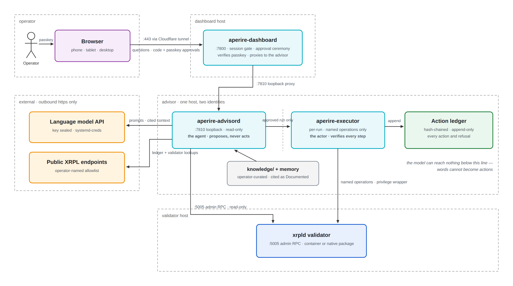
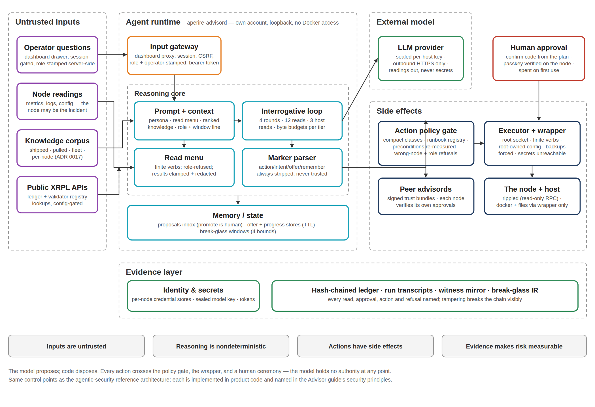

# Aperire One Advisor Guide

The Advisor is Aperire One's optional agentic layer. It's an AI agent that watches your validator, explains what the numbers mean, answers questions with cited sources, and (with your per-action approval) runs operations on the node, starting with version upgrades. Everything it does or refuses to do lands in a tamper-evident audit log.

This guide covers what the Advisor **is**: how it reasons, the approval ceremony, the audit trail, and its hard limits. To turn it on, read the [Advisor Setup Guide](ADVISOR-SETUP.md). That one covers what it's allowed to do, the accounts involved, and the one-command install.

**What it needs to act.** Aperire One monitors a node however you installed it, and the Advisor acts on both shapes: a container run through Docker Compose, or the vendor's own package run under systemd with no Docker on the host at all. It finds the deployment by inspecting the container or the systemd unit, whichever this host runs, then drives that shape's own tools: a compose file and an image on a container, the package manager and the unit on a native install. A host running neither is refused at discovery, and the refusal names what it found instead. Monitoring, alerting, and the rest of the dashboard work the same on either shape. What acting on each one means in practice differs enough to earn its own comparison tables, in [the upgrade ceremony](#the-upgrade-ceremony) and [the rollback](#rolling-back-to-the-last-known-good-release) below, and the [Deployment Guide's native section](DEPLOYMENT-GUIDE.md#a-native-node-without-docker) covers installing or adopting the node itself.

Two more references:

- [Architecture guide](ARCHITECTURE-GUIDE.md) for the dashboard's own components and trust model.
- [Metrics guide](METRICS-GUIDE.md) for what each metric means.

---

## Architecture



Every arrow the agent owns is a read. The one arrow that crosses from reasoning to acting carries a live, passkey-signed approval, and nothing else crosses at all. The language model has no path to the executor or the node. The audit ledger records what crossed, and what was refused.

## The design in one paragraph

The Advisor is zero trust by construction. The agent that reasons and the executor that acts are separate services with separate identities. The agent can propose a named operation but holds no privilege. The executor holds the privilege but accepts only a short list of named operations, re-measures the node itself before acting, and demands a fresh operator approval (a confirmation code plus a passkey signature) for every stage of every action. A hallucinated step has nothing to grab onto, and a compromised browser session cannot manufacture an approval.

## The two services

| Service | Identity | What it can do |
|---------|----------|----------------|
| `aperire-advisord` | The agent. Loopback-only HTTP, read-mostly | Measure the node, evaluate plans, answer questions through a configured language model, look up public XRPL data. Its three write verbs (record an approval, capture a snapshot, start a run) are token-gated, and starting a run also requires a live passkey approval |
| `aperire-executor` | The actor. Invoked per run, on the host | Execute a runbook's named operations through a privilege wrapper, verifying each step against the node |

The dashboard's Advisor tab is a client of both, through the dashboard's authenticated session. You can also drive the executor from its own CLI. Same checks, same approvals, same transcripts. One approval drives one run: the run claims it before its first change, so if the CLI and the tab both try to use it, the second is refused before it acts and names the run that holds it.

## What it can see, know, and remember

**Measured.** Live readings, labeled with that word in every answer:

- The node itself: server state, peer count, validated ledger and age, consensus health, via the admin RPC
- The deployment definition (the compose file) versus what is actually running. This is how it tells a staged change from an applied one
- The newest published release of the node software, read from the registry
- Any ledger's public profile (close time, transaction count, consensus cadence) from a public XRPL API you name in configuration
- The network's view of any validator key (agreement scores, domain, version) from a public validator registry you name in configuration
- The dashboard's metric cards, passed in with baselines and change detection

**Documented.** The knowledge corpus, also labeled in answers. The folder `advisor/knowledge/` holds operator-curated Markdown, read fresh on every question. Drop a `.md` file in to teach the Advisor something. No restart needed. What is loaded: `.md` files at the top of the folder plus `nodes/<label>/*.md` one level down, `README.md` and symlinks skipped, nothing else. Files are loaded whole. Good candidates: your node's normal baselines, incident postmortems, metric threshold references, distilled operational guides.

A fleet keeps two more layers beside that folder, in `advisor/knowledge-fleet/`: `base/` for public material pulled in on purpose, and `local/` for the notes you have promoted to the whole fleet. Both are written only by a signed bundle the aggregator pushes, never by a deploy, and both may use taxonomy folders (`xrpl/`, `os/`) and a small YAML header per file (`title`, `tags`, `applies_to`, `priority`, `last_reviewed`, `source`). Tags and folder names give the ranker something to scope by, and `applies_to` keeps a note written for one fork out of a node running another. All four layers rank together per question; when two of them hold the same filename, the more specific one wins — this node's own note, then the fleet's promoted copy, then the pulled one, then what shipped — and the drawer names the copy it did not use. A pushed file can never join the always-sent core, and it can never be `role-policy.md`: a bundle changes what the Advisor knows, never what it is allowed to do. Push one with `aperire-knowledge-push` from the aggregator; each node verifies the signature and every file hash, refuses a sequence it has already applied, swaps the corpus in atomically, and records the bundle in its own ledger. Files without a header work exactly as they always have, which is the whole shipped corpus today.

**The Knowledge card.** When the Advisor concludes something worth keeping for the whole fleet, it writes a proposal instead of publishing one. Proposals sit outside every prompt until a person adds them, and the **Knowledge** card on the Advisor tab is where you read them. Its header carries a count of how many are still waiting on a decision. Admins only: the card is absent for a monitor and the routes behind it refuse one.

The card shows one proposal at a time, newest first across every node, with previous and next to move through the queue. Each carries where it came from — the node, the time, and the question that produced it — then the note itself, then a suggested place in the taxonomy. A proposal arrives as a summary and a recommendation you can scan: what was observed, then what should be recorded or done about it, with the folder the file would land in at the bottom of the card. A note written without those two headings is shown whole, under the summary. **Edit** opens the file as it would be written, with the title, path, tags, `applies_to` and priority pre-filled and the body editable; your edits stay with that proposal while you page around. **Add knowledge** writes it into `knowledge-fleet/local/`, stamps the header with who proposed it and who promoted it, lints the whole corpus, and pushes the signed bundle. The result names every node: which applied it, at which sequence, and which did not and why. Promoting and reaching the fleet are two separate facts, and the card says both — a promoted note whose push missed a node is in the corpus and rides the next push. **Reject** takes an optional reason and records the decision on the node that proposed it, so a later re-proposal can say it was rejected before, and so `proposal.promoted` and `proposal.rejected` land in that node's own ledger.

**Pulling the field guide.** The same card carries the base pull: public material, at a commit you pin, into `knowledge-fleet/base/`. Name the repository in `dashboard/config/knowledge.yaml` (there is an example beside it) — there is no default, because a public repository that lands in every Advisor's prompt is a supply-chain and prompt-injection surface, and which one it is should be a decision you can point at. Only `http(s)` URLs are accepted.

The pull is two clicks. **Pull the field guide** fetches the repository and shows the commit and what changed since the last pull, file by file. **Apply** copies that exact commit in, lints, and pushes. Long documents are split into single-topic files at their H2 headings on the way in: a 138 KB guide copied whole is refused by the linter and useless to a ranker that sends a file whole or not at all. Files that carry no header get a minimal one — the title from their own heading, the source as `repository@commit`, and the pull date. The pinned commit and pull date are kept beside the bundle archive on the aggregator.

The limit is on what reaches the model, not on what loads. Every question ranks the corpus against the words in it and injects up to 96 KB, always-sent core files first. Anything that does not fit is left out whole, never truncated, and the drawer shows a "budget reached" step naming each file it dropped. So a corpus larger than the budget still works: you see what was left out instead of getting a silently shortened answer.

**Remembered.** The Advisor keeps its own memory across sessions and writes to it when it concludes something worth keeping. Its own conclusions stay marked unconfirmed: it cannot establish facts by writing them down and reading them back. A note about rolling the node back comes back with the node's present answer under it, and that answer wins. To see what it remembers, run this from the install's `advisor` folder, as the Advisor's account, the same way you accept the compact:

```
sudo -u <advisor account> ./bin/aperire-executor memory
```

Add `--confirm <id>` to agree with a conclusion, or `--retract <id> --reason "<why>"` to withdraw one that's wrong. A retracted note is never recalled again. The memory file keeps it with the reason and the person `sudo` names, and the audit ledger records a `memory.retracted` entry.

## Talking to it

The drawer on the Advisor tab is the conversation. Answers label every claim with its provenance: Measured, Documented, or plainly Unexplained when it does not know. Three shortcuts feed it context automatically:

- **Check & advise.** Every metric card carries a button that hands that card's measurements to the Advisor and asks what they mean
- **Investigate.** Every recorded missed validation on the Consensus tab links into the drawer carrying the context captured at the moment of the miss. The Advisor fetches the ledger's public profile itself and compares
- **Named references.** A question that names a ledger index or a validator public key gets the relevant public lookup attached without being asked

## When it acts: BREAK GLASS

**BREAK GLASS is the product-wide term for every privileged Advisor operation.** The Advisor answers questions freely. The moment an operation could touch the node, or read deeper than the ordinary tier allows, you break the glass: a typed confirmation code plus your passkey, admin only, a hard expiry, and a hash-chained ledger entry. The term is on screen, not just in this document. The chat box carries a **⛒ BREAK GLASS** chip while a window is open, and the header on every tab shows a countdown pill until it closes.

Five instances ship today: the **upgrade ceremony** (below, from its card or from the drawer), the **restart** you ask for in the drawer, the **configuration change** you ask for the same way, the **rollback** back to the release you were on before, and the **investigate window** every one of them runs inside.

### The upgrade ceremony

Actions are runbooks: predefined, versioned procedures with preconditions, steps, verifications, and rollbacks. The upgrade runbook runs in two stages, and what each one does depends on the shape:

| | Container | Native package |
|---|---|---|
| **Prepare** | Backs up the node config and the deployment file, builds the target image on this host from the XRP Ledger Foundation's signed package, verifies it reports the target version, records what it resolves to, points the deployment at it. The node keeps running throughout. Nothing goes offline. | Backs up the node config (there is no deployment file to back up), confirms the target is installable, keeps a copy of the package currently installed, then installs the target. The package manager verifies the vendor's signature before it installs. Its own maintainer scripts can restart the node right here, so prepare is not the outage-free half a container's build is |
| **Cutover** | Recreates the node on the new image, giving the old container's stop an explicit grace of at least five minutes (what the package's own unit gives the same binary), then reads the container's own first lines to confirm the node's config reached it. The container is back in roughly 30 seconds; the node itself takes a few minutes to return to consensus | Restarts the node onto the version prepare installed, whether or not the package's own scripts already restarted it. That restart is what makes cutover deterministic regardless of what those scripts did |

Either way the stage is named `cutover` everywhere: the CLI (`--stage=cutover`), the API, and the audit ledger. In the tab, the button that starts or retries it reads "Restart the node now". That is a step of the upgrade, not the standalone restart below, which runs a different runbook and is asked for in the drawer. Immediately before cutover's restart the executor re-checks that consensus still looks healthy and **refuses** if it doesn't. Afterwards it does not call the run done until the node both reports the target version and returns to full sync within the timeout. A restart that "worked" but left the node out of consensus is reported as exactly that.

**Where a container node's image comes from.** The official one, first. The XRPL release process publishes `rippleci/xrpld` as part of the release itself, and the Advisor asks the registry one question about the exact release you are upgrading to, by name. When a tag carries it, the digest that tag points at is pinned there and then, and the pull uses the digest: a tag moved between the moment you approve and the moment your node restarts cannot change what gets installed. Your deployment ends up naming `rippleci/xrpld@sha256:…` with the release in a comment beside it, so the file says which release it is and pulls exactly one set of bytes.

**Four things are checked before anything is swapped, and any one of them failing stops it.** The image reports the release and the commit that the signed package's own binary reports. The package hash recorded in its build history equals the hash the signed package index publishes. It runs as an account of its own rather than defaulting to root. And its `/usr/bin/xrpld` is byte for byte the binary inside the signed `.deb`, fetched through apt's own signature checking. That last one is the one that matters: it binds the bytes that will run to the XRPL Foundation's signing key rather than to a claim. A mismatch is never retried and never worked around. It stops, shows both values, and offers to build the release from the signed package instead.

**Building it on your own box is the second source, and it is one press away.** A release ships as a signed package first and an official image does not always follow the same day, which matters when a release arrives with an amendment deadline on it. When no official image carries a release the Advisor says so and offers the build; ask for a build at any other time and it does that instead, on a card that says which source it chose and why. The build checks the signing key's fingerprint against the published one and refuses on a mismatch, installs one exact package version through apt's own signature checking, and proves what it built before it keeps the tag. The image it makes is named `localhost/xrpld:<release>`, a name no registry can answer for, and the deployment carries `pull_policy: never` beside it so a missing image fails at once rather than sending anything to a registry. It touches no container, so your node validates throughout.

**Two things about a container deployment are read before the stop.** A container that names no user has been running as root, and the built image's own account is 997:997, which on your host is whichever account holds that uid. The upgrade refuses such a node until the deployment says `user: "0:0"`, which keeps the behaviour it already has. A deployment that mounts the node config only at `/config` is refused for a related reason: the image copies that config to `/etc/xrpld/xrpld.cfg` at start and refuses to run when it cannot. Each refusal names the one change that fixes it, and never both at once.

**The two shapes prove the installed bytes differently, not to different degrees.** A container upgrade verifies the image it built: the signing key's fingerprint, the package's own signature chain, and then the version and the package the image itself reports, recorded as a digest that is compared again immediately before the swap. A native upgrade verifies the vendor's signature on the package, then confirms the version that came up is the version that was installed. Both are real guarantees, and neither is the other one reached by a shortcut.

**What a native upgrade has proven so far.** The check that resolves the target version reads this host's own package repositories directly, and the restart step's own pass or fail reading has been proven against the real wrapper script on a native host. What it has not yet proven is a version change carried all the way through: the native install and rollback steps are built and covered by the test suite, but no newer package has been published since the one currently shipping, so there has been nothing to install and confirm against yet. The full ceremony, prepare through cutover, has been driven and confirmed end to end on a container host.

One approval covers the upgrade start to finish (prepare, then cutover, under the ceremony that started it), and it has two gates:

- **The confirmation code.** Eight characters, derived from the plan's fingerprint. It is not a secret and grants nothing. It names the exact change, so a page cannot collect your approval for a different plan than the one on screen. The same code appears in the executor CLI and the audit log, so you can cross-check it out of band.
- **The passkey.** A WebAuthn assertion over a fresh, single-use random challenge, bound server-side to the plan and stage, verified independently by the dashboard and the Advisor, expiring in minutes and spent on use.

Before anything runs, the executor re-measures all preconditions itself. If one refuses, the run does not start, and the refusal is recorded with the same care as an action. You can always take the manual path instead. Every plan presents its complete steps (command, expectation, and undo) for running by hand.

**The approval is checked again between the two stages.** If it expired or you withdrew it while prepare was running, or the cutover's own preconditions refuse when they are measured again, the restart does not run. The run stops and says which of those it was, what prepare left behind, and what the node reported when it stopped. On the official image path prepare changes nothing the node starts from. A build points the deployment at the new image during prepare, and a native install puts the new package in place, so there the stop tells you the next restart of the node, by anyone, starts the new release. The stop goes into the audit ledger too. Approve the upgrade again to finish it.

**Complete means the node said so.** A run is called complete only when one `server_info` reading from the node shows all three of these at once: a process that started after the run's restart step began, the release the run was meant to leave it on, and full sync. The Advisor keeps that reading with the result, and the tab names the release from it. A node that comes back on a different release stops the run with both versions named. A node never seen coming back stops it too: the old process still answering, or nothing answering at all. Neither is ever reported as "still catching up". What the reading proves is that the node restarted after the run's restart step began, not that this run caused it. A restart by hand, or a second run from the command line in the same minutes, looks the same from the node. The audit ledger records every run, so an overlap is on the record.

**On a native host the package install can restart the node itself.** Its maintainer scripts do on some platforms, and that happens in prepare. The Advisor reads the node when prepare ends. If the package already restarted it onto the target, that restart counts: the run's own restart is skipped, the approval is spent, and the node is watched back to full sync the same way. If the package restarted it onto anything else, the run stops and names both versions. Every stop, and every run that ends early, says what the node reported when it stopped. It never assumes the node wasn't touched.

**You can also just ask for it.** The card above is one door; the drawer is the other, and both reach the same plan. Inside a break-glass window, say "upgrade this node" and the Advisor answers the way it does for a restart: what is running, what release is available, what the two stages do, how long the node is away, then the fleet with a star on the node it thinks you mean. Reply yes and the gate appears under that answer, leading with the node's name and the version, carrying the same confirmation code the card carries. Ask before breaking glass and it tells you to, with the button beside it; a monitor is told this is an admin's act. The Advisor never picks the version: it names the release this host derives, and a version it invented is refused with both versions in the refusal. Approving either door stands the other down, because it is one plan and one code.

### Restarting the node

Restarting is its own runbook (`restart-node`), and it is the same glass. The node comes back on the image it is already running: nothing is changed, so there is nothing to put back.

**You ask for it.** There is no restart button sitting on the tab. Open the Advisor drawer and say what you want — "restart this node", "restart node1 for maintenance" — inside a break-glass window. The window is the gate: break glass from the button at the top of the panel first, and if you ask before opening one, the Advisor says so in a line with the button beside it rather than assessing something you cannot then act on. A monitor is told plainly that this is an admin's act, inside a window.

It is also permitted per host: only on a host that runs a node, and only when that host's operator compact names the `restart` class. Permit it when you accept the compact:

```
./bin/aperire-executor compact --accept --privilege=D1 --classes=upgrade,investigate,restart,config
```

The terms themselves don't change, so there is nothing new to read. A host whose compact doesn't name the class refuses the restart outright, and says so with that command when you ask.

**An acceptance names one node, so changing the node's shape means accepting it again.** The acceptance is recorded against the node's identity: the container's name where the node runs in a container, the systemd unit where it runs from a package. Replace a container node with a native one on the same box and that identity changes underneath an acceptance you already made, so the Advisor refuses every privileged class there, correctly, until the compact names the node the host runs now. It tells you when you ask, with the node it was accepted for and the node this is, and the native install path says the same thing at the end of its run with the exact command, carrying the privilege and the classes you had. It never accepts on your behalf. The terms are unchanged either way, so there is still nothing new to read.


**It shows you the fleet, and stars the node it thinks you mean.** A restart of the wrong box is the mistake worth spending a turn to prevent, so the Advisor answers first with its assessment and a table of the fleet — the node, its hostname, its role, its state — with a star on the one it would restart. Reply yes, or name another node. It can only ever restart the host it runs on: ask it for a peer and it says which Advisor it is, and offers to select that node in the header and ask there.

**The assessment comes before the gate.** The Advisor publishes what it read of the node right now (sync state, peers, validated ledger age, uptime, running version, what the deployment names, free disk), plus anything it thinks is worth a second look: a node restarted a few minutes ago, peers below their usual count, disk headroom in the thin band above the floor that refuses. It also says plainly what it could **not** determine, which in this release includes whether the node can read the configuration it will start with. A reading it did not take reads "not measured", never zero. Free disk is measured on the filesystem the node's own store sits on, and the check names that path: where the store belongs to the node's own account and the Advisor cannot reach it, the privilege wrapper takes the reading as root, so a store on its own volume reports its own mount rather than the root filesystem's.

**Why you are restarting** — applying a configuration change, relieving resource pressure, planned maintenance, or your own judgement — is taken from what you asked for. It goes into the audit ledger, and it is part of what the confirmation code identifies, so each reason has its own code.

**Expect 8 to 10 minutes back to full on a node of this class**, most of it spent catching up from the node's own store. That is the measured figure and it is deliberately not the "about 30 seconds" the container's own restart suggests.

Five preconditions block it, the same way the upgrade's do. Two are worth calling out:

- **Consensus must not look anomalous.** This is the hard boundary below, not a formality: a wedged, unreachable or amendment-blocked node fails it and the restart is refused. Recovering a node in that state stays a manual act.
- **The deployment must name the version the node is running.** A restart with a staged tag sitting in the deployment file would be an upgrade nobody approved, so it is refused.

Then the gate, under that answer: the node's name, hostname, container and role at the top of it (a validator says it stops proposing for the length of the restart), the confirmation code, and the passkey — the same glass as an upgrade. The code's instruction names the node you are confirming, because a code typed under the wrong name is exactly what this step exists to prevent. The run streams into the same terminal, records the grace it gave the node to stop (floored at 90 seconds, because a node killed mid-write is how a data store gets damaged), and confirms the node came back on the build it was already running, read from a process that started after the restart. A different build halts the run and names both, rather than being reported as a slow resync. A node that never shows a newer process halts it as "not seen restarting", because a node that was never restarted looks exactly like one that came back.

From a shell, the same runbook: `aperire-executor execute --runbook=restart-node --stage=restart --intent=planned-maintenance`. It exits 0 only when the node proved the run finished, 1 when the run stopped or failed, and 3 when the node restarted on the right build but hadn't reached full sync inside the window. Exit 3 is neither success nor failure, so a script can tell it apart from both.

When the Advisor runs as its own account, which has no Docker access, the executor reads the node and runs its steps through the node wrapper's root socket, the way the service does. `check`, `advise`, `execute` and `cancel` all work that way. Give the socket with `--wrapper-socket <path>`, or set `APERIRE_WRAPPER_SOCKET`. With neither, an installed wrapper named with `--wrapper=<its installed path>` brings its own socket (the wrapper `aperire-node-wrapper-node2` uses `node-wrapper-node2.sock`) without asking. Otherwise the executor uses the one socket your account can reach, and asks you to name it with `--wrapper-socket` if it can reach two. A socket you name that can't be reached is an error that names the socket. The executor never falls back to Docker for it. Run as your own account with Docker access, it reads the node directly, as before. `execute`, `cancel` and `ledger --repair` refuse to run as root.

### Changing a configuration setting

Four settings can be changed through the Advisor and no others: `online_delete`, `advisory_delete`, `node_size` and `ledger_history`. Everything else in the file — every port, every path, every stanza carrying key material — is unreachable, because there is no operation that names a file or writes an arbitrary line. Each of the four has a safe operating band enforced on the privileged side, so a value rippled would accept but that would hurt this node is still refused, with the band in the refusal.

**You ask for it, and the Advisor recommends.** Inside a break-glass window, ask what `node_size` should be on this box. It reads what the four settings are set to right now, recommends a value with a reason drawn from this node's own measurements, and shows you the fleet with a star on the node it would change. Reply yes and the gate appears under that answer.

**The gate shows the diff, and the Advisor did not write it.** The service reads the node's own configuration and computes the change itself: the file it read and the machine it is on, the current line or lines struck out in red, what replaces them in green, in the exact spacing that gets written. A setting assigned twice — two `online_delete` lines is a real configuration and this operator has one — shows both, because both are rewritten. The Advisor's words are the reasoning; the diff is measured.

Two of the four are not `key=value` lines at all. rippled writes `node_size` and `ledger_history` as a section whose value is the line underneath its header:

```
[node_size]
huge
```

The gate shows that header above the change as unchanged context, and colours only the value line, because that is the only line the rewrite touches. If the section is missing, appears more than once, or has no value under it, the change is refused before any ceremony, naming the section and the file. Nothing is ever added: the Advisor rewrites a setting the file already has, because which part of the file a new one belongs in is not something it can decide.

A dated copy of the file is taken before anything is written, named beside it, and its path is in the run log and the ledger. Restoring it puts the old value back.

**All four are read at startup, so the node restarts to apply the change.** The gate says so in amber, and one approval covers both: the edit and then the restart, in sequence, under one passkey. The button reads "Approve & apply + restart". Approving the edit on its own would leave the node running one configuration and holding another, and asking for a second passkey in that gap asks you to authorise the half that does nothing before the half that does.

The preconditions are the restart's, plus one this runbook adds: **the node must be able to read its own configuration, as the account that actually runs it.** On a container that is the account the deployment configures, or the image's own where the deployment names none. On a native install it is the account the systemd unit runs the node as, read directly from the unit rather than assumed, which is the more precise of the two: a container check can only prove what the deployment's configured user could open, and that is not always the account the process ends up running as. Either way, a config the node cannot read makes it come up on defaults with no error anywhere, and the first symptom is a peer count that looks wrong days later. It is checked before the restart, and again right after the rewrite. A check that could not run at all (no shell in the image, a container that is not running, a service user this host does not recognise) is reported as unmeasured, never as a pass.

It is permitted per host, like the restart, by the `config` class in the operator compact.

```bash
./bin/aperire-executor compact --accept --privilege=D1 --classes=upgrade,investigate,restart,config
```

From a shell, the same runbook: `aperire-executor execute --runbook=config-change --stage=config --key=node_size --value=large`.

### Rolling back to the last known good release

An upgrade path without a rollback is half a tool. Rolling back is its own runbook (`rollback-node`) and its own glass, and you ask for it the way you ask for the other three: inside a break-glass window, "roll this node back".

**You do not pick the version.** The Advisor derives it, twice, from things your node produced itself, and one of the two sources differs by shape:

| | Container | Native package |
|---|---|---|
| **First source** | the newest dated copy of the deployment file that names a version other than the one running. Those copies are taken before every version change, so the tag inside one is what the node was running then | the most recent completed package install that ended on the version now running, and the version it recorded replacing. There is no deployment file to keep dated copies of, so one completed native upgrade already answers this by itself |
| **Second source** | the versions this node's own runs have completed on, from the audit ledger | the same: the versions this node's own runs have completed on, from the audit ledger |

If both sources derive a version they must agree. On a container, history alone is never enough on its own; only the first source, the dated deployment copies, can derive a target by itself, and the Advisor says so rather than implying corroboration it does not have. On a native install either source can derive a target alone, because one completed package install already answers what a container needs two runs of history to show, and whichever one stood alone is named as not corroborated. If the two disagree, it refuses and names both, because a version change is not guessed. If neither names a version other than the one running, there is nothing to roll back to and it says that instead of offering a control.

The gate shows the change the way a configuration change shows its diff: the version you are leaving in red, the version you are landing on in green, the dated copy the target was read from, and how old that copy is.

**It carries a warning the upgrade does not**, and it is the reason this act gets its own paragraph. A build that has been writing your node's data store may leave the older build unable to read it, and the failure is quiet: the node starts, peers, and never acquires a validated ledger. It was observed on this project on 2026-08-06. The Advisor measures whether the running build arrived by a completed version change, says so in amber above the confirmation code, and reports "could not determine" as exactly that rather than as an all-clear.

**Expect the outage this node's own restarts measured, and possibly longer.** The gate quotes how long this node took on its last few restarts, from the moment the restart began until it proved it was back in full sync. A node with no timed restart is told there's no measured figure yet. A rollback can take longer than that figure: the node may have to rebuild from the network, and it is not validating while it does. A validator gets that said twice. An upgrade proposed in chat quotes the same measured figure, without the rebuild.

The run is one stage, and it too takes a different shape of the same steps. On a container it takes a dated copy of the current deployment, fetches the target while the node is still running, points the deployment back at it, and recreates the container; only the last step interrupts anything. If that release is still on the host, which it usually is because the node was running it until the upgrade, nothing is downloaded and the rollback needs no registry at all: the moment you want a rollback is not the moment to depend on one. On a native install there is no deployment file to copy, so the run confirms the target is installable, keeps the package currently running (so the next rollback, back the other way, has something to install if the repository stops offering it), installs the target the way an upgrade does, and restarts the node onto it; the restart is the only step that interrupts anything. Nothing else is touched on either shape: not the configuration, not the data store. Afterwards the Advisor waits for the node on the version it rolled back to, tolerating the outgoing version briefly while the old container comes down or the old process exits, and reports "restarted, not yet in full sync" honestly rather than calling a run done that is not.

**Going forward again is another rollback.** What this run just produced, the dated copy on a container or the completed package install on a native host, names the version you came from, so the next rollback derives that as its target. The same act, the other direction.

It is permitted by the **`upgrade`** class — the same class the upgrade uses, because a rollback changes the node's version and that is what the class covers. There is no separate class to add.

From a shell: `aperire-executor execute --runbook=rollback-node --stage=rollback --target=3.2.0 --intent=regression-suspected`. The target is required there and is never derived from the release registry: "the newest published release" is the opposite of a rollback.

### The investigate window

When an ordinary answer isn't enough, the Advisor offers it plainly: *"Do you want me to investigate this deeper? I will need your approval first."* Accepting is the same glass as the upgrade (the typed code, the passkey, admin only), and it opens a **15-minute window** rather than answering one question: up to 5 investigations, 40 privileged host reads, or 400,000 model tokens, whichever runs out first. While it's open, the **⛒ BREAK GLASS** chip sits on the chat box with the time remaining and a one-click early close. Every privileged read lands in the same hash-chained ledger as an upgrade, and the window's closing entry is the summary an auditor reads.

There is deliberately no one-shot deep question. A single deep question is a window closed early. And the window adds **no new capability**: the same menu of reads with bigger ceilings. Key material is excluded at every tier because no wrapper verb emits it. There is nothing a window could grant.

A **monitor** sees the offer as information. The dashboard refuses the ceremony server-side, and the Advisor's trust store holds no monitor passkeys to verify an approval against. Two locks, one message: deeper digging is an admin act.

## Upgrading a fleet node from the aggregator

On a single host the Advisor lives with its node, and you approve an upgrade right there. On a fleet, the dashboard is an aggregator watching several nodes, and the approval has to travel to the node being changed. The security of the whole thing rests on **the node itself verifying your passkey**, not the aggregator vouching for you.

The pieces, in the order they matter:

1. **Each node runs its own Advisor.** Its plan, its preconditions, its audit ledger, its credential store. All local to that node's host.
2. **The aggregator publishes a signed trust bundle** of the admins' public keys and pushes it to each node (`aperire-auth fleet-trust-push`, or the menu under Operators & access). Public keys only. Each node verifies the bundle against the aggregator's key it already holds, then **pins** the relying party and origin on first install and refuses any later change to them. A compromised aggregator can add or drop a credential, but can never redirect which origin is allowed to approve.
3. **You approve on the node's own plan.** Pick a node in the fleet view, open the Advisor tab, and its Upgrade card shows that node's own plan and preconditions and the confirmation code that node derived. Type the code, approve with your passkey. The challenge was issued by that node's Advisor and is verified by it. The aggregator only carries the request.
4. **The record stays on the node.** What the node did is written to the node's own hash-chained ledger. The aggregator keeps only what it observed. A credential that appeared in a node's trust store without a matching ledger entry would be visible on the node's own record, which the aggregator cannot rewrite.

Revocation is eventually consistent. Demote or remove an admin once at the aggregator and the next push drops them from every node it can reach. A node that was unreachable at push time keeps its previous set until it can be reached. The per-node trust comparison on the tab says so before you rely on it.

A node whose deployment the wrapper does not recognise, a container not managed by the tool it expects, or a package neither shape's configuration names, will show its Upgrade card but refuse the run at its preconditions, naming what is missing. The same honesty as everywhere else.

## The audit trail

- **The action ledger.** Append-only and hash-chained. Each entry commits to the one before it, so an alteration or deletion is visible. It records plans, approvals, every step's start and outcome, completions, halts, cancellations, and refusals, written by the executor from its own observations. Never from what a plan claimed or a model said.
- **Repairing a forked ledger.** Two programs writing at once could once leave two entries with the same number after the same entry, which breaks the chain: `aperire-executor ledger` then prints `CHAIN BROKEN`, the ledger reads as not intact, and break glass is refused with "ledger unavailable". Every write now takes a lock on the file and follows the last entry on disk, so this does not recur. A ledger that already forked is mended with `sudo -u <advisor account> ./bin/aperire-executor ledger --repair`, with no run in progress (it refuses while a run holds an approval). It accepts only a fork: every entry must still hash correctly and every entry must follow one that is earlier in the file. At each fork the entry written first stays, with everything before it, byte for byte. That is the only version of the ledger anything else could have seen. The entries written after it at the same point are not discarded. The repair carries them whole, data included, inside one new `ledger.repaired` entry chained after the kept ones, so the ledger still says what they recorded. It also moves them, unedited, into `ledger.jsonl.fork-<time>` beside the ledger, saves a full copy of the file as it was in `ledger.jsonl.pre-repair-<time>`, and prints all of this. An altered entry, a missing one, an unreadable one, or moved entries too large to carry in one row are named and left alone, and the file stays untouched as your evidence. The dashboard's witness and the aggregator's mirror only ever accepted the entries that stay, so neither is expected to raise anything: the mirror reads the repair as the next entry and shows it as "Ledger repaired". If the witness does show "The action ledger contradicts what this dashboard witnessed" (`rewritten` or `truncated`) after a repair, something other than the repair changed the ledger. Treat it as real and compare the fork file and the copy with the ledger.
- **Run transcripts.** Every run streams live into the tab's terminal and is kept permanently. The Run history card lists every transcript with its attempts, duration, and verdict, each opening into a full replay. A verdict reads **complete** only when the node proved it, **stopped** when the run ended short, and **not confirmed** when its last line claims an outcome the node never proved. That covers runs recorded before the Advisor began keeping that proof.

## Security principles

An AI agent next to a validator is a fair thing to be wary of. Watch one
question make the trip — the animation below is the whole security model in
one loop. The model (cloud API or local, your pick, its key sealed to this
host) only ever reads prepared text with the secrets already stripped. An
action is only ever a proposal. Your passkey stands in front of every run,
verified by the node itself. Every hop lands in a hash-chained ledger. And
the red path — the model reaching your node directly — does not exist:


Pick whatever model you trust and can afford, wherever it runs. The choice
changes how good the advice is, never how safe the system is: every boundary
in that picture is enforced by the service and the wrapper, not by the
model's good behavior. A weaker model gives weaker answers. It does not get
weaker locks.

The Advisor's shape matches the reference architecture the agentic-security
field converged on: untrusted inputs, a reasoning core that is never trusted
with authority, an external model behind a guard, side effects behind a
policy gate and a sandbox, humans approving, and an evidence layer under all
of it. This diagram is that reference drawn with Aperire One's real components:



Where this maps to the reference's control points: the input gateway is the
dashboard proxy (session, CSRF, server-stamped role); the request guard is
the read menu and its budgets, with redaction done below the Advisor; the
response judge is the marker parser, which strips and validates every
model-authored block server-side; the tool policy gate is the compact, the
runbook registry and the re-measured preconditions; the sandbox is the
executor behind one root socket and a finite-verb wrapper; peer agents are
peer advisords behind signed trust bundles; and the evidence layer is the
per-node credential stores, the hash-chained ledger, the run transcripts and
the witness mirror. One deliberate difference from the generic reference:
human approval here is not a box the runtime may consult — it stands in
front of every side effect, and the node itself verifies the human.

The same field's control map says every edge needs a gate, and groups the
gates four ways. Ours, edge by edge:

| Control | Where it lives here |
|---|---|
| **Prevent** — block untrusted intent before it plans | The session gate and server-stamped role before a question reaches the Advisor; the first-turn check that answers a monitor or an admin without a window before any assessment work; model-authored markers stripped and validated server-side, never executed; a compact class absent means the action class does not exist on that host. |
| **Constrain** — limit data, tools, identity, egress, autonomy | Read budgets per tier (reads, host reads, bytes, rounds); finite verb allow-lists in the menu and the wrapper; key material stripped below the Advisor; the sealed per-host model key; loopback binding with tokens; outbound egress only to the configured model endpoint; the Advisor proposes and can never approve, run, or promote anything itself. |
| **Detect** — watch drift, anomalous chains, policy bypass | Trust-bundle serial drift surfaced per node before a ceremony can fail; the witness mirror that makes ledger tampering visible; every read, refusal, approval and action in the step trace and the ledger as it happens; the alert engine watching the node the Advisor watches. Behavioural anomaly detection on the Advisor's own read patterns is not built — the budgets keep any chain short, and the ledger makes it reviewable. |
| **Recover** — kill, quarantine, revoke, replay, roll back | Exit break glass (one click) or stop the service (systemd); revoke an operator and every node refuses their passkey; forced dated backups before any change, with the restore path in each runbook's reversal note; the ledger and transcripts replay exactly what happened. Rollback to last known good as its own ceremony is on the roadmap; until then the reversal notes are the path. |


Four principles shape everything above. Each maps to concrete mechanisms you can point at, not policy statements.

### Least privilege

Every part of the Advisor holds the minimum it needs, and nothing it does not.

- `aperire-advisord` runs under its own system account with no Docker access and no shell privileges. It can read the dashboard's versioned read API and call the model. That is all.
- `aperire-executor` may run exactly one privileged command: the wrapper, through the root socket the Advisor's account is allowed to connect to. No sudo rule and no Docker group are involved. The wrapper's verbs are a fixed allow-list of operations; its paths come from a root-owned config it will not take from a caller.
- The model receives readings and questions, never credentials. Its own API key is sealed to the host and usable nowhere else.
- Roles narrow reads further: a monitor keeps the health readings and loses the seven reads that map the host. A role can only remove privilege, never add it.
- Read budgets cap even an admin: three privileged reads per ordinary question, more only inside an approved window with its own caps.

### Trust boundaries

Every boundary is enforced where the more-trusted side lives, never by asking the less-trusted side to behave.

- The wrapper strips validator key material from the config **on the privileged side**, before a byte reaches the Advisor. The Advisor is not trusted to ignore a secret; it never receives one.
- Each node's advisord verifies approvals against **its own** credential store, fed by a bundle the dashboard signs and the node checks. A dashboard-host compromise cannot mint an approval a node accepts.
- The node checks every action is addressed to it by name and refuses one meant for another node, whatever the caller believed.
- Loopback is treated as a network boundary, not a user boundary: every service port binds 127.0.0.1 and still requires its token.
- Knowledge shapes advice, never authority. Nothing written into the corpus can grant a read, alter a precondition, or touch a ceremony; those are code.

### Defense in depth

No single check stands alone; the important refusals happen at least twice, in different components.

- An action takes: an accepted compact class on the host, a plan whose preconditions pass, a confirm code derived from that exact plan, a passkey the node verifies itself, and an approval that one run claims before it acts and spends when it ends or first stops. Any one failing stops it.
- The role rules are enforced in the dashboard proxy **and** again in the service; the page's rendering is a courtesy on top, never the boundary.
- A break-glass window is bounded four ways at once: time, questions, privileged reads, and model spend, whichever comes first.
- The executor re-measures preconditions at run time regardless of what was true at approval time; consensus looking anomalous refuses the restart and the cutover even after approval.
- Every ceremony challenge is single-use and bound to the specific act, so a captured approval for one thing cannot be replayed as another.

### Incident response

The tools for a bad day are built in, bounded, and leave a record.

- **Investigate:** break glass opens a time-boxed window with raised reads on one node. Every privileged read lands in the ledger with the asker's name; the window closes on its bounds or one click.
- **Preserve:** evidence capture snapshots the node's state into the Advisor's records before anything is changed.
- **Act:** an approved upgrade, restart or configuration change, assessed first, confirmed by name, streamed live, and confirmed back to full sync or honestly recorded as unconfirmed.
- **Revoke:** removing an operator or demoting a role re-syncs every node's trust store, and a revoked passkey stops approving fleet-wide.
- **Reconstruct:** the hash-chained ledger on each node, mirrored to the aggregator's witness store, names who did what, when, with what proof. Tampering breaks the chain visibly.
- Rollback to last known good as a first-class runbook is on the roadmap; until it ships, the reversal path is documented in each runbook's reversal note.

## Hard boundaries

Some things the Advisor will not do regardless of approvals:

- It never reads or writes validator key material
- It never edits amendment voting or the validator list configuration
- It never restarts a node while consensus looks anomalous. This is what blocks the restart, and the upgrade's cutover with it: both re-measure it, and both refuse

These are enforced in the executor's code, not requested in a prompt.

## Roles

**admin** can approve and run actions. **monitor** can see the state of everything and approve nothing. Approval ceremonies also pin to the passkey that opened the session. An admin approves with their own credential, not with a role.

A monitor's reading is narrower than an admin's in two places, and both are enforced by the service rather than by what the page chooses to draw. Seven host reads are an admin's: the node configuration, the node log, the journal, kernel settings, process limits, the configured validator list sites, and the domain file. None is secret — validator key material never leaves the host for anyone, at any tier — but together they describe where this validator is and how it is reached, and a monitor session is meant to watch the node rather than map it. Memory, disk on the data path, and whether the Aperire One units are up stay available to everyone. A refused read shows in the answer's step trace as "needs an admin", with no break-glass offer beside it, because a monitor cannot open a window. Second: a break-glass window belongs to the admin who opened it. While one is open on a node, a monitor's questions on that node still get ordinary answers at the ordinary tier; they are never routed into the window and never refused because of it.

The rules are written out in `advisor/knowledge/role-policy.md`, which the Advisor is given on every question so it can explain them. Editing that file changes what it says, never what it enforces.

The first account created on a host bootstraps as **admin**. Every account after it starts as **monitor** and is promoted deliberately with `aperire-auth set-role <email> admin`. `set-role`, `revoke`, and `del` re-sync the Advisor's trust store themselves, and a passkey enrolled in the browser reaches it the moment the enrollment lands. `aperire-auth advisor-sync` is the catch-up for a host whose Advisor tab says the store is stale. The full roles table lives in [AUTH-GUIDE.md](AUTH-GUIDE.md).

## Configuration

All Advisor configuration lives on the host and is changed on the host. Never through the browser.

- **Model.** `./scripts/setup-advisor-model.sh` configures the provider, model, and API key interactively. `--show` prints what is configured (never the key). `--disable` turns the model off. `--doctor` checks this host end to end (config file, sealed key, unit, service, and whether the running Advisor actually reports a configured model) and prints the command that finishes the job if anything is missing. Any other flag prints the help and exits 2. The key is kept where only root on that host can read it: sealed with systemd-creds (to the TPM where one is available) on systemd 250 and newer, and as a `root:root` 0600 file loaded with `LoadCredential=` on older systemd, which is what Ubuntu 22.04 runs. The older path uses no TPM even on hardware that has one, and a copy of that file is a working key off the machine, which the sealed form is not. Either way it never appears in any config file, environment, or log, and the Advisor reads it under the same credential name. The install checklist prints which method a host will use; the setup guide has the table and the trade-off in full. The Advisor's deterministic surface (readiness, plans, execution, audit) works with no model configured at all. The model adds conversation and diagnosis.
- **Service token.** `advisor/state/approve.token`, mode 0640, generated by the Advisor at startup if absent. Group-readable so the dashboard can read it when the Advisor runs as its own account. The containing directory is 0750. The dashboard presents it on every call. It gates reads as well as writes: loopback is a network boundary, not a user boundary, and what these endpoints return is the audit ledger, the run transcripts and the node's deployment. It is not what authorises an action (that is the passkey). It only proves the caller can read a file this service's user owns.
- **Public lookups.** `advisor/state/xrpl-lookup.json` names the one ledger endpoint and one validator registry the Advisor may query. Absent or disabled means the Advisor says lookups are not enabled rather than reaching anywhere. New outbound access is always an operator decision.
- **Knowledge.** The `advisor/knowledge/` folder, as above.
- **Keeping the readiness answer warm.** `aperire-advisord` re-evaluates the plans it was last asked about every three minutes while it is otherwise idle (the answer served is about that old, and says exactly how old: it carries its own timestamp and an `age_seconds` field; the tab's first poll refreshes it seconds later), so opening a node's Advisor tab from a fleet dashboard finds the answer already measured instead of waiting for it. It remembers the last few plans it was asked about, in `advisor/state/check-warm.json` (the questions and when each was last asked, never an answer), so a restart begins warm rather than making the next person to open the tab pay for it. It stands aside while a run is in progress, spaces itself out while the evaluation is failing or slow, and stops after a day with nobody asking, resuming on the next request. While it is spaced out, or standing aside, the answer served can be older than three minutes, up to ten, and `age_seconds` says so. When a refresh fails, the answer served meanwhile carries `refresh_failed` with the reason and the time, and an answer older than four minutes is not served behind a failure: the request measures again, and a host that still cannot be read answers with the reason instead of an old card. Every answer also carries `node_read`, `ok` or `failed`, taken from the node reads that evaluation made: it is how the tab knows the node itself didn't answer, rather than guessing from the wording of a failing check. `--check-warm=false` on the service's command line turns it off, and `AP_CHECK_WARM_DEBUG=1` in its environment adds a journal line per refresh if you want to watch it work.
- **Persona.** `advisor/persona.md`, the Advisor's identity: what it is expert in, how it should carry itself, and its boundaries restated in its own voice. Edit it and restart `aperire-advisord`.

Persona and knowledge are deliberately separate, and the reason matters. Knowledge is *evidence*: it is injected as reference material and cited as Documented. Persona is *identity*: it shapes how every answer is reasoned and is never quotable as a fact about your node. Keeping them apart means no amount of editing the knowledge corpus can redefine what the Advisor is.

A third layer sits in the code itself and cannot be edited from a file: the labelling discipline, the statement of what the agent can and cannot reach, and the hard boundaries above. Those protect the validator, so they are not left where a file edit could remove them.

## Design decisions, with the reasons

### Why is the confirmation code derived instead of random?

A random code shown by a page and typed back into the same page proves only that a human was present. A derived code has independent sources of truth. The CLI and the audit log show the same eight characters for the same plan, so an operator who cross-checks anywhere catches a page displaying one plan while requesting approval for another. The anti-replay property lives where it belongs: in the passkey challenge, which is random and single-use.

### Why can't the model run anything?

The model's output is prose. The executor accepts named operations from a fixed list, re-measures preconditions itself, and requires a cryptographic approval bound to the specific plan. This is what makes hallucination an inconvenience instead of a hazard. A made-up step has no name the executor recognizes and no approval that matches it.

### Why not LangChain or LangGraph?

The Advisor uses those patterns without those frameworks. The knowledge
library is retrieval-augmented generation with a human curation loop: ranked
selection against the question, an injection budget, layer precedence, and
the Knowledge card as the librarian's desk. The read menu is an agent tool
loop: named reads, checked parameters, budgets, multiple rounds. The
runbooks are staged workflow graphs: deterministic stages, preconditions
re-measured at every edge, approvals gating the transitions.

The difference is who holds each piece. The tool registry is a fixed
allow-list in one file, not a runtime abstraction. The workflow graphs are
code the model can only propose entry into, never drive. And the package
that enforces all of it depends on nothing beyond the Go standard library,
so it can be reviewed in isolation - which no fast-moving framework
dependency tree allows. Agent frameworks optimize for assembling many tools
and providers quickly. Next to a validator, the requirement is the opposite:
few tools, fixed, and slow to change without a person reading the diff.

### Why do public lookups need naming in a config file?

An agent that can silently grow new network destinations is an agent whose egress you no longer know. Each external source the Advisor may consult is named by the operator in one file, off by default. The Advisor treats "not enabled" as an answer to give, not an obstacle to route around.

### Why does an untracked validator come back as an answer, not an error?

Public registries track validators with published domains, mostly UNL members. A private validator being absent is the normal state, and the Advisor says exactly that, naming local measurements as authoritative. An error would invite fixing something that is not broken.

### Why does changing the model need a root command as well as a passkey?

The API key is sealed with host-bound encryption, by a root program the dashboard can reach only through one private socket, and only while a window root opened is still open. The passkey proves an operator approved the change; the window proves someone with root on that host agreed it could happen now. The second gate exists because the dashboard is what checks the passkey, so a compromised dashboard account could pass its own check but cannot open a window. On a fleet, one root line on the aggregator opens the window on every node at once, and each node's own root decides whether to honour it.
