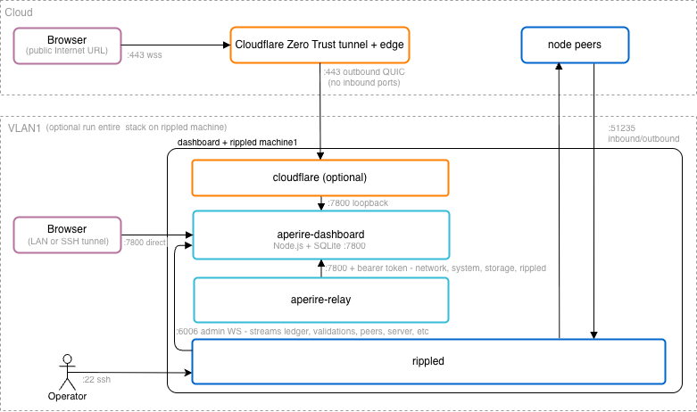
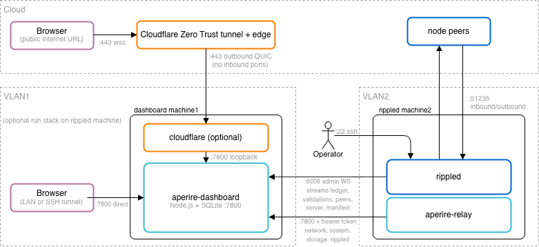

# Aperire One Deployment Guide

This is the way in. One command installs Aperire One, and this guide walks beside it: what the command will do, what you should see, and what to fix if you see something else. It assumes nothing about Linux beyond being able to open a terminal and type.

At the end you have a dashboard running as a supervised service on your own machine, an operator account you sign into with a passkey (a fingerprint, a face, or a hardware key, no password anywhere), and live pages watching your XRPL validator: consensus, peers, host, amendments, alerts. Budget about 15 minutes. Most of that is a build you watch scroll past.

Nothing here is a black box. The guided setup prints every command before it runs it, so when it finishes you know what was done and could do it by hand next time. [What sudo actually does](#what-sudo-actually-does) is the complete list of what lands on your machine and why, and `curl -fsSL https://get.aperire.one/uninstall | bash` takes it back off.

**On this page:** [Will this work on my system?](#will-this-work-on-my-system) · [Pick your shape](#pick-your-shape) · [What sudo actually does](#what-sudo-actually-does) · [The guided setup](#the-guided-setup) · [Updating](#updating) · [Wiring each shape](#wiring-each-shape) · [Installing without the questions](#installing-without-the-questions) · [First sign-in](#first-sign-in) · [Uninstalling](#uninstalling) · [Where to go next](#where-to-go-next)

---

## Will this work on my system?

| OS | Where it stands |
|---|---|
| **Ubuntu 24.04 LTS** | Verified end to end: the install, the Advisor on its own account, everything back after a reboot. |
| **Linux Mint 22** | Verified the same way, dedicated Advisor account included. The installer recognises Mint and says nothing about it. |
| **Ubuntu 22.04 LTS** | Works, with one exception. The Advisor's dedicated account needs systemd 250 or newer and 22.04 ships 249, so on 22.04 the Advisor runs under your own account instead. The one-line install notices and says so; the clone path takes `--advisor-shared-account` to say it up front. The dashboard, the relay and the tunnel are unaffected. |
| **Debian 12 and other systemd distributions** | Should work on the same criterion. Untested, so you are the first. The one-line install refuses a system nobody has verified and points you at the clone path, which is not gated: `install.sh` prints `warning: Aperire One is verified on Ubuntu 24.04 / 22.04 LTS and Linux Mint 22.` and carries on. That is a note about what has been tested, not a refusal. |

The real requirement is systemd 250+, and only for that one Advisor account. Check yours with `systemctl --version`, first line.

| Hardware | What it needs |
|---|---|
| The dashboard on your validator host | Around 250 MB of memory and very little CPU. No new hardware. |
| The dashboard on its own box | 2 vCPU, 4 to 8 GB RAM, 50 GB SSD is generous. It is not doing consensus. |
| Build time | `npm ci` and two Go builds. On a 2 vCPU VPS this is the slow part, minutes rather than seconds. |

**What you need before you start.** You do not have to check any of this by hand. The installer measures the whole list first, prints one line per item with what it found, and stops before it changes anything if something is missing:

```
  ok       OS: Ubuntu 24.04.3 LTS
  ok       account: alice, with sudo available
  ok       disk: 41 GB free on / (/home/alice)
  warn     clock: not synchronised
           sudo timedatectl set-ntp true   # passkey enrollment and TLS both fail on a clock that has drifted
  ok       node: xrpld 3.4.1 (proposing), admin WS 127.0.0.1:6006, RPC 127.0.0.1:5005
```

A warning never blocks. A `MISSING` does, and the list ends with `Before Aperire can install, fix these:` and the exact command for each one.

This is the list it checks:

| | Co-located (one box) | Split (two boxes) | Dashboard only |
|---|---|---|---|
| A running node (`rippled` / `xrpld`) | on this box, admin WebSocket on `127.0.0.1:6006` | on the other box, admin WebSocket reachable over the LAN | not on this box |
| A non-root account with `sudo` | yes | yes, on both | yes |
| `git` | installed for you by the one-line install; needed up front only if you clone | same | same |
| A domain name | only for the Cloudflare tunnel | only for the tunnel | only for the tunnel |
| Docker with a Compose node | only if you want the Advisor | only if you want the Advisor | no |
| 5 GB free disk, 1 GB memory | yes (10 GB is comfortable) | yes, on both | yes |
| Ports 7800 (and 7810 with the Advisor) free | yes | 7800 on the dashboard box | yes |
| Outbound HTTPS, and a synchronised clock | yes | yes, on both | yes |

Run everything as your ordinary account with `sudo` in front, never logged in as root. The services run as you, and the installer works out who you are from `sudo`.

**Check a box without installing anything.** The same list, on its own, fetching nothing into place and leaving no checkout behind. It exits 0 when the host is ready and 1 when it is not, so it is also what you run from a script before you build twenty of them:

```bash
curl -fsSL https://get.aperire.one | bash -s -- --check
```

**Finding your node.** On the co-located and split shapes the check looks for the node the way you would: a running `rippled` / `xrpld` / `xahaud` process or container, then its config file, then the standard ports on loopback (admin WebSocket 6006 then 6005, RPC 5005, 5006, 51234). It confirms a candidate by asking it `server_info`, so a socket that merely accepts is never reported as a node. If nothing answers it says the three things it can be, and offers you the port:

```
    1. the port is not exposed
    2. there is no node on this host
    3. the node listens on a non-standard port

  Admin WebSocket port to use (Enter to continue without a node, and the dashboard will wait for one):
```

Whatever you type there becomes `RIPPLED_URL` in `/etc/aperire/aperire.env`, so you do not have to come back and set it afterwards.

**What you do not need.** No Kubernetes. No external database (history goes in a SQLite file the installer creates). No identity provider, no OAuth app, no password policy: sign-in is a passkey on your own device. Nothing Aperire installs opens a port to the internet (the split shape opens two LAN-only ports, scoped to one address each; see [What listens, and where](#what-listens-and-where)). No Node.js, no Go, no build tools installed by hand; the installer puts the toolchain in place itself.

---

## Pick your shape

Three layouts. Pick the row that describes your machines.

| Shape | Use when |
|---|---|
| **Co-located**, one box | Everything is on one machine and you want the simplest thing that works. One command, one host. |
| **Split**, two boxes | **Recommended for production.** The validator carries the node and nothing else, and a dashboard upgrade never touches validator uptime. |
| **Dashboard only** | This box watches nodes that live elsewhere, one dashboard for a fleet. Add each node once with the fleet helper. |

Both of the first two reach the browser the same two ways: over your LAN, localhost or an SSH tunnel, or through a Cloudflare tunnel with no inbound port opened. Cloudflare is optional in every shape.

**Shape A and Shape B.** The hardening guide's port table, the architecture guide and `install.sh --role` name the first two by letter. **Shape A is co-located**, one box. **Shape B is split**, two boxes. Dashboard only has no letter, because the letters predate it. That is the whole definition, and anywhere else in these docs a shape is named by letter, this is what it means.

### Co-located



The dashboard and the relay run beside `rippled` on the validator host. The dashboard reads the node over loopback. Simplest to set up and the cheapest to run.

### Split, the recommended one



The validator host runs the node and the relay. The dashboard runs on a separate LAN box and reads the node's admin port across the LAN, locked to that one address. This is the sentry-style layout described in the [rippled field guide, Port Configuration & Security](https://github.com/realgrapedrop/rippled-field-guide/blob/main/docs/RIPPLED-FIELD-GUIDE.md#port-configuration--security), which is the canonical reference for the reasoning.

A dashboard on a remote VPS is deliberately not supported. It would put the node's admin port on the public internet or turn the relay into a data forwarder, and neither is worth it.

---

## What sudo actually does

Typing `sudo` in front of a script somebody else wrote is the scariest moment of any install. So here is the whole list, on one page.

Two words first, in case they are new:

- A **systemd unit** is a small text file that tells Linux how to start a program, keep it running, and start it again after a reboot. It lives in `/etc/systemd/system/`. You can read every one of them.
- **Loopback** is the address `127.0.0.1`, which means "this machine only". A program bound to loopback cannot be reached from the network at all, not from your LAN and not from the internet.

### The packages it installs, with apt

`git curl ca-certificates sqlite3 acl file gawk`, and on a host that runs the dashboard also `build-essential python3 python3-yaml openssl`. It checks each one first and installs only what is missing.

Three things do not come from apt, because the apt versions are too old to build with:

| What | Where it goes | From |
|---|---|---|
| Node 22 LTS, through nvm | your account's `~/.nvm`, not system-wide | the pinned nvm release on GitHub |
| The dashboard's npm packages (`npm ci`) | `dashboard/node_modules` inside the checkout | the npm registry |
| Go 1.23 | `/usr/local/go` | go.dev, checked against a SHA-256 pinned in the script |

Then it builds the relay and (if you asked for it) the Advisor binaries from the source you just cloned, as your own account.

### The accounts it creates

| Account | Why it is separate |
|---|---|
| `aperire-relay` | The relay reads `/proc` and pushes numbers out. It gets a system account with no home directory and no shell, so nothing can log in as it, and it never needs anything of yours. |
| `aperire-advisor` (only with `--with-advisor`) | The Advisor is the only part that can change anything, so it runs furthest from you: its own no-login account, deliberately **not** in the `docker` group, holding exactly one permission (below). |

The dashboard and the Cloudflare tunnel run as **your** account, unprivileged. The dashboard shares it on purpose, because it reads your `rippled.cfg` and owns its own data directory. The unit sandboxes it hard anyway: read-only home, strict filesystem protection, no capabilities, a locked-down syscall filter.

### The files it writes

| Path | What it is |
|---|---|
| `/etc/systemd/system/aperire-server.service` | the dashboard unit |
| `/etc/systemd/system/aperire-relay.service` | the relay unit |
| `/etc/systemd/system/cloudflared-aperire.service` | the tunnel unit, only with `--with-tunnel` |
| `/etc/systemd/system/aperire-advisord.service` | the Advisor unit, only with `--with-advisor` |
| `/etc/logrotate.d/aperire` | rotates the dashboard's logs daily, keeps 14 days compressed |
| `/usr/local/sbin/aperire-node-wrapper` | the one program the Advisor may run as root, `0755 root:root`, with `--with-advisor` or on a native node |
| `/usr/local/lib/aperire/config-write-lib.sh`, `trusted-path-lib.sh` | two libraries that program loads, `0644 root:root`, beside it |
| `/etc/aperire/` | the config directory, `755 root:root` |
| `/etc/aperire/aperire.env` | the dashboard's settings and its relay token, `0640`, root-owned |
| `/etc/aperire/relay.conf` | the relay's settings, `0640`, readable by the relay account only |
| `~/.local/bin/aperire-auth`, `~/.local/bin/aperire-one` | two symlinks into the checkout, in your own home. No root involved. |

Everything else stays inside the directory you cloned into: the SQLite history file, the logs, the Advisor's state, and the two config files you edit yourself, `dashboard/config/authn.yaml` (where operators reach this dashboard) and `dashboard/config/channels.yaml` (where alerts go).

### The Advisor's root socket

Only the Advisor gets a node-wrapper socket, and only if you install it. There is no sudoers rule and no docker group. The Advisor's account reaches the node wrapper, the one script that may act on your node as root, through a socket:

```
/run/aperire/node-wrapper.sock    root:<the Advisor's own group>, mode 0660
```

A systemd socket unit (`aperire-node-wrapper.socket`) listens there and starts a small root-owned broker, `aperire-wrapper-broker`, for each connection. The group and mode mean only the Advisor's account can connect. The broker checks the caller's user id again and refuses everyone else, root included. It reads one request line, looks the verb up in a fixed table, checks every argument against that verb's own pattern, and runs the root-owned copy of the wrapper. Nothing in a request is a path, and there is no shell and no wildcard. The installer copies the wrapper from `scripts/aperire-node-wrapper.sh` into `/usr/local/sbin`, and the broker checks on every call that the copy is a regular file owned by root that nobody else can write. A second node instance on the host gets its own socket, `node-wrapper-<instance>.sock`. The script itself takes a fixed list of verbs and no free-form arguments, which is what keeps "reach one script as root" from meaning "run anything as root".

Because connecting to a socket needs no privilege, the Advisor's service runs with `NoNewPrivileges=true`.

If you do not install the Advisor, Aperire One adds no node-wrapper socket and no sudoers rule.

### What listens, and where

| Component | Listens on |
|---|---|
| Dashboard | `127.0.0.1:7800`. Loopback only, unless you set `HOST` yourself for a split install. |
| Advisor | `127.0.0.1:7810`. Loopback only, always. |
| Relay | nothing. It opens no port. It dials out to the dashboard and pushes. |
| Cloudflare tunnel | nothing. Outbound QUIC to Cloudflare's edge. |

Read "no inbound ports" as a claim about the **public internet**, not about every
interface on the box. Nothing Aperire installs is reachable from the internet in
any shape. Whether something is reachable from your LAN depends on the shape, and
the split shape opens two LAN ports deliberately. Per shape, every port and what
keeps it honest:

| Shape | Host | Port | Reachable from | What holds it there |
|---|---|---|---|---|
| Co-located | the one box | `7800` dashboard | loopback | the bind address, `HOST` unset |
| Co-located | the one box | `7810` Advisor | loopback | the bind address, always |
| Co-located | the one box | node admin (`6006`) | loopback | your node's own config |
| Co-located | the one box | `51235` peer | internet | your node, before Aperire, unchanged |
| Split | dashboard host | `7800` dashboard | one LAN address | `HOST` plus a UFW rule scoped to the validator |
| Split | dashboard host | `7810` Advisor | loopback | the bind address, always |
| Split | validator host | node admin (`6006`) | one LAN address | your node's config plus a UFW rule scoped to the dashboard |
| Split | validator host | `51235` peer | internet | your node, before Aperire, unchanged |
| Either, tunnelled | dashboard host | none added | internet, via Cloudflare | outbound QUIC only, no listener |
| Either, fleet | node host | none added | the aggregator, over a tunnel | the node dials out, no listener |

Two things are worth saying plainly. The only port Aperire ever leaves facing the
world is `:51235`, and that one is your node's, it was there first, and nothing
here changes it. And a LAN port is not a public port, but it is not nothing: scope
both split-shape rules to a single address at the firewall rather than to a subnet.
Details in [Split: three edits](#split-three-edits), and the firewall commands are
in the [Hardening guide](HARDENING-GUIDE.md#firewall).

### The honesty properties

- **You see the command before it runs.** Guided setup prints each real command in full, then runs it. `install.sh` prints its whole plan (which scripts, in which order) and waits for one `y` before touching anything.
- **Nothing phones home.** There is no telemetry, no registration, no callback. The only outbound traffic during an install is the fetching listed above: apt, the nvm release, the npm registry, go.dev, and Cloudflare's package repository if you asked for the tunnel. Afterwards the dashboard talks to your node and to the alert channels you configure yourself, and nothing else.
- **It reads the node, it does not drive it.** The dashboard only ever sends read commands. It holds no validator key and can neither sign nor submit anything. Even the Advisor's config reader strips key material before it is allowed to see the file.
- **You can take it off, in one command.** `curl -fsSL https://get.aperire.one/uninstall | bash` reads the host, prints what it found, and asks the one thing it cannot work out: keep your database and config, or wipe the box clean. [Uninstalling](#uninstalling) is the whole story.

Two things the uninstaller leaves behind on purpose, whichever answer you give, so you are not surprised:

1. **Your node.** The container, its configuration and its ledger store. Nothing in the uninstall reads or writes them, and the only thing it changes about the node directory is taking back the access control entries it added for the Advisor account.
2. **docker, Go and nvm.** Those are the box, not the install. `--wipe --toolchain` is the one way to add the last two.

---

## No node yet

Aperire One watches a node. If this box has one, skip to [the guided setup](#the-guided-setup). If it has none and you want one here, tell the install so and it puts a hardened mainnet node on the box first, then the dashboard and relay beside it:

```bash
curl -fsSL https://get.aperire.one | bash -s -- --node
```

Without the flag, the install notices there is no node, reads the box as a fleet dashboard, and says so before it does anything. Answer `5` at its role prompt and you get the same thing. The check alone (`--check`) says the same on a box with no node, so you can see the reading before you commit. Its line reads: a hardened mainnet node goes in first, then the dashboard beside it.

On a host that already runs Aperire One, the same installer is a step of the bootstrap. It takes over a node the host already has (`--adopt` for a docker node, `--native` for one run by systemd). Root runs the release's checked copy of it, never the one in your install:

```bash
curl -fsSL https://get.aperire.one | bash -s -- --run node --adopt
```

Either way it is safe to run again: it keeps a config it did not write, keeps the image tag the node is already on, and only rewrites what actually changed.

What it does:

- **Installs the Docker engine and the compose plugin** if they are missing, and adds you to the `docker` group. That group is root without a password, so it says so, and nothing in the install depends on the membership. Log out and back in before `docker ps` works without `sudo`.
- **Writes `~/aperire-node/config/rippled.cfg` and `validators.txt`** from the shipped stock config. It never writes over a config that is already there, and says when it kept one. The validator list publishers are upstream's mainnet block, copied rather than retyped.
- **Writes the hardened compose**: every capability dropped, no privilege escalation, the image pinned to a tag, a 90-second grace period so the store is never hard-killed, and the container log capped at 100 MB across 5 files. The admin ports, `5005` and `6006`, are published on `127.0.0.1` only. The peer port, `51235`, is the one thing facing the world.
- **Runs the node as a non-root user**, `xrpld`, which is the account the vendor's own image ships and the account its own systemd unit uses. See below for what that means for file ownership.
- **Starts it, then proves it**: the container is healthy, both admin ports are listening on loopback and nowhere else, `server_info` answers, the ledger sequence moved between two reads, and the container itself reports the uid it is running as.
- **Closes the config to everyone else**, on the first run and on every run after it. `rippled.cfg` holds `[validator_token]` on a validator, and a config left group-and-world readable is a token every account on the box can read. The last step of the run takes the file to `0640` and its directory to `0750`, after granting a read to anything that legitimately needs one, and it proves the node can still open the file before it finishes. The run says which of the three happened: closed, already closed, or left alone and why.

### The node is not root inside its container

Every capability is dropped, so the process is bound by the file modes on what it mounts whatever uid it is. Three things follow, and the installer sets all three:

| Path | Owner | Mode | Why |
|---|---|---|---|
| `config/rippled.cfg` | you, group `xrpld` | `0640` | The node reads it through the group, and nobody else reads it at all. On a validator this file holds the token, so the group is the narrow one, not yours |
| `config/validators.txt` | you, group `xrpld` | `0644` | Same read, no secret in it: these are public publisher lists |
| `data/` | `xrpld` | `0755` | The node writes its ledger store and its debug log here. Owned by anyone else, the first start fails on "Can not create /var/lib/xrpld/db". Readable to you, because the dashboard walks it to size the store and it is public ledger data |

The account is created if the box has none: a system account, no home, no login shell, at uid and gid 997 when those are free, which is what the image uses. When something else on the box already holds 997 the installer takes the ids the system allocates instead and says which account held it. `/etc/aperire/node.conf` records what it chose.

The config is mounted twice, read-only: at `/config/rippled.cfg`, where the image's entrypoint looks for it, and at `/etc/xrpld/xrpld.cfg`, which is the path the node opens. The second mount is why **the first start prints one "Read-only file system" line per config file**. That is the entrypoint trying to copy a config that is already sitting where it copies it to, and the node under it is reading your config. It also means the image's own default config is covered: a node that cannot read your config now refuses to start and says so, instead of quietly coming up on settings nobody chose.

**Already running a node this installer put here?** It is running as root inside its container, and moving it takes one run:

```bash
curl -fsSL https://get.aperire.one | bash -s -- --run migrate-node            # reports, changes nothing
sudo docker compose -f <your compose file> stop
curl -fsSL https://get.aperire.one | bash -s -- --run migrate-node --apply
sudo docker compose -f <your compose file> up -d
```

`stop`, not `down`. `down` removes the container, and the container is what carries the label naming its compose file and the log the rotation guard reads. The report is meant to be run first, while the node is still up: it prints the account it would create or find, what is already true about the ownership, the four things `--apply` would do, and then the stop. Only `--apply` refuses while the node is running.

It also refuses while the ledger store is mid-rotation, and refuses when it cannot get that verdict at all. The verdict comes from the privilege wrapper, which a host with no Advisor has no configuration for; there, the run says so, names the node's own log and the line to look for in it, and takes `--rotation-checked-by-hand` from an operator who has read it. "Could not ask" is not "no rotation in flight": a node stopped inside one came back with an empty store.

The run creates the account, moves the store's ownership and the config's group, and patches your compose file in place so a per-host edit survives. It replaces the comment block above `name:` with the current one, so a migrated file explains itself the way a fresh one does, and copies every line from `name:` down untouched. The previous compose is kept beside it as a dated `.bak`, and the run prints the commands that put everything back. The store goes back to root with `curl -fsSL https://get.aperire.one | bash -s -- --run migrate-node --hand-store-back` (node stopped), entry by entry, not with a `chown -R` you type. Re-running the installer on a node it has not migrated yet changes nothing and points here; re-running it on one that has been migrated keeps that deployment and says so.

Then the install below finds it by itself.

**A node that outlived an uninstall.** Uninstalling with the wipe-clean answer removes `/etc/aperire` whole, and leaves your node running, which is the point. What goes with that directory is the file recording which node this host runs, and everything that reads it (the rotation window, the relay's label, the after-reboot check, the baseline check, the config closer, the migration) then has nothing to read. One command puts the record back:

```bash
curl -fsSL https://get.aperire.one | bash -s -- --run node --adopt
```

It measures the node that is running: its name, the config it mounts, the admin RPC it publishes, the account it runs as. It installs nothing, starts nothing, restarts nothing and changes no file's contents. It does close that config the same way an install does, because a node that outlived an uninstall has the same world-readable config a fresh one has: the mode changes, the bytes do not. Where it cannot be sure it refuses and says why, rather than recording a guess: two node-shaped containers here (name the one you mean with `--name`), no published admin RPC, a record already naming a different node, or a docker that would not answer, which is not the same as a host with no node.

**Putting a node back on a rebuilt host.** A compose file carries `user: "<uid>:<gid>"`, and those numbers are per host: 997 when the host had it free, whatever the system allocated when it did not. A rebuilt host allocates its own. So before you put a saved compose back, allocate the account and check the numbers match what the file names:

```bash
grep NODE_ /etc/aperire/node.conf   # from the backup: NODE_USER, NODE_UID, NODE_GID
getent passwd xrpld                 # what this host has now
```

If they differ, either create the account with the recorded ids before the node's first start, or edit `user:` in the compose and `chown -R` the store to match. A node whose deployment names a uid that does not own its store cannot create `/var/lib/xrpld/db`, and the failure reads like a broken image.

Useful flags:

| Flag | What it does |
|---|---|
| `--dir PATH` | Where the node lives. Default `/home/<you>/aperire-node` |
| `--name NAME` | Container and compose project name, and the label the fleet knows this node by. Default `aperire-node` |
| `--image-tag TAG` | Pin the image. By default it asks the registry for the newest release |
| `--role validator` | Adds the commented `[validator_token]` stanza and chmods the file `0640` |
| `--adopt` | Record a node that is already here, and close its config. Nothing else changes |
| `--native` | No Docker: adopt or install the vendor's own package. See below |
| `--yes` | Unattended |

**It does not generate a validator key, and it never will.** The key is the validator. Make it off this box with the `validator-keys` tool, paste the token into the config where the placeholder is, and restart the node.

**A new node syncs for hours, not minutes.** `server_state` walks `connected` to `syncing` to `tracking` to `full`, not in a straight line, and it can drop back a step while it finds peers. During that phase the dashboard's health endpoint answers `ok:false` on ledger age. That is the node syncing, not a broken install.

If you would rather not run a node here, `--role dashboard` is the install: this box watches nodes that live elsewhere.

---

## A native node, without Docker

The container is the default shape and the one everything above describes. A node installed from the vendor's own package, running under systemd with no Docker on the host at all, is supported too: the privilege wrapper, the rotation window, the relay and every tab read it the same way. One box in my own fleet runs this shape, because a shape only stays proven if something keeps running it.

### Installing one, or adopting one

```bash
# Install the vendor's package and point everything at it
curl -fsSL https://get.aperire.one | bash -s -- --run node --native --name <the label your fleet knows this node by>

# Adopt a node that is already here, installing nothing
curl -fsSL https://get.aperire.one | bash -s -- --run node --native
curl -fsSL https://get.aperire.one | bash -s -- --run node --native --unit xahaud.service
```

The install is offered on the combinations the vendor names and nowhere else: Ubuntu 22.04, Ubuntu 24.04, Debian 12 and RHEL 9, all x86_64. It adds the vendor's repository and signing key, installs the package, hardens the config it ships, and starts it. Anywhere else the run refuses by name and points at the adopt path: install a node yourself, by the vendor's instructions or from source, and run this again.

Adopting installs nothing from anywhere. The config, the admin RPC, the package version and the log source all come from the unit that is already running. `xahaud` is adopt-only: no repository here is named for it, so a host running one always takes this path and the run says so.

Either way the run ends with the privilege wrapper configured, so there is nothing left to wire by hand.

### A host installed before the package moved

`xrpld` packages moved from `repos.ripple.com` to `packages.xrplf.org`, under a new signing key. The old repository stops at 3.3.0 and never carries 3.4.0 or later. A native host installed while it was current still takes its package from there, so its package manager and the Advisor never see a newer release.

Run the update. Among its steps it checks a native node's package source and moves it:

```bash
curl -fsSL https://get.aperire.one | bash -s -- --update --force
```

- It adds `packages.xrplf.org` with the vendor's key, checked against the fingerprint the vendor publishes, and refreshes that one list.
- It first keeps the installed package in the Advisor's rollback directory, `/var/lib/aperire/rollback`, because `packages.xrplf.org` never carries 3.3.0. A rollback can then still install it from there.
- The old source is retired only after `packages.xrplf.org` has answered with the package and the installed one is kept. If either fails, the old source stays and the run says which step failed.
- It removes the old source and its key only when the file is exactly what this installer wrote. A file you edited is kept, and the run names it with the command that removes it.
- It installs nothing, upgrades nothing and restarts nothing. The upgrade stays yours, from the Advisor tab or the package manager.
- A host already on `packages.xrplf.org` is left alone, and so is one whose `xrpld` comes from a source you chose.

`--native` on a host with a node, and every update that applies a new release to a native host, run the same move for you. Until it has run, the Advisor's upgrade card says the source is retired and names this command.

### What the package puts where

Measured on a host running `xrpld` 3.3.0-1 from the signed package. These are the paths the package itself defines and the ones everything else reads, so they are worth knowing before you go looking:

| | |
|---|---|
| Unit | `xrpld.service`, shipped at `/usr/lib/systemd/system/xrpld.service`, with `User=xrpld` |
| Binary | `/usr/bin/xrpld`, plus `validator-keys` beside it |
| Config | `/etc/xrpld/xrpld.cfg`, with `[validators_file]` pointing at `/etc/xrpld/validators.txt` |
| Store | `/var/lib/xrpld/db/nudb`, under a state directory the package creates `0750` and owns as `xrpld` |
| Log | `/var/log/xrpld/debug.log`, with its own `logrotate` entry |
| Account | created by the package, not by this installer |

The account is the package's, and the store and log directories are the package's. Nothing here changes any of them.

### The peer port a fleet pins, and the slot a private validator needs

**The port.** The vendor's package listens on `2459`. Every containerised node here answers on `51235`, because the compose maps the host's `51235` to `2459` inside. A fleet pins its peers by address and port, so a host that changes shape and keeps the package's own port stops answering where the rest of the fleet is dialling, silently. A validator of mine sat at one peer for 45 minutes on exactly that.

So a native install writes `[port_peer] port = 51235` and says which port it chose, and where `ufw` is active it asks for that port to be allowed inbound. It never enables a firewall: switching on a default-deny firewall over a live SSH session is how an operator locks themselves out. `--vendor-peer-port` keeps the package's own port and says in one line what a fleet that pinned this host loses by it.

**The slot.** rippled's default peer cap is 21. A freshly installed node fills those slots with public peers within minutes, and an inbound connection from your own validator then has nowhere to land. Converting a host is when this bites, because the container had the validator connected long before it ever filled up.

- A conversion carries `[ips_fixed]`, `[peers_max]` and `[peer_private]` across from the config this host had, and prints what it carried and from where. Anything the new config already names is left alone, and nothing is invented: no fixed peers is a choice too.
- A fresh native install serving a private validator needs that validator in `[ips_fixed]` by hand. A fixed peer holds a slot.
- After a conversion, the validator's own outbound may not come back on its own: after enough refused dials its retry backoff grows into hours. On the validator, once the converted node is answering on the port again, ask for the connection rather than waiting it out:

```bash
curl -s --data '{"method":"connect","params":[{"ip":"<the converted node>","port":51235}]}' \
  http://127.0.0.1:5005/
```

The proof is the validator's peer count, read from the validator, not from the node that moved.

### How much history it keeps, and what that costs

The package ships `online_delete = 512`. The config this project writes for a containerised node has always used `16384`, so left alone the two shapes of the same product would look back over wildly different amounts of history: the Governance and Consensus tabs, the ledger search and the System tab's growth line all read whatever the store still holds.

A native install therefore sets `16384`, the same window, and says so with what it costs. The cost is disk. On the lab box the containerised node's store was about 43 GB at this window; at the package's own 512 a node needs a small fraction of that. If you would rather keep the package's value, `--vendor-retention` leaves it exactly as shipped and the run says that is what it did.

The install also writes one `advisory_delete = 0` line, which means the store rotates when the node decides rather than when a timer authorises it. That is a supported choice and the default here. If you would rather schedule rotations instead, see [make store pruning something you schedule](#make-store-pruning-something-you-schedule) and set the config back to `1`. Two of the window's own timings are uncalibrated guesses until a real rotation on the node has been timed, so watch the first one.

### The rotation guard reads a log, and says when it cannot

Stopping a node while its ledger store is mid-rotation is what empties a store. The guard against it is half a lock and half the node's own log, and on this shape the log source is declared in the wrapper's configuration rather than searched for: either `journal`, or the absolute path the config's `[debug_logfile]` names. The wrapper installer refuses to write a configuration whose declared source is silent or whose timestamps it cannot parse, rather than leaving that discovery for the first restart, and every way the read can fail afterwards says in its own words that the guard is down to the lock alone.

### What the wrapper will not do on this shape

The wrapper is the one program that touches your node. On a native host the image operations have nothing to act on, and each refuses by naming that fact rather than failing on a compose file that is absent on purpose:

`pull`, `build-image`, `image-digest`, `image-version`, `running-digest`, `recreate`, `set-image`, `set-image-local`, `backup-compose`, `compose-backups`, `restore-compose`, and `artefact-hashes deployment-definition`.

In their place it gains six package verbs: `package-version` (what the package database says is installed), `package-available` and `package-latest` (what the repositories this host already trusts would offer), `package-install` (that exact version, never an unversioned one and never an upgrade of anything else), `package-keep` and `package-kept`.

Everything else, the reads and the restart, works on both shapes and is the same verb.

What these verbs add up to for an upgrade or a rollback on this shape, and what has and has not been proven against a real version change, is in the [Advisor Guide's upgrade ceremony and rollback sections](ADVISOR-GUIDE.md#the-upgrade-ceremony).

### Where a kept rollback package lives

`package-keep` puts a copy of the package currently installed in `/var/lib/aperire/rollback/`, with its `sha256` beside it, so a rollback is possible after the repository stops offering that version. Nothing prunes it, by design: a pruned rollback artefact is the exact failure it exists to prevent. Each one is tens of megabytes, so it is worth knowing they are there. `/var/lib/aperire/rollback` usually sits on the same filesystem as the node's own store, so kept packages shrink the System tab's free-days figure without ever showing up as store growth.

Not under the install directory, which reads like the obvious place: an update unpacks a fresh tree and moves the old one aside, so an artefact kept there would be stranded exactly when it is wanted. Not in `/etc` either, which is where they used to go on this shape. Ones kept there before are still listed and still installable from.

### The unit's own start limiter

The vendor's unit ships `StartLimitIntervalSec=5min` and `StartLimitBurst=5`: five starts inside five minutes and systemd refuses the sixth, leaving the node stopped. A version change and a rollback spend four between them, so this is reachable on an ordinary afternoon. The wrapper clears the failure counter before it starts the unit and says it did, and if it still refuses, the run says the limiter is why. By hand it is:

```bash
sudo systemctl reset-failed xrpld.service && sudo systemctl start xrpld.service
```

Nothing here raises that limit. It belongs to the unit file the package ships.

---

## The guided setup


### One command

```bash
curl -fsSL https://get.aperire.one | bash
```

That is the whole install on a fresh Ubuntu box. It works out what this host is (a node running here means co-located, no node means this box watches others), fetches the release into `$HOME/aperire-one`, and hands over to `install.sh`, which puts the toolchain in place and installs the services. It prints its plan and takes one answer before it touches anything, and it finishes by asking the dashboard's own `/healthz` before it tells you the install worked.

Answer up front instead of being asked:

```bash
curl -fsSL <the URL above> | bash -s -- --role co-located --yes
curl -fsSL <the URL above> | bash -s -- --role dashboard --yes
curl -fsSL <the URL above> | bash -s -- --role relay --yes
```

`relay` is the node's box in a split install. The rest of this guide, `install.sh` and the uninstaller call that role `validator`; the one-liner takes either name and passes `validator` on.

### Joining a fleet from the same command

If you already run an aggregator, name it and this box joins the fleet at the end of its own install:

```bash
curl -fsSL https://get.aperire.one | bash -s -- \
  --fleet-aggregator https://<your-aggregator-host>
```

The install runs to the end, waits for this box to report its own node key, and then asks this terminal for a pairing code. Mint the code on the aggregator when it asks and not before: a code is good for fifteen minutes, and a fresh-box install takes as long as the box takes.

| Flag | What it does |
|---|---|
| `--fleet-aggregator <url>` | The aggregator's origin, `https://<host>`. Dashboard and co-located boxes only; a relay box has no dashboard to pair |
| `--fleet-label <label>` | The name to propose for this node, `[a-z0-9-]{1,32}`. Defaults to the host's short name, and the aggregator settles it |

**There is no `--fleet-code` on this command, deliberately.** The one-liner reaches the installer through `sudo`, and `sudo` writes the whole command line to `/var/log/auth.log`, which is kept for weeks and is readable by the `adm` group. A pairing code is live for fifteen minutes, so that is the exposure that matters. The install asks for the code on your terminal instead, which is the recommended way regardless. A box that is already built can take one on the installer directly, where there is no `sudo` in the chain when you are already root:

```bash
sudo bash ~/aperire-one/install.sh --role=co-located --no-prepare \
  --fleet-aggregator=https://<your-aggregator-host> --fleet-code=APR-XXXXX-XXXXX-XXXXX-XXXXX
```

Even there it costs you the process list and your shell history, so the pair command with `--code -` is better still.

Pairing asks two things that cannot be answered for you, so it needs a terminal: the pairing code, and then the aggregator's pairing fingerprint. You print that on the aggregator, as root, with `sudo aperire-fleet-arm --fingerprint`. It prints one line of 64 characters, and you paste all of it at the box. A box that cannot pair, for any reason, is still installed, enabled and running: nothing is rolled back, and the closing text prints the one line that pairs it later. The ceremony itself, the node key comparison, the fingerprint paste and what the node ends up holding, is in the [fleet guide](FLEET-GUIDE.md#joining-at-install-time).

Run it again on a host that already has Aperire One and it says so, tells you what it found, and points at the menu. It does not install over a running host.

**Read it before you run it.** Piping a URL into a shell runs code you have not seen, and you are welcome to see it first. Same script, one more step:

```bash
curl -fsSL <the URL above> -o get-aperire.sh
less get-aperire.sh
bash get-aperire.sh
```

**Every release is signed.** The script checks the release's signature against the release key built into it before it fetches the archive, and refuses a release that is unsigned or signed by anyone else. That can't vouch for the script itself, since whoever serves the script chooses what it says. So if you want that checked too, [Release Signing](RELEASE-SIGNING.md#check-a-release-by-hand) has the five commands that check it against the published key first.

It also refuses to run a half-delivered copy of itself. A piped run re-fetches itself to a file, checks the file ends with the last line it is supposed to have, and runs that; and everything in it is a function called from the last line, so a copy cut short defines things and does nothing. A connection that drops mid-download leaves you with no install, never half of one.

### Which release am I on

The install writes `~/aperire-one/.release` when it finishes, and that file is the only place a host records it:

```bash
cat ~/aperire-one/.release
```

```json
{
  "tag": "snapshot-2026-09-08",
  "commit": "f92ee3b",
  "sha256": "8e1c...",
  "published_at": "2026-09-08T00:00:00Z",
  "source_url": "https://get.aperire.one/release.tar.gz",
  "installed_at": "2026-09-08T11:04:12Z"
}
```

Three readings, and the third one is worth saying out loud:

| At the tree root | What this host is |
|---|---|
| a `.release` | on that release, published on that date |
| no `.release`, a `.deploy-ref` | deployed from the commit that file names, not installed from a published release |
| neither | unknown, and older than 2026-09-08, which is when the stamp started being written |

An install driven from a clone writes the stamp too, with an empty tag and no date: nobody published that tree, so there is nothing to state. It fills in the commit it checked out, because that much it knows. Nothing here guesses, and the version in `dashboard/package.json` is not consulted: it has not moved in any release, so it is not a release identity.

### Or clone it and drive it yourself

The one-liner is the three commands below with the reading done for you. Nothing stops you doing it by hand, and on a distribution the one-liner has not been verified on, this is the way in:

```bash
git clone https://github.com/realgrapedrop/aperire-one.git aperire-one
cd aperire-one
sudo bash aperire-one
```

`aperire-one` is the front door. On a host with nothing installed it says so and opens the walkthrough:

```
Nothing of Aperire One is installed on this host yet — opening guided setup.
```

On a host that already runs Aperire One the same command opens the operator menu instead (install, operators, Advisor, fleet, maintenance, verify), with **Guided setup** still an entry you can pick any time. After STEP 1 the command is just `aperire-one` from any directory.

It needs a terminal, and says so if it does not have one. Piped input answers questions you never saw, so it refuses rather than guess. For automation use [install.sh](#installing-without-the-questions).

### STEP 0, what this host is

> Aperire One installs by role: the same clone becomes a different set of services depending on what the box is for. Pick the one that describes this machine.

```
    1) co-located   the node, the dashboard and the relay, all on this box
    2) dashboard    the dashboard only; your node lives on another box
    3) validator    the node's box in a split: the relay only, no dashboard
    4) cli-only     the operator commands on a workstation, no services
```

Pick `1` if everything is on one machine and you are not sure.

The two dashboard roles then get two more questions, each with its consequence beside it:

- **The Advisor** (default no). Optional. It answers questions about this node and can run an upgrade you approve with your passkey. Monitoring works fully without it and it can be added later. It needs a node on this host, container or native, for the action side to have anything to drive. On systemd older than 250 the setup says so, because its dedicated account needs 250 or newer.
- **The Cloudflare tunnel** (default no). Publishes the dashboard on the internet with no inbound port open. It needs `cloudflared` installed and its config already written ([the steps are below](#reaching-it-from-the-internet-with-a-cloudflare-tunnel)), and it is the first thing the installer does, so answering yes without them stops the run before anything is installed. Say no now and add the tunnel later. LAN or SSH access needs nothing at all.

**What you should see:** `ok    role: co-located`

### STEP 1, install what this role needs

> One command. It puts the toolchain in place (build tools, Node 22, Go), builds the binaries, and installs each part as an enabled, non-privileged systemd service that survives a reboot. It prints its own plan and asks once before it touches anything.
> First it checks what this host has, one line per item, and stops on anything missing rather than failing minutes into the build.

The [checklist](#will-this-work-on-my-system) comes first, then the plan, then one question. The wizard has a terminal, so if no node is found on a co-located or split box it offers you the port there rather than refusing.

The command it shows you is the one you could type yourself:

```bash
sudo bash install.sh --role=co-located
```

Roughly 1 to 5 minutes, most of it the build.

The Advisor is not part of this unless you asked for it: it is off by default and can be added to a running host at any time, with one command, no reinstall and nothing to reconfigure:

```bash
curl -fsSL https://get.aperire.one/advisor | bash
```

It finds the install already on the box and does both Advisor steps, and it refuses on a host that has no install to add to. When it finishes, refresh the dashboard, open the menu, choose **Settings & Updates**, then **Advisor AI model**, and set up a language model there. Full details in [Adding it later](ADVISOR-SETUP.md#adding-it-later).

**What you should see:** the installer's own `───── installation complete ─────`, then

```
  ok    aperire-server.service is running
```

If the installer stops, guided setup stops with it and names the step. Nothing after that point would be true. Fix what it reported and run `sudo bash aperire-one` again: everything that did install stays installed, and each step detects what is already done rather than repeating it.

### STEP 2, your first operator

> Aperire One has no passwords. You create an operator, and they enroll a passkey in a browser through a single-use link. The first account should be admin: admin approves Advisor actions, monitor sees the same dashboard and approves nothing.

**First, where do operators reach this dashboard?** This comes before the account on purpose. The enrollment link is built from `public_url`, and the passkey is bound to `rp_id`. Change either one later and every passkey has to be enrolled again.

The setup prints what `dashboard/config/authn.yaml` says today and asks whether you will open the dashboard on this machine (a browser here, or an SSH tunnel). Answer honestly:

- **Yes**, and the shipped `http://localhost:7800` is right.
- **No**, and it offers to open the file so you can set both values:

  ```yaml
  public_url: https://<the address operators type>
  rp_id:      <that same host name, no scheme, no port>
  ```

  If they are still localhost afterwards, it refuses to issue a link:

  ```
  FAIL  still localhost — not issuing an enrollment link against it
  ```

  That refusal is the point. A link nobody can open, and a passkey bound to the wrong host, is worse than no account.

**Then the account. Easiest in the browser:** open the dashboard at the address
you just set. A box with no operators shows a setup page rather than a lock
screen, because there is nothing yet to sign in to. Enter your email, enroll a
passkey, and you are the administrator and already signed in. The role is
forced to admin by the server.

The setup page stops answering the moment that account exists, so there is
nothing to disable afterwards, and a second person opening the same address
gets the lock screen and an honest "an administrator already exists".

**Or from the shell,** which is what to use when nothing can reach the box in a
browser yet, or when you are scripting the install:

```bash
aperire-auth add you@example.com --role admin
```

**What you should see:** the operator created, then the link on its own, twice. Once when it is issued, so you can open it in another window while the rest of the flow runs, and once at the end, because by then the first one has scrolled away:

```
 ────────────────────────────────────────────────────────────
  OPEN THIS LINK IN A BROWSER — single use, expires in 15 minutes

    http://localhost:7800/login.html?token=…
 ────────────────────────────────────────────────────────────
```

Open it on a device with biometrics. Choose **Register** and approve the prompt (Touch ID, Face ID, Windows Hello, a hardware key). That prompt is the enrollment: the passkey is created on your device and never leaves it. Nothing else signs you in.

Expired before you got to it? `aperire-auth magic-link <email>` issues another and the account stays.

### STEP 3, what the role still needs

One short step, different per role.

| Role | What happens |
|---|---|
| **co-located** | Nothing to do. The installer wired the relay to the dashboard on this box, URL and token both local, and started it. The step confirms: `ok    aperire-relay is running and pushing host metrics` |
| **dashboard** | Each node is joined once, from here. The step offers the dry run first (`bash scripts/aperire-fleet-add.sh --dry-run`, which prints every change and writes nothing) and then the real thing. The [Fleet Guide](FLEET-GUIDE.md) is the full walkthrough. |
| **validator** | The relay is installed, enabled and running, and standing by: its config names no dashboard, so it dials nothing and says so once in its journal. The step offers to open `/etc/aperire/relay.conf` for `dashboard_url` and `auth_token` (which must match `RELAY_TOKENS` on the dashboard host), then restarts it to pick them up. |
| **cli-only** | Nothing runs on this box. Point the commands at a dashboard host over SSH. |

**The same step, in the browser.** Once the account exists, open **Settings &
Updates**, then **Add a node**: it asks where the node runs and answers with
the command for that machine, and it stays there for as long as this
dashboard exists, not only on the first visit.

| Where the node runs | What the page gives you |
|---|---|
| On this box | What this box reports right now: a relay that is pushing is named as pushing, with the age of its last frame. If nothing has pushed, the install command for the relay, absolute, for this host. |
| On another box | The published one-liner for the node's host, then the two `relay.conf` keys to fill in there, with this dashboard's own address already in `dashboard_url`. The token is the one your dashboard host accepts, under `RELAY_TOKENS`. A dashboard with no node of its own also gets the other half of [Split: three edits](#split-three-edits): let its address send admin commands in the node's `rippled.cfg`, and set `RIPPLED_URL` in `aperire.env`. A button checks whether the dashboard is connected to a node afterwards. Aperire makes neither edit for you. |
| It already runs Aperire | Whether Aperire is installed there, then the root command that prints this aggregator's pairing fingerprint (run on this dashboard's own machine, which the page names), then a pairing code and the command that carries it (run on the node's machine; it asks for the fingerprint first, then calls in). When the node's row appears, the page shows whether the node matched the fingerprint. Compare its node key with the one printed on that box, then approve with your passkey. |

Then it tests what you chose. A relay pushes and the dashboard never dials it,
so the test is the honest one: it watches for the first authenticated frame
from that host and reports what arrives. If ninety seconds pass with nothing,
it names the three reasons, in order of how often they are the cause: the relay
is not running or is standing by with no `dashboard_url`, the token is not one
this dashboard accepts, or nothing on that host can reach this address. If the
hop would cross the network in plain text, the page says so before you start,
with the two sanctioned fixes.

### STEP 4, prove it works

> Reads only, changes nothing, and needs no root.

```bash
systemctl is-active aperire-server
curl -fsS http://127.0.0.1:7800/healthz
```

**What you should see:** `active`, then a line of JSON. In it, `ok` is the whole host's verdict, `rippled_connected` says whether the node answered, and a small `relay_last_push_ms` means the relay is feeding.

A node that has no ledgers yet reports ok:false honestly — that is the node syncing, not a broken install.

On a host with the Advisor the step also offers the full after-a-reboot check, which asserts all three services, the node, its config permissions and both loopback endpoints:

```bash
bash scripts/verify-after-restart.sh
```

Run that one after every reboot.

### Running it again

Every step detects what is already done, says so, and offers to skip:

```
  ok    aperire-server.service is already installed on this host

  Run the installer again anyway? (safe, it is idempotent) [y/N]
```

```
  ok    2 operator(s) already exist on this host

  Add another operator? [y/N]
```

So there is no wrong moment to run `sudo bash aperire-one`. Ctrl-C at a prompt is safe, because nothing has been started yet. Mid-step, let it finish: every installer here is idempotent, so a re-run heals a partial one, but a re-run is what heals it.

## Updating

One command moves an installed host to the latest published release. It is the same address the install came from, with one flag:

```bash
curl -fsSL https://get.aperire.one | bash -s -- --update
```

Without `--update` that command refuses: it is the install, and nothing may be installed on top of a running service. With it, the same script updates the host it is on. The operator menu has it too, as **Update to the latest release** under INSTALL & UPGRADE, and the dashboard's Settings page prints the same line under Updates when it finds a newer release.

**The card says what the update brings.** Under Updates in Settings, below the Apply button, is a **Release notes** fold. It is closed until you open it, and inside are the changelog lines this release added since the one you are on, grouped the way the changelog groups them: Added, Fixed, Changed. They are published beside the release, so what you read there is what was written for the release you are about to install and not a general description of the product. A host that is already up to date keeps the fold, named for the release it is on. On a fleet, a node that is behind carries the same list in its own tip, under the command that would bring it up. A release published before this existed has no notes, and then there is no fold.

**It stops before it starts if there is nothing to do.** The release the endpoint serves is compared with `~/aperire-one/.release`, and a host already on it is told so and nothing is fetched:

```
this host is already on snapshot-2026-09-08.
  installed  snapshot-2026-09-08, sha256 8e1c...
  published  snapshot-2026-09-08, sha256 8e1c...
```

So it is safe to run twice, which is what you do when you are not sure the first one worked. `--update --force` applies the same release again anyway.

**What it keeps.** Everything of yours, and the list is not a promise, it is printed file by file as each one moves:

| | |
|---|---|
| `data/` | the database: operators, passkeys, alert history, and the logs beside it |
| `dashboard/config/` | the files you edited: `rules.local.yaml`, `channels.yaml`, `authn.yaml`, `fleet.yaml` and the rest |
| `advisor/` | the Advisor's own directories: its token, its evidence, its fleet knowledge |
| `/etc/aperire` | untouched, so the relay token stays the one your dashboard already trusts |

`dashboard/config/rules.yaml` is the exception, and deliberately: the shipped rule set is the product's, so an update replaces it. Your overrides live beside it in `rules.local.yaml` and cross untouched.

**It says what changed, and nothing you were told on the install.** An update runs the same installer a first install runs, and that installer has a lot to say to a host with nothing on it: set `public_url` and `rp_id` before you enroll a passkey, create your first operator, turn a firewall on, put `~/.local/bin` on your PATH. None of it is true of a host that has been running for months, and the first of them reads as a warning about the passkeys already in use. So an update tells the installer this host is already set up, and what you get instead is what this run touched (the unit files, written and reloaded) and what it did not (`/etc/aperire`, the database, your config, your operators). Every reading each step takes on the run is still printed: a claim about a service is measured on the run that makes it, never repeated from the last one.

**One thing outside the tree is refreshed.** The Advisor's two root programs live in `/usr/local/sbin`, copied there rather than run out of the checkout, so swapping the tree would leave the host running the previous release's copy of them. The update compares each one against the new tree and replaces it if it differs. Only the ones already on the host: an update never adds a root program that was not there.

**What it does not do is restart anything.** The new code lands on disk and the services carry on running what they started with, so nothing goes down without you. When the swap is finished it names what is still old and asks:

```
what is still running the old code

  The new code is on disk. These processes are still running, on the old code:

    aperire-server.service
    aperire-relay.service

  Restart them now? [Y/n]
```

Answer `n` and it prints the `systemctl restart` line for later. `--yes` answers yes. `--no-restart` skips the question and prints the command. A run with no terminal and no `--yes` prints the command too, rather than restarting a service nobody answered for.

The list is read again from systemd just before it prints. A service that was running when the update started and is down now is named as down, with its `journalctl` line and the `systemctl start` command, never listed as still running. An update rebuilds the Advisor's binary beside the old one and renames it into place, so a running Advisor keeps running its old build until it restarts.

Between the swap and the restart the box is in a real state worth knowing about: the dashboard's pages are served out of the tree, so a browser reload gets the new page against the old server, and anything the new page expects that the old server does not send reads as an em dash. The restart settles it. **None of this touches the node.** It is a different service, on its own schedule, and no part of an update stops, restarts or reconfigures it.

**Rolling back, by hand.** Two things are left on the box:

| | |
|---|---|
| `~/aperire-one.previous-<stamp>` | the whole tree as it was, code and all |
| `~/aperire-one.db-<stamp>` | the database as it was, copied out of the tree before anything moved |

The snapshot sits beside the checkout rather than inside `data/` for exactly this reason: `data/` moves into the new release with everything else, so a copy inside it would travel with the database it is a copy of. The newest two are kept and older ones are removed, each one named as it goes.

The kept trees follow the same rule at a longer length. An update keeps the newest 8 and removes older ones, and says how many it removed. Eight is as far back as the release digests go: root keeps a record for no more than the last 8 releases, so it could not check an installer run out of an older tree. The newest kept tree is the one a rollback returns to, and it is never removed. A kept tree that still holds `data/` or your config (a move that did not finish) is left and named, never removed. The update removes trees with your own account only; one that holds a file another account owns is left, named, with the `sudo rm -rf` line for it.

A rollback leaves a tree of its own: the release you left, as `~/aperire-one.rolled-back-<stamp>`. Nothing returns to it, so no digest record is needed for it and it does not follow the eight. A rollback keeps the newest 3 and removes older ones, with your own account, by the same rules: never the install you are running, never a link, never a tree that still holds `data/` or your config. The closing text of the rollback says which tree it kept and how many it removed. There is nothing to clean up by hand.

To go back:

```bash
sudo systemctl stop aperire-server aperire-relay
mv ~/aperire-one ~/aperire-one.failed
mv ~/aperire-one.previous-<stamp> ~/aperire-one
mv ~/aperire-one.failed/data ~/aperire-one/data       # your data, from the tree you are leaving
sudo bash ~/aperire-one/install.sh --role=co-located --yes
```

That returns the code and keeps the database you have been running on. To return the database as well, do it with the services stopped, and **move the write-ahead files out of the way with it**:

```bash
sudo systemctl stop aperire-server
cd ~/aperire-one/data
rm -f aperire.db aperire.db-wal aperire.db-shm         # -wal and -shm belong to the database you are replacing
cp ~/aperire-one.db-<stamp> aperire.db
cp ~/aperire-one.db-<stamp>-wal aperire.db-wal 2>/dev/null || true   # only a file-copy snapshot has these
cp ~/aperire-one.db-<stamp>-shm aperire.db-shm 2>/dev/null || true
sudo chown $USER:$USER aperire.db* && chmod 600 aperire.db*
sudo systemctl start aperire-server
```

Leaving `aperire.db-wal` behind is the one way to get this wrong: SQLite replays it onto whatever database it finds beside it, so the newer writes would be poured back over the older file. And know what a database rollback costs either way: every row written since the update, alert history and sign-ins included.

**If the download is wrong, nothing moves.** The archive is checked against the checksum the published script names before a byte of it is unpacked, so a cut download or an archive that changed underneath the run stops with both sums printed and your tree exactly as it was. Before that, the release's signature is checked against the release key, and an update never moves to a release published before the one you're on. See [Release Signing](RELEASE-SIGNING.md).

### From the dashboard

The same update, without the SSH. Sign in as an administrator, open **Settings & Updates**, unfold **Updates** and press **Check now**. When this host is behind and it has the updater installed, an **Apply update** button appears beside it.

The button applies the release the card names, on the host serving the page. Three clicks in all:

1. **Apply update.** Your passkey is asked for, and what it approves is that release: its tag, its commit and its checksum, fixed at the moment you press the button. An approval taken for one release cannot install another. The card then becomes a step log and follows the run: copying the database aside, fetching the release, carrying your files across, building and installing.
2. **Restart now**, or **Later**. When the code is on disk the card names the processes still running the old one and asks. Nothing restarts until you press it, and pressing it asks for your passkey a second time. **Later** leaves the note on the card and "restart pending" on the card's own title line, so a folded card still says what is left to do. Restarting the dashboard drops the page for a moment; it reconnects on its own and comes back reporting the new release.
3. **Roll back**, only if the run failed. A failure says which step it stopped on, that nothing was restarted, and where the previous tree is. The rollback puts that tree back under the same passkey. It does not restore the database: a failed run never reached one, and returning a database is the by-hand path above.

**What the button cannot do**, and each of these is a deliberate limit rather than a gap:

| | |
|---|---|
| Pick a version | It applies what the endpoint publishes, or nothing. There is no version field. |
| Point somewhere else | The address it fetches from is root-owned config on the host, not something the page sends. The worst a stolen browser session can do here is install the release everyone else is installing. |
| Restart by itself | Every restart is a second, separate approval with the process names in front of you. |
| Update another node | This host only. A peer that is behind keeps the one-liner in its row: taking a node down has an ordering and a safety question a single host does not. |
| Appear without an updater | A host installed before the updater existed shows no button and says so. The one-liner above still works there. |

An administrator is required, and the routes behind the button refuse a monitor by themselves rather than relying on the button being hidden. Every run and every refusal is written to the audit record on the Settings page, with who approved it and what happened.

**What runs underneath.** An admin can do all of the above from the page instead of from a shell. What runs is the same bootstrap, driven by a small root program the install puts on the host (`/usr/local/sbin/aperire-update`) behind a private socket the dashboard account alone may open. The dashboard itself never writes the tree it runs out of, and it cannot: a web process that rewrites its own code turns one bad session into something that survives a restart.

**What the request may say, and what it may not.** This is the part worth reading twice. The request carries the tag, the commit and the checksum the page believes is current, and nothing else. **It cannot name a source.** Where this host fetches from lives in `/etc/aperire/update.conf`, which is root-owned and which the dashboard account cannot write, and the root program fetches the publisher's `release.json` and checksum from there itself. If what the request names is not what the endpoint publishes right now, the request is refused and nothing is downloaded. So a request can narrow what is installed, never widen it: the widest thing it can ever do is install the release the publisher published.

**And the endpoint can't lie about what was published.** The root program checks the release's signature against the release key already on this host (`/usr/local/lib/aperire/release-signers`, root-owned), never against anything it fetched. It runs the install script only when its sha256 is the one that was signed, and it refuses a release published before the one you're on. Someone who takes over the endpoint can serve files, but can't make this host run them. See [Release Signing](RELEASE-SIGNING.md).

**What it can do:**

| | |
|---|---|
| Check | Read this host's stamp and what the endpoint publishes, and grade one against the other. Cross-checks `release.json` against the checksum file beside the archive, and reports a disagreement as a publish in progress rather than an update. |
| Apply | Run the same `--update` you would run at a shell, streaming every line to the page as it happens, and restart nothing. |
| Restart | Restart the units it named, one at a time, reading each one back afterwards. A separate request, with the list in front of you. |
| Roll back | Put the kept tree back with your database, and re-run the installer from it. |

**What it cannot do:**

| | |
|---|---|
| Install anything but the published release | Covered above: no source in the request, and a disagreement is a refusal. |
| Restart anything by applying | Applying and restarting are two requests. The apply names what is still running the old code and stops there. |
| Touch the node | It restarts only this host's own Aperire units, by name, from a fixed list. The node is not on it. |
| Restore the database | Rolling back returns the tree and the database that came with it. The snapshot taken before the update is left where it is, and the run says so and prints its path: putting a database back costs every row written since, and that is not a thing to do by implication. |
| Run twice at once | One run at a time, held by a lock. A second request while one is in flight is refused. |

Every request needs an admin session and a passkey. A monitor never sees the option and would be refused by the API if they found it.

**If the host has no grant**, updating from the page is simply not offered, and the command at the top of this section still works. `curl -fsSL https://get.aperire.one | bash -s -- --run update-grant` adds it; `curl -fsSL https://get.aperire.one | bash -s -- --run update-grant --remove` takes it back off. See [The root sockets on a dashboard host](HARDENING-GUIDE.md#the-root-sockets-on-a-dashboard-host).

---

## Wiring each shape

Guided setup covers the co-located path end to end. These are the pieces that need a decision only you can make.

### Where operators reach it, before the first operator

Do this first, in every shape, on every host you do not browse from directly.

`dashboard/config/authn.yaml` ships pointing at localhost:

```yaml
public_url: http://localhost:7800
rp_id: localhost
```

That is right on a laptop or desktop you open the browser on. It is wrong on a VPS, a LAN box, or anything else you reach by name. The enrollment link is built from `public_url`, and the passkey is bound to `rp_id`, so a link issued against the shipped default on a remote host is a link nobody can open and a passkey bound to an origin nobody signs in from. Nothing warns you at sign-in time, and there is no repair: the account has to be re-issued and the passkey enrolled again.

So set both values before `aperire-auth add`:

```yaml
public_url: https://aperire.example.com   # the address operators type
rp_id: aperire.example.com                # the same host name, no scheme, no port
```

`rp_id` is the host portion of `public_url`, with no scheme and no port. Behind a Cloudflare tunnel it is the public hostname, not the box's own name. Then restart the dashboard so it reads them:

```bash
sudo systemctl restart aperire-server
```

Guided setup asks about this before it issues any link, and refuses to issue one while the file still says localhost. The flag-driven path has nobody to ask, so it names this step in its closing summary instead. Both are pointing at the same file.

### Co-located: check one thing

The defaults already match: the dashboard looks for `ws://127.0.0.1:6006`. Confirm your node is listening there, with admin rights for loopback:

```ini
# rippled.cfg
[port_ws_admin_local]
port = 6006
ip = 127.0.0.1
admin = 127.0.0.1
protocol = ws
```

The stanza name is just a label, and whatever you call it has to be listed under `[server]` in the same file. What matters is a `ws` port with `admin` set.

On a different port, set `RIPPLED_URL=ws://127.0.0.1:<port>` in `/etc/aperire/aperire.env` and restart `aperire-server`.

The installer also finds your node's config file and data directory by itself, for the System tab's database size and free-space rows. It handles a native node and one in Docker, and prefers the node that is running over a stale install beside it. If it cannot find them it writes commented placeholders rather than guessing, and a later re-run picks them up once the node exists.

### Split: three edits

Two addresses run through all three: `192.168.x.Y` is the validator, `192.168.x.Z` is the dashboard host. Substitute your own.

**1. On the validator, open the admin WebSocket to the dashboard host and nowhere else.**

```ini
# rippled.cfg
[port_ws_admin_local]
port = 6006
ip = 0.0.0.0                          # or the validator's LAN IP
admin = 192.168.x.Z                   # the dashboard host, the only IP that may send admin commands
protocol = ws
```

Restart the node, then lock the port at the firewall and prove both halves:

```bash
sudo ufw allow from 192.168.x.Z to any port 6006
nc -zv 192.168.x.Y 6006     # from the dashboard host: open
```

Check from a host outside your LAN that it is **not** reachable. If it is, fix the firewall before going further.

**2. On the dashboard host, point at the node and bind the LAN.** After `sudo bash install.sh --role=dashboard`, edit `/etc/aperire/aperire.env`:

```bash
RELAY_TOKENS=<the token the installer printed>
RIPPLED_URL=ws://192.168.x.Y:6006
HOST=0.0.0.0                          # so the relay on the validator can reach :7800
```

```bash
sudo systemctl restart aperire-server
curl -s http://127.0.0.1:7800/healthz | jq     # rippled_connected: true
```

`HOST=0.0.0.0` is the one place you leave loopback, and the dashboard warns in its log when you do. The relay's push carries a bearer token but plain `ws` over your LAN is still plain: put it behind local TLS, WireGuard or an SSH tunnel if the LAN is not yours alone.

**3. On the validator, fill in two keys and start the relay.** `/etc/aperire/relay.conf`:

```toml
dashboard_url = "ws://192.168.x.Z:7800/ingest"
auth_token    = "<the token from the dashboard installer>"
node_label    = "validator-01"
data_mount    = "/var/lib/rippled"    # the volume the node's database lives on
```

```bash
sudo systemctl enable --now aperire-relay
journalctl -u aperire-relay -n 20 | grep connected
```

The relay finds the node's four ports by reading its config, so the Network tab's connection counts need no manual entry. Everything else it takes, and how to override a value, is in the [Relay Reference](RELAY-REFERENCE.md).

**Ports, when you are done:** the validator has `:51235` public (peers) and `:6006` LAN-only, scoped to the dashboard host. The dashboard host has `:7800` LAN-only, scoped to the validator. Nothing else. The [Hardening Guide](HARDENING-GUIDE.md#firewall) has the UFW rules per host.

### Reaching it from the internet, with a Cloudflare tunnel

Optional. It publishes the dashboard without opening a port: `cloudflared` dials out to Cloudflare and the traffic comes back down that stream. Skip it for LAN, localhost or SSH access.

```bash
# 1. cloudflared from Cloudflare's signed apt repo (GPG-verified, and apt upgrade keeps working)
sudo mkdir -p --mode=0755 /usr/share/keyrings
curl -fsSL https://pkg.cloudflare.com/cloudflared/cloudflared.gpg \
  | sudo tee /usr/share/keyrings/cloudflare-main.gpg >/dev/null
echo 'deb [signed-by=/usr/share/keyrings/cloudflare-main.gpg] https://pkg.cloudflare.com/cloudflared any main' \
  | sudo tee /etc/apt/sources.list.d/cloudflared.list
sudo apt-get update && sudo apt-get install -y cloudflared

# 2. Authenticate and create the tunnel
cloudflared tunnel login
cloudflared tunnel create aperire

# 3. Your config (substitute your account and the tunnel's UUID)
cat > ~/.cloudflared/config-aperire.yml <<EOF
tunnel: aperire
credentials-file: /home/<you>/.cloudflared/<tunnel-uuid>.json
ingress:
  - hostname: aperire.example.com
    service: http://localhost:7800
  - service: http_status:404
EOF

# 4. DNS, the unit, and the proof (run the script from the repo root)
cloudflared tunnel route dns aperire aperire.example.com
curl -fsSL https://get.aperire.one | bash -s -- --run tunnel
curl -s -o /dev/null -w "%{http_code}\n" https://aperire.example.com/    # 200
```

Air-gapped? Download a pinned release rather than `latest`, and verify the SHA-256 Cloudflare publishes for that asset before installing it.

The tunnel runs as your account, which is fine for a single-operator host. To give it its own account instead, create a non-login user, put the credentials where only that account can read them, and pass both variables on every run of the tunnel step (the script rewrites the unit each time, so a hand-edited `User=` does not survive):

```bash
sudo useradd --system --no-create-home --shell /usr/sbin/nologin cloudflared
sudo install -d -m 750 -o cloudflared -g cloudflared /etc/cloudflared
sudo cp ~/.cloudflared/*.json ~/.cloudflared/config-aperire.yml /etc/cloudflared/
sudo chown -R cloudflared:cloudflared /etc/cloudflared
sudo APERIRE_TUNNEL_USER=cloudflared \
     APERIRE_TUNNEL_CONFIG=/etc/cloudflared/config-aperire.yml \
     bash scripts/setup-aperire-tunnel.sh
```

Field reference, DNS detail and troubleshooting: the [Tunnel Reference](TUNNEL-REFERENCE.md).

### Make store pruning something you schedule

Do this on every host that runs a node. It is the one node-config change Aperire asks for, and it exists because of a real incident: a node restarted while rippled was rotating its NuDB store came back with zero ledgers and rebuilt from genesis. A clean shutdown inside a 90-second stop grace did not save it.

With `online_delete` alone, rippled decides when to rotate, so the window arrives unannounced roughly every 32 hours and any restart can land in it. Add one line to `[node_db]`:

```ini
# rippled.cfg
[node_db]
type=NuDB
path=/var/lib/xrpld/db/nudb
online_delete=32768
advisory_delete=1                     # rotate only when asked, never on a whim
```

Now rippled prunes only when something calls the `can_delete` admin RPC. On an Aperire host that is a daily timer, at 04:00 local, which holds a lock for the few minutes the rotation takes. The node-operation wrapper takes the same lock, and independently refuses to stop the node while its log says a rotation is running.

Three commands, in this order:

```bash
curl -fsSL https://get.aperire.one | bash -s -- --run advisory-delete        # adds the line, backs up first, restarts nothing
# restart the node yourself, when no rotation is in flight:
docker logs --tail 500 <container> | grep -E 'rotating|finished rotation'
curl -fsSL https://get.aperire.one | bash -s -- --update --force      # installs and enables the daily window
```

The installer runs the last step for you on a `validator` or `co-located` install, and leaves the timer stopped until it can see that the node has `advisory_delete` on. It finds the node without being told: a node installed by `scripts/install-aperire-node.sh` is recorded in `/etc/aperire/node.conf`, the Advisor's wrapper records one in `/etc/aperire/node-wrapper.conf`, and failing both it asks docker and takes the answer when exactly one node container is running. Two, and it names them and asks you to pick, because a root timer pointed at the wrong container is worse than no timer. Pick with `curl -fsSL https://get.aperire.one | bash -s -- --node-wrapper <container>` (or `--node-wrapper-native <unit>` for a node run by systemd), then run the last command above again. The last command also moves the host to the latest release, so run it when you are ready for that. Check any time with:

```bash
sudo /usr/local/lib/aperire/aperire-can-delete.sh --status
systemctl list-timers aperire-can-delete.timer
```

What it trades away, stated plainly: this does not make an interrupted rotation survivable. Power loss or a kernel panic inside the window is still exposed. What changes is that the window is a few minutes a day at an hour you chose, instead of an unannounced hour or two that a restart can walk into. If the timer ever stops, the store grows instead of pruning, and the `nudb_mount_free_days` alert catches that weeks before the mount fills.

### Getting alerts out

Alerts are evaluated and recorded from the first minute, but nothing is delivered until you configure a channel. The installer already seeded `dashboard/config/channels.yaml` from its template, so this is an edit rather than a copy: fill in email (through Resend), ntfy push, webhooks, or any subset, then `sudo systemctl reload aperire-server`. Prove it with **Test Fire → Live Test** on the Insights tab before a real alert has to. Full setup, sender-domain verification and the phone-side gotchas: the [Alerting Guide](ALERTING-GUIDE.md).

---

## Installing without the questions

`install.sh` is what the guided flow calls underneath, and it takes every answer as a flag. This is the path for Ansible, cloud-init, or an SSH one-liner.

On a box with nothing on it, the same run starts one step earlier: `curl -fsSL <the bootstrap URL> | bash -s -- --role co-located --yes` fetches the release first and then runs exactly this.

```bash
sudo bash install.sh --role=co-located --yes    # one box
sudo bash install.sh --role=dashboard --yes     # split: the dashboard box
sudo bash install.sh --role=validator --yes     # split: the node's box
bash install.sh --role=cli-only                 # a workstation, no sudo
```

| Flag | What it does |
|---|---|
| `--role=` | Required: `co-located`, `dashboard`, `validator` or `cli-only`. |
| `--with-tunnel` | Also install the `cloudflared-aperire` unit. Do the [tunnel steps](#reaching-it-from-the-internet-with-a-cloudflare-tunnel) first: this one runs before everything else and stops the whole install if `cloudflared` or its config is not there yet. |
| `--with-advisor` | Also install the Advisor, its dedicated account and the node wrapper. Needs a node on this host, container or native, for the wrapper to drive. |
| `--advisor-shared-account` | Run the Advisor as your account instead of its own. Weaker, because that account is in the `docker` group, so the wrapper becomes an audit trail rather than a boundary. Required on Ubuntu 22.04. |
| `--relay-binary=PATH` | Use a prebuilt relay binary instead of the one the prepare step builds. |
| `--no-prepare` | Skip the toolchain step and manage Node, Go and `npm ci` yourself. `APERIRE_OFFLINE=1` makes the prepare step refuse downloads and only report what is missing. |
| `--no-preflight` | Skip the [prerequisite check](#will-this-work-on-my-system) it runs first. Only for tooling that has already checked. `--yes` does not skip it, and nor should you: an unattended run that installs half a product is worse than one that refuses. |
| `--no-restart` | Do everything and start or restart nothing: the unit files are written and reloaded, and the services carry on running the code they started with until you restart them. This is what [an update](#updating) uses, and it is the reason nothing goes down without you being asked. |
| `--instance=NAME` | A second dashboard on the same host, one per node. It suffixes the units, config files and database. Give each instance its own checkout. |
| `--port=N` / `--advisor-port=N` | Listen ports, default 7800 and 7810. A second instance needs both. |
| `--yes` / `-y` | Do not prompt before running. |

A second node on the same host, from its own checkout:

```bash
sudo bash install.sh --role=co-located --instance=node2 \
     --port=7900 --advisor-port=7910 --with-advisor
```

Without `--yes` and without a terminal (a piped run, cloud-init, an SSH one-liner), the installer prints its plan, says it needs that one answer, and exits 2. It does not stall and it does not die silently.

Four honest limits on the unattended path:

- **The node question cannot be guessed.** On `co-located` and `validator`, if no node is found and there is nobody at the keyboard, the run stops rather than installing a dashboard that will wait forever for something that is not there. Name it up front instead: `RIPPLED_URL=ws://127.0.0.1:<port>` in `/etc/aperire/aperire.env` before you run, or install with `--role=dashboard` if this box genuinely has no node.
- **It never asks about `authn.yaml`.** Set `public_url` and `rp_id` ([above](#where-operators-reach-it-before-the-first-operator)) before you create the first operator. The closing summary reminds you while the file still says localhost.
- **`--with-advisor` skips its one question** (whether to configure a model now) when there is no terminal. The Advisor installs and runs, but it cannot answer anything until you configure a model from a terminal on the host: `bash scripts/setup-advisor-model.sh`, or `aperire-one` → Advisor → model setup.
- **On the split roles the relay is installed but not started**, because only you know the remote dashboard's URL and token.

With `--no-prepare` you provide the toolchain: Node 22 on your account's PATH with `dashboard/node_modules` populated, `build-essential python3 python3-yaml git openssl sqlite3` from apt, and for the relay or Advisor a Go 1.23+ build of `relay/aperire-relay`, `advisor/bin/aperire-advisord`, `advisor/bin/aperire-executor` and `advisor/bin/knowledge-lint`. Leave out the last one and the Advisor still runs, but Promote and the knowledge pull on the dashboard refuse until it is there.

---

## First sign-in

Open your `public_url` and sign in with the passkey you enrolled. There is no password to type and none to lose.

If the enrollment link said `http://localhost:7800` and you are not sitting at that machine, stop before you enroll anything. Fix `public_url` and `rp_id` ([above](#where-operators-reach-it-before-the-first-operator)), restart the dashboard, and issue a new link with `aperire-auth magic-link you@example.com`. The account survives. A passkey already enrolled against the wrong origin does not: delete it and enroll again.

| Tab | What it answers |
|---|---|
| **Overview** | Is anything on fire right now. |
| **Consensus** | Is my validator agreeing with the network, and voting on time. |
| **Network** | Peers, bandwidth, packets, retransmits, connection counts. |
| **System** | CPU, memory, disk, the node's database size and growth. |
| **Governance** | Amendments, what is voting, what is coming. |
| **Insights** | Alerts firing, alert history, digests, delivery channels. |

If a Network card is still blank 30 seconds after the relay connects, the [Operational Guide](OPERATIONAL-GUIDE.md#failure-modes-and-triage) has the triage table.

**The Advisor**, if you installed it, is the tab that answers questions in plain language: why is my agreement down, what changed on this host, what would an upgrade look like. It reads. It acts only through a fixed list of verbs, only inside a break-glass window you open, and only after you approve the exact plan with your passkey. It trusts your passkey from the moment you enroll it; `aperire-auth advisor-trust` shows what it holds, and `aperire-auth advisor-sync` catches it up if the Advisor tab ever says the store is stale.

Everything else lives behind one command: `aperire-one` opens the operator menu, and the menu wraps every script in `scripts/`, printing each command before it runs it.

---

## Uninstalling

One command, the mirror of the install:

```bash
curl -fsSL https://get.aperire.one/uninstall | bash
```

There is no release to fetch here: the uninstaller is part of the install already on the box, so this finds that install (from the running dashboard unit's own `WorkingDirectory`) and hands over to it. On a host with nothing on it, it says so and stops.

Root never runs the `uninstall.sh` in your checkout. The install's scripts are staged first, each file read once and held to the release's digests and to the trusted-path check, into a directory only root can write, and that copy runs, told which install it removes. That needs the root-owned checking libraries an install or update puts under `/usr/local/lib/aperire`. A host without them is told to update first, and nothing is removed.

The one thing it ever downloads is the uninstaller, and only when the copy on your host can't be staged: it is older than the keep/wipe question, or older than staged runs. An install made before the keep/wipe change carries an `uninstall.sh` that requires `--role` and refuses `--keep` and `--wipe` as unknown arguments, so the line above would end on `unknown argument: --wipe`. When that is what it finds, it fetches the current `uninstall.sh` from beside itself, checks it arrived whole, says on screen that it did so and where from, puts it in a directory only root can write and runs that. The file in your checkout is left as it is. A copy that arrives short, arrives stale, or does not arrive at all is refused, and nothing is removed. `--no-upgrade` turns the download off, so on an install like that it is refused by name; update the install first.

### What it works out, and what it asks

It reads the host rather than asking you to describe it. The unit files in `/etc/systemd/system` and the contents of `/etc/aperire` say which halves are installed (dashboard, tunnel, Advisor, relay, rotation timer, operator CLI) and which `--instance=NAME` dashboards are here. It prints that as a plan before it touches anything.

Then it asks the one question the host cannot answer, and there is **no default**:

| | What stays |
|---|---|
| **1) keep artifacts** | `data/` (the database: operators, passkeys, alert history), `/etc/aperire/` (relay token, config, any sealed key) and the checkout. A later install picks them up where they are. |
| **2) wipe clean** | Nothing named aperire is left on the host. |

On a run with no terminal, name the answer:

```bash
curl -fsSL https://get.aperire.one/uninstall | bash -s -- --wipe --yes
curl -fsSL https://get.aperire.one/uninstall | bash -s -- --keep --yes
```

`--yes` on its own is **not** an answer. It skips the "proceed?" confirmation, which is a different question, and a run with neither flag and no terminal refuses with exit 2 rather than guessing.

### What each answer leaves

Both answers remove the same things: every unit and timer (`aperire-server` and each instance, `aperire-verify`, `cloudflared-aperire`, `aperire-relay`, `aperire-can-delete`), the `aperire-relay` binary and account, everything the Advisor installed (its unit and the `.before-account` and `.before-hardening` copies, both root sockets and their programs, the sudoers rules, the access control entries granted to `aperire-advisor`, the account, the `aperire-svc` group, `advisor/bin`), the hardening guide's `aperire-rippled-proxy` unit and `aperire-restart` sudo rule where you placed them, the logrotate entries, and every `aperire*` link in `~/.local/bin`.

A keep never leaves a kept file on a group or account it deleted, because the next group or account made on the host could be given that id:

- Files in `/etc/aperire` that belonged to the dashboard's, the relay's or the Advisor's own account or group go to root, modes unchanged. A reinstall gives the dashboard's env file, an aggregator's fleet tokens and `relay.conf` back.
- The `aperire-svc` group stays while a file kept in `/etc/aperire` is on it, such as an aggregator's fleet tokens, and every member except a dashboard that stays is taken out of it. A reinstall reads them through it again, and refuses a group that lists anyone else. A wipe removes it.

They differ in what is left standing:

| | keep | wipe |
|---|---|---|
| `data/` (database, logs) | kept | removed |
| `/etc/aperire/` (relay token, config, sealed key) | kept | removed |
| `/etc/aperire/node-wrapper.conf`, the perms record | kept | removed |
| `advisor/state`, `advisor/evidence` | kept | removed |
| the checkout | kept | removed |
| `/etc/profile.d/aperire-go.sh` | kept | removed |
| `/var/lib/aperire/verified-images`, `/var/lib/aperire/rollback` (the Advisor's records of images it verified, and a package kept for a rollback) | kept | removed |

### Reinstalling over a keep

The one-liner installs over what a keep left, and puts back the dashboard with its data and config. It does not put back every half the uninstall took off:

| Taken off | The reinstall | To put it back |
|---|---|---|
| The relay | Back only when it finds a node running on the host. A host with no node, such as an aggregator that reports its own metrics, gets none, and `/etc/aperire/relay.conf` stays where it is. | `curl -fsSL https://get.aperire.one \| bash -s -- --dir ~/aperire-one --run prepare-host --role co-located`, then `curl -fsSL https://get.aperire.one \| bash -s -- --dir ~/aperire-one --run relay-colocated --unit aperire-server --port 7800 --binary ~/aperire-one/relay/aperire-relay` (use your dashboard's port) |
| The Advisor | Not back. It is always its own install. | `curl -fsSL https://get.aperire.one/advisor \| bash` |
| The pairing grant (an aggregator's) | Not back, so the host cannot pair nodes until it is. Your fleet keys stay in `/etc/aperire`. | `curl -fsSL https://get.aperire.one \| bash -s -- --dir ~/aperire-one --run fleet-broker-grant` |

The uninstall's closing text names each of these that it took off, with its command. The reinstall's closing text says which came back, read from the host after the install, and names the ones that did not.

Neither answer touches your node, docker, Go or nvm. `--wipe --toolchain` adds the last two (`/usr/local/go`, `~/.nvm`, `~/.npm` and the Go module cache), and it is refused without `--wipe`.

The checkout is removed only when a dashboard unit's `WorkingDirectory` names that exact directory. If nothing on the host names it, the uninstall keeps it and prints the `rm -rf` for you to run yourself: this is the one step that cannot be undone, and it is not taken on a resemblance.

### Removing one half only

`--role` overrides the detection when you want one half gone and the other left running:

```bash
curl -fsSL https://get.aperire.one/uninstall | bash -s -- --role=advisor --wipe     # the Advisor, nothing else
curl -fsSL https://get.aperire.one/uninstall | bash -s -- --role=validator --keep   # the relay and the rotation timer
bash uninstall.sh --role=cli-only --keep         # just the CLI links, and no sudo needed
```

`dashboard`, `validator`, `advisor` and `cli-only` are **scoped**: `--wipe` under one of them removes that half's own configuration and state, and never `/etc/aperire`, `data/` or the checkout, because the half that is staying still reads them. `co-located` is both halves, so it is not scoped. The older `--purge-config`, `--purge-data` and `--purge-all` still work and still mean exactly what they say.

One exception on an aggregator: `--role=dashboard --wipe` takes the fleet broker's own files out of `/etc/aperire`, and the fleet arm key and its `fleet-arm.made` go with them. Every paired node trusts that key, and while the dashboard's fleet records still name a node nothing makes a new one on its own: put it back from a backup set, or run the grant installer with `--new-fleet-keys` and pair every node again.

### Putting it back

An uninstall that wiped is a loss like any other, and the way back is the same one a rebuilt host takes: install again from the one-liner, then put your database, your config and your tokens back in the order that works. That is [Restore a host from a backup](OPERATIONAL-GUIDE.md#restore-a-host-from-a-backup) in the Operational Guide.

### Reading back that it is gone

```bash
bash scripts/aperire-leftovers.sh
```

Lists anything named aperire still on the host (units, `/etc/aperire`, sudoers entries, everything under `/var/lib/aperire`, programs under `/usr/local`, the accounts and the `aperire-svc` group, `~/.local/bin/aperire*`, access control entries naming `aperire-advisor`, the checkout) and exits 1 if it found any. It reads only. After a `--wipe` the checkout is gone, so run it from any other copy of the release.

Run as your login, it can't read everything. `/etc/sudoers.d` is root's alone on Ubuntu, and so is `/root`. Each place it couldn't read gets a `not checked` line naming the place and the root command that reads it by hand, for example `sudo ls -la /etc/sudoers.d`. That run ends with `incomplete` and exits 3, never "nothing of ours is here". Read those places yourself: anything there named `aperire` is a leftover.

### What is still yours to remove

| Left behind | Remove with |
|---|---|
| The Cloudflare tunnel itself (the unit goes, the tunnel does not) | `cloudflared tunnel delete aperire` |
| `advisory_delete=1` in your node config, if the rotation timer was installed | remove the line and restart the node, or reinstall the timer. Nothing prunes the ledger store until you do. |

Upgrades are the same install scripts run again, so an upgrade is a re-run rather than a new procedure. The [Operational Guide](OPERATIONAL-GUIDE.md#operational-runbook) has the order.

---

## Where to go next

| Guide | Read it when |
|---|---|
| [Hardening Guide](HARDENING-GUIDE.md) | The install is done and you want the host itself locked down: firewall rules per shape, SSH, patching, a CIS baseline to work through. Do this one before you call it production. |
| [Release Signing](RELEASE-SIGNING.md) | You want to check a release before you run it: the release key, what it signs, and exactly what the installer and the Update button refuse. |
| [Operational Guide](OPERATIONAL-GUIDE.md) | Running it day to day: health checks, logs, what to do when a panel goes blank, upgrades, token rotation. |
| [Auth Guide](AUTH-GUIDE.md) | Adding operators, roles, a second device, and recovering when a device is lost. The [Enrollment Guide](ENROLLMENT-GUIDE.md) is the same thing screenshot by screenshot. |
| [Alerting Guide](ALERTING-GUIDE.md) | Wiring email, ntfy or webhooks, and proving they deliver before you need them. |
| [Relay Reference](RELAY-REFERENCE.md) | Every relay setting, its unit, the push protocol, port monitoring, and what to check when host metrics stop. |
| [Tunnel Reference](TUNNEL-REFERENCE.md) | Every tunnel field, credential handling, DNS, and tunnel troubleshooting. |
| [Fleet Guide](FLEET-GUIDE.md) | More than one node on one dashboard: joining a node, reaching it privately, upgrading any node in the fleet. |
| [Advisor Setup](ADVISOR-SETUP.md) | Turning the Advisor on, the accounts involved, and how to undo it. |
| [Advisor Guide](ADVISOR-GUIDE.md) | What the Advisor is: how it reasons, the approval ceremony, the audit trail, and its hard limits. |
| [Architecture Guide](ARCHITECTURE-GUIDE.md) | The components, the data flows, the trust boundaries, and why each decision went the way it did. |
| [Metrics Guide](METRICS-GUIDE.md) | What a number on screen means. The [Metrics Catalog](METRICS-CATALOG.md) is the full row-by-row reference, sources and thresholds included. |
