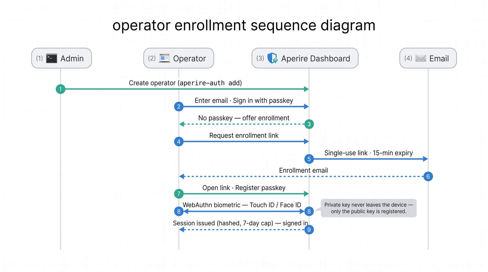
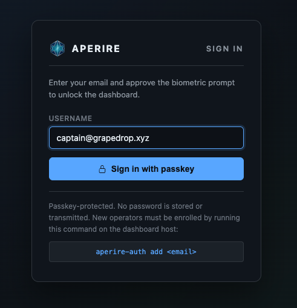
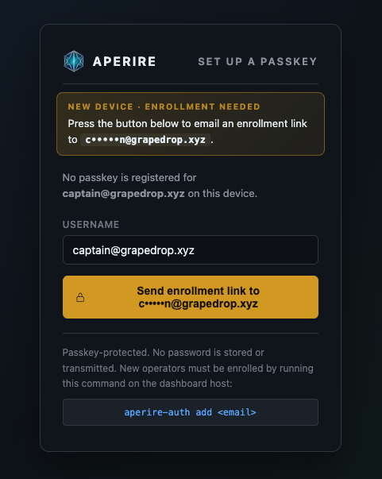
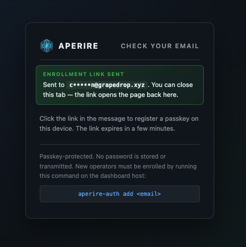
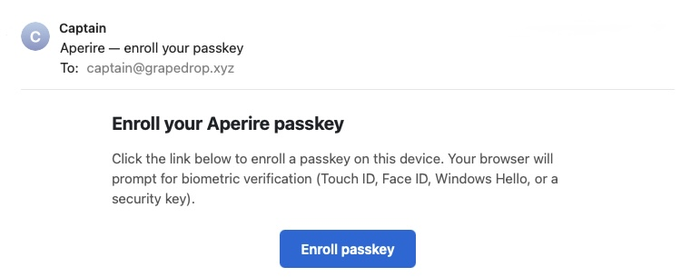
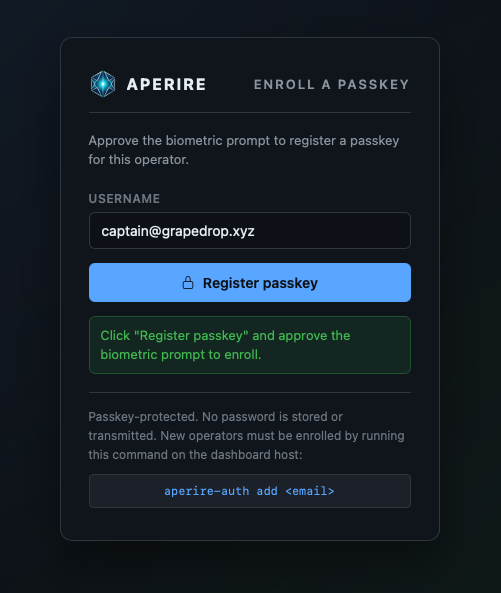
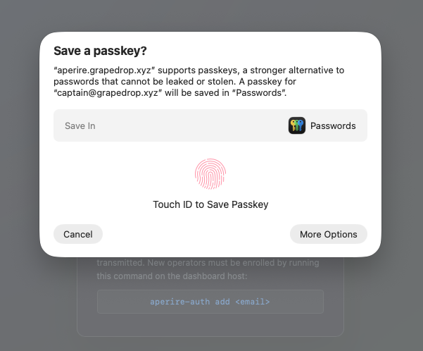

# Aperire One Operator Enrollment

Create an operator account and enroll its first passkey, screen by screen. This is for the admin setting an operator up (shell access, the `aperire-auth` CLI) and for the operator registering their device in a browser. For ongoing operator management, lost-device recovery, and the full authentication model, see the [auth guide](AUTH-GUIDE.md); for trust-boundary detail, see the [architecture guide](ARCHITECTURE-GUIDE.md).

The example throughout enrolls `operator@example.com`. Two people are involved:

- **Admin**: has shell access to the dashboard host and runs the `aperire-auth` CLI.
- **Operator**: the person being enrolled, working in a browser.

## Why enrollment is secure

| Property | What it means |
|---|---|
| **Passwordless** | Authentication is a passkey (WebAuthn / FIDO2). No password is created, stored, or transmitted. Only a public key is registered, and the private key never leaves the operator's device. |
| **Admin-gated creation** | Creating an operator needs shell access to the host (`aperire-auth add`), with one exception: a box that has never had an operator can be claimed once from a browser, which is how the first administrator is made. That window closes with the first operator and never reopens, not on a restart and not if every operator is removed later. Every account after the first is admin-gated. |
| **Biometric required** | Every passkey ceremony requires user verification: Touch ID, Face ID, Windows Hello, or a security-key PIN. Device presence alone is rejected. |
| **Single-use link** | The enrollment link is single-use and expires in 15 minutes. It is invalidated the instant it is used, or once it expires. |
| **Phishing-resistant** | The passkey is bound to the dashboard's exact domain. It cannot be replayed against any other site. |
| **Nothing replayable at rest** | Nothing stored in the database can be replayed to sign in. A database read yields no usable link and no usable session. |
| **Bounded sessions** | Sessions idle out, expire after 7 days, and signing out kills them server-side. |

## The flow at a glance

<p align="center"></p>

An admin creates the account on the host. The operator opens the dashboard, requests an emailed enrollment link, opens it, approves a biometric prompt, and is signed in. No secret crosses the wire. The device keeps the private key and registers only its public half.

## The `aperire-auth` command

`aperire-auth` is the operator-management CLI. Run it on the dashboard host as yourself. It opens `aperire.db` as the account the dashboard's systemd unit runs as. When that isn't you (a fresh install runs the dashboard as its own `aperire-dashboard` account), it says so in one line and asks for your sudo password once. An operator's email is their identity: it's what they type at the lock-screen and what most commands take as the argument. Configuration lives in `dashboard/config/authn.yaml`. Edit that file, not the script. The CLI re-reads it on every run. Restart `aperire-server` only to pick up server-side session-policy changes.

Synopsis:

```
aperire-auth <action> [<argument>] [--role <admin|monitor>]
```

The installer symlinks `aperire-auth` into `~/.local/bin`, so it runs from any directory. It puts `aperire` there too, the interactive menu that wraps every script in `scripts/`. If either command isn't found, install the shortcuts with `scripts/install-aperire-cli.sh`, or run the CLI from the dashboard install directory as `bash scripts/aperire-auth.sh <action>`.

The `<argument>` is an email for most actions, a credential ID for `revoke`, or a session ID for `revoke-session`. Run `aperire-auth help` for the built-in version of this list.

The commands, grouped by task.

### Creating and managing operators

Create an operator, list operators, and remove an operator, a single passkey, or a session. `add` issues the enrollment link. `list-credentials` and `list-sessions` show the IDs you pass to `revoke` and `revoke-session`.

```
aperire-auth add <email> --role <admin|monitor>
aperire-auth list
aperire-auth del <email>
aperire-auth list-credentials <email>
aperire-auth revoke <credential-id>
aperire-auth list-sessions <email>
aperire-auth revoke-session <session-id>
```

### Roles

An operator's role decides whether they may approve Advisor actions. `admin` may approve and run Advisor actions; `monitor` approves nothing. Both roles see the same dashboard. The role is set when you create the operator (`add --role`) and changed later here.

```
aperire-auth set-role <email> <admin|monitor>
```

### Advisor trust

The Advisor keeps its own copy of the admin passkeys it will accept. `advisor-sync` refreshes it; `advisor-trust` shows what it currently holds. `del`, `revoke`, and `set-role` run `advisor-sync` for you, and a passkey enrolled in the browser is handed to the Advisor the moment the enrollment lands (the dashboard asks for the sync through a private socket the Advisor installer sets up; nothing the dashboard sends goes into the store, it is rebuilt from the database). Run it yourself when the Advisor tab says the trust store is stale, which on a host with the installer's grant should not happen.

```
aperire-auth advisor-sync
aperire-auth advisor-trust
```

### Enrollment links

Enrollment and recovery both work through a single-use link. Use `enroll` (the default) for a new operator or device, `recover` for a lost passkey. The link is printed, and emailed too when an email channel is configured.

```
aperire-auth magic-link <email> [enroll|recover]
```

### Arguments

- `<email>`: the operator's identity, and where the enrollment link is sent.
- `<credential-id>`: a passkey ID from `list-credentials`.
- `<session-id>`: a session ID from `list-sessions`.
- `--role <admin|monitor>`: the operator's role (see Roles).

## Walkthrough

### Step 1: Create the operator (admin)

On the dashboard host:

```
aperire-auth add operator@example.com --role monitor
```

```
created operator: id=15  operator@example.com
role: monitor — sees everything, approves nothing.
      To let them approve Advisor actions: aperire-auth set-role operator@example.com admin

magic-link issued (user=operator@example.com, purpose=enroll, ttl=15m, ...)

  https://aperire.example.com/login.html?token=...
```

The role is required: `--role admin` for someone who may approve Advisor actions, `--role monitor` otherwise (the roles table lives in [AUTH-GUIDE.md](AUTH-GUIDE.md)). The account has **no passkey and no session yet**. It cannot sign in until a passkey is enrolled. The printed link is one way in. The self-serve flow below is the other, so the admin never has to transport a URL.

### Step 2: Start sign-in (operator)

The operator opens the dashboard URL (e.g. `https://aperire.example.com`), enters their email, and clicks **Sign in with passkey**.

<p align="center"></p>

### Step 3: Request the enrollment link (operator)

Because no passkey is registered for this operator on this device yet, the screen switches to **enrollment**. The operator's email is shown masked. Click **Send enrollment link**.

<p align="center"></p>

This is self-serve: the operator triggers their own enrollment email (rate-limited per operator). No further admin step is needed.

> **Air-gapped or no email configured:** an admin can issue the link directly on the host with `aperire-auth magic-link <email>` and hand the operator the printed URL.

### Step 4: Check your email (operator)

A confirmation appears. The single-use enrollment link has been emailed.

<p align="center"></p>

The link is single-use and expires in 15 minutes. The operator can close this tab. Opening the link reopens the enrollment page.

### Step 5: Open the enrollment email (operator)

The email is titled "Aperire One — enroll your passkey". Click **Enroll passkey** (or paste the URL it contains). The link opens the dashboard's enrollment page.

<p align="center"></p>

### Step 6: Register the passkey (operator)

Back on the dashboard, the page is now armed to enroll. Click **Register passkey**.

<p align="center"></p>

### Step 7: Approve the biometric prompt (operator)

The browser or OS prompts to create a passkey for the dashboard domain. Approve it with the device's biometric or PIN: **Touch ID, Face ID, Windows Hello, or a security-key PIN**. This verification is required. The ceremony fails without it, and it is what binds the passkey to a person on this device.

<p align="center"></p>

On approval the passkey is created, the operator is signed in, and the dashboard loads. Enrollment is complete. Every later sign-in is one tap of **Sign in with passkey** plus the biometric.

## Verify (admin, optional)

On the dashboard host, confirm the passkey registered:

```
aperire-auth list-credentials operator@example.com
```

```
id  name                  transports          created                last_used
──  ────────────────────  ──────────────────  ─────────────────────  ─────────────────────
9                         internal,hybrid     2026-06-06 19:13:42    never
```

The operator now has one passkey and an active session. Nothing stored for that session can be replayed to sign in, and the session carries an absolute 7-day lifetime cap.

If the operator's role is `admin`, the Advisor trusts the new passkey as soon as it is enrolled: the dashboard asks the host to sync the trust store the moment the enrollment lands. Confirm with `aperire-auth advisor-trust`. If the Advisor tab shows the trust store as stale instead, the host is missing the sync grant; `curl -fsSL https://get.aperire.one | bash -s -- --run trust-sync-grant` adds it (the Advisor install command runs it for you), and `aperire-auth advisor-sync` catches up by hand. Monitors don't approve Advisor actions, so none of this applies to them.

## See also

- [Auth guide](AUTH-GUIDE.md): managing operators, adding more passkeys, lost-device recovery, the full authentication model.
- [Architecture guide](ARCHITECTURE-GUIDE.md): trust boundaries and where credentials live.
- [Operational guide](OPERATIONAL-GUIDE.md): day-to-day operations and incident response.
