# Aperire One Fleet Guide

The Advisor can read sibling nodes in your fleet and cite their data as evidence in its answers, always labelled by which node it came from. This guide covers registering a fleet peer, including the normal case where the peer runs on another machine.

Two principles shape everything below:

- **One dashboard per node.** Every node runs its own full dashboard, with its own sign-in. A dashboard that knows a fleet reads its peers through their read APIs and draws the node you pick in its own pages, so picking a node changes what is on screen and nothing else. The fleet gives the Advisor read-only eyes across those dashboards. What an operator can do *to* a node from one of them is a short named list, under "Settings: every node from one page".
- **The Advisor acts on one node only, its own.** A fleet peer is evidence, never a target. The registry that names peers cannot carry a verb, an admin endpoint, or a database connection. A row is a label, a read-API origin, a token path and a transport note, plus optionally a role and a node-key pin. An unknown field fails the whole file rather than being ignored.

## What a peer needs before it can be registered

The peer is a normal Aperire One install: dashboard running, read API serving. Verify on the peer itself:

```
printf 'authorization: Bearer %s\n' "$({ cat <peer-repo>/advisor/state/read.token 2>/dev/null || sudo python3 -I /usr/local/sbin/aperire-state-file read <peer-repo>/advisor/state/read.token; } | tr -d '[:space:]')" \
  | curl -s -H @- "http://127.0.0.1:7800/read/v1/recent?metric=peer_count&limit=1"
```

The token goes to curl on its standard input (`-H @-`), not as an argument: any account on the host can read a running command's arguments.

Run it as the account that installed Aperire there, or one with sudo. The `cat` works when the peer has no Advisor account. When the Advisor has its own account, `advisor/state` is `0750` and `read.token` is `0640` for that account and the service group. No login is in either, so `cat` fails and one `sudo` reads the file through the root-held `aperire-state-file` helper, which opens it without following a link and prints it. Root runs that file, so check it is root's first: `stat -c '%U %a' /usr/local/sbin/aperire-state-file` should print `root` and a mode with no group or other write bit, such as `755`. If it prints anything else, don't run the `sudo`. If the peer has no `/usr/local/sbin/aperire-state-file`, run `curl -fsSL https://get.aperire.one | bash -s -- --update --force` there. A `401` with an error line above it means the token wasn't read. It doesn't mean the read API is down.

A JSON body with points means the read surface is up. Two refusals are deliberate:

- A request without the token is refused (401).
- A request from any address other than loopback is refused even with the token. That is why the tunnel section below exists.

## Host metrics on a fleet peer

Registration makes a peer's consensus, peers, validations and ledger data appear in the aggregator. All of that comes from the peer's rippled through the read API. Two surfaces need one thing more:

- The **System** tab's host metrics (CPU, memory, disk, NuDB sizing, rippled process usage).
- The **Network** tab's live bandwidth and error counters.

These are not rippled data. They are read from the peer's own host, and on the peer that means a running relay.

So each fleet peer runs its **own** `aperire-relay`, co-located with that peer's dashboard and pushing to that dashboard's `/ingest`. The relay's `auth_token` must appear in that peer dashboard's `RELAY_TOKENS`. The relay feeds the peer's own dashboard, and the dashboard serves those numbers to the aggregator over the same read API as everything else. The aggregator never reaches the relay directly.

Install it exactly as on any single host. See the relay steps in the [Deployment guide](DEPLOYMENT-GUIDE.md) and the [Relay reference](RELAY-REFERENCE.md). On a co-located host the installer wires the token from the dashboard's environment and starts the service for you.

Until a peer has a relay, its System-tab host cards and its Network-tab BANDWIDTH LIVE and ERRORS & BUDGET cards read *"Host metrics aren't served for a peer without a relay"* rather than showing a zeroed reading. Every other surface for that peer still works. A freshly installed relay reads live immediately. The cumulative figures, such as the monthly bandwidth budget, start near zero and fill in over the following hours.

## Joining a node to the fleet

One command does everything below, with no hand-written YAML or JSON. The example is the usual case, a peer on another machine. Bring its token to this host first, with the three commands in [The peer's read token](#the-peers-read-token). The join reads your copy:

```
scripts/aperire-fleet-add.sh \
  --read-origin http://127.0.0.1:7901 \
  --token-path "$HOME/core-two.token" \
  [--place-token] \
  [--dashboard-url https://core-two.example.internal/overview.html] \
  [--label core-two] \
  [--role node] \
  [--hostname core-two.example.internal --tunnel my-fleet-tunnel] \
  [--dry-run]
```

Run it on the host whose fleet is being extended, where this dashboard and (if installed) this Advisor already live. `--dry-run` prints every change and writes nothing. Drop it once the plan looks right.

`--token-path` is your own copy of the peer's token. `--place-token` has root put a second copy where the dashboard and the Advisor read it, because your copy sits in your home folder and they can't open it. The script refuses `--place-token` on a host with no Advisor, so leave it off there. A peer on the same machine is the one case that points `--token-path` at the peer's own file: see [Peers on the same machine](#peers-on-the-same-machine).

`--role` is one of `aggregator`, `node`, `validator`, or `relay`, and goes into both registries. Leave it out and the peer is unspecified, which is fully supported: nothing is guessed from its absence.

`--dashboard-url` is optional. It records where that node's own dashboard answers, for an operator reading the registry. Nothing renders it as a link and nothing dials it. Leave it out and the row carries no `dashboard_url` line at all, the same row a node that joins through pairing gets when it does not know an address anybody else could open, so a node whose address nobody knows yet still joins.

It needs `python3` with PyYAML, `openssl`, and `curl` on the host it runs on. All three come with a normal install. It also uses the dashboard's own `tsx` to re-read what it wrote with the real parser; without it the write still happens, and the script says the verification was skipped.

**What it checks before touching anything.**

- `--read-origin` must be a bare loopback origin (the read API's own rule).
- `--token-path` must exist and be readable by the account running it. When it isn't, the refusal names whose file or folder is in the way, its mode, and the step that fixes it.
- `--dashboard-url` is optional, and a value that is given must be https. The fleet's origin rule allows plain http only to a loopback name, and a loopback name is exactly what a registry row drops, so a plain-http address is either one this product does not accept or one no row would keep.
- A given `--label` must fit the registry's charset.
- It reads the peer's own `/read/v1/identity` and refuses the join if that fails. A node you cannot identify is not a node you register.
- An existing trust-key file that is too loosely permissioned or does not parse. That check runs first of all, before the peer is even contacted.
- Every duplicate check runs before any file is written or any DNS record is touched: a label already registered in either registry, or a `read_origin` already in this dashboard's `fleet.yaml`.

**What it prints.** The peer's `pubkey_node`, prominently, with one line telling you to compare it against the node's own report before trusting it. This read is trust-on-first-use, not verified (see "Pinning a peer's identity" below). If this node does not already have its own trust key (see "Joining a node's pairwise trust key", further down), it generates one and prints its public fingerprint too, for the same eyeball pass.

**What it writes.**

- A row in this dashboard's own `fleet.yaml`, including the pubkey pin filled in from the identity read above, and the role if you gave one.
- A row in the Advisor's `fleet.json`, if the Advisor is installed here. On a host with no Advisor that step is skipped and named, and the join still finishes. The Advisor is optional, and a dashboard-only host is a normal fleet member.
- With `--place-token`, a root-owned copy of the peer's token under the Advisor's state folder, and both rows record that path. See [The peer's read token](#the-peers-read-token).
- For a peer on this same machine, this node's trust public key into the peer's own trust file, so the peer can later accept an enrollment grant issued from here.

It then reloads this dashboard (`systemctl reload aperire-server`, SIGHUP, in place) and, where an Advisor is installed, prints the `aperire-advisord` restart command rather than running it. An Advisor restart re-seals the model key and closes any open break-glass window, so that stays your call. Last, it prints the exact command to run ON THE PEER to enroll your passkey there (per-node sign-in, see "Signing in across a fleet" below). A navigate-and-redeem grant will replace that manual step once it lands.

**What it refuses, always.**

- A non-loopback `--read-origin`.
- An unreachable or unidentifiable peer.
- A missing token path.
- A malformed or duplicate label.
- A plain-http `--dashboard-url`.
- A `read_origin` already in `fleet.yaml`.
- A `--role` outside the four the registries accept.
- A broken `advisor/state/fleet.json`.
- A trust file that already exists with a mode wider than `0640`, or that does not parse.

None of these are silently repaired. Each stops the whole run with the specific reason.

DNS is the one step that degrades instead of failing. With `--hostname` and `--tunnel` given and `cloudflared` available with an origin certificate, it resolves the named tunnel first (never trusting `route dns`'s own exit code against an unconfirmed name) and creates the record. Otherwise it prints the exact CNAME to create by hand.

The sections below explain, by hand, what each of these writes and why. Read them if you want to know what the command did, or if you are registering a peer some other way.

## Reaching a peer on another machine

The read API only answers loopback. A remote peer is reached through something that lands as loopback on both ends. The peer is never exposed to the network, and no firewall rule opens.

Two arrangements do that. The fleet link is where this is going; an SSH forward is what works today and keeps working.

### The fleet link

The node dials out. Its dashboard opens one outbound HTTPS connection to the aggregator and holds it, and the aggregator binds a loopback listener at its end, on the same `790x` port a forward would have landed on. No inbound port on the node, no SSH key and no SSH account on either side, and a node behind NAT needs nothing at all.

Two ways to set one up. **Pairing** is the one to use: an administrator mints a code on the Settings page, you run one line on the node, and the node joins. A box that is not installed yet does both at once, from the install command. The hand-placed path below still works and is what a node you cannot run a command on needs.

One route the link does not carry: the read API's event stream. A node reached over a link answers it with a named refusal, and the Overview's quorum bar steps off its own two-second poll instead. Nothing else differs, because the link ends in a loopback listener and every fleet surface dials exactly what it dials for a node on a forward.

Revoking one node is its row deleted from the aggregator's file and a reload, and it takes effect at the reload: the aggregator closes the link that node is already holding rather than waiting for its next connection. Re-minting a credential revokes the old one the same way. The node stops dialling and says so on its own Settings page. It then asks once an hour, so a node refused by mistake comes back on its own once the aggregator accepts it again, with nothing restarted. A node revoked with **Revoke** on the Settings page is told so with a revocation the aggregator signed, and that node stops for good until it is paired again.

### Joining at install time

A box with nothing on it joins the fleet from the same command that installs it. This is the shortest path, and it is the one the Settings page prints.

**On the new box**, as your ordinary account:

```bash
curl -fsSL https://get.aperire.one | bash -s -- \
  --fleet-aggregator https://<your-aggregator-host>
```

The install runs to the end: the toolchain, the services, the Advisor if you asked for one. Pairing is the last step, and it goes last for a reason. The Advisor's token has to exist before this node pairs, or the aggregator gets a row it can never reach the Advisor on, and only a fresh code fixes that.

Then it waits for this box to report its own node key, up to five minutes, saying so while it waits. That key is what the Pending row is pinned to, and a row without one is a row nobody can approve into anything useful. On a box that just had a node deployed on it, that wait is the node catching up.

Then it asks:

```
   This node is up and reports its key:
       nHB1c...9Kf2

   On the aggregator, open Settings & Updates -> Fleet registry list -> Pair a
   node. It prints a code, good for fifteen minutes and one node.

   Paste the pairing code, then Enter:
```

**Mint the code when it asks, not before.** The code's fifteen minutes runs from the mint, and how long a fresh box takes to build is the box's business: apt, a Node download, an npm install, two Go builds, and a container image pull if it is getting a node too. That is why the code is not on the one-liner.

From there it is the ceremony below: paste the aggregator's pairing fingerprint on the box, then compare the node key against the Pending row and approve under your passkey. The code is typed rather than echoed and never appears on a command line.

`--fleet-label <label>` proposes a name; the aggregator settles it.

There is no `--fleet-code` on the one-liner. That command reaches the installer through `sudo`, and `sudo` writes the whole command line to `/var/log/auth.log`, where a live code would sit for weeks readable by the `adm` group. The install asks for the code on your terminal instead. A box that is already built can pass one to `install.sh` directly, where there is no `sudo` in the chain when you are already root; it still costs you the process list and your shell history, so the pair command below, with `--code -`, is better. Passed as an argument, the code sits in that box's own process list for the whole of that run, from the moment you press Enter until the approval lands or the code expires fifteen minutes after it was minted; typed on a terminal with `--code -`, it never does.

**If it cannot pair, the install still worked.** Nothing is rolled back. The box is installed, enabled and running, and the closing text says it is not paired and prints the one line that pairs it:

```
  Not paired. This run had no terminal, and pairing asks two questions that
  cannot be answered for you. Nothing was sent and no code was spent.
```

Five cases are worth telling apart, and the closing text names each:

| What it says | What happened | What to do |
|---|---|---|
| the aggregator refused | an expired or wrong code, or a node that already trusts another aggregator | mint a fresh code and run the printed line |
| nothing was written here, look at the aggregator first | the aggregator could not confirm whether it registered this node | open the Fleet registry list and look. Do **not** run the pair command again first: that is the one action that could register the node twice |
| not paired, no terminal | the run had no terminal to paste the pairing fingerprint on | run the printed line from a terminal |
| the fingerprint you pasted is not this pairing's | what you pasted did not match what the node computed. Nothing was sent and nothing was written | print it again on the aggregator and paste all of it. If it was exactly that, stop: the keys offered to this node are not the aggregator's |
| what was pasted is not a pairing fingerprint, nothing was dialled | three pastes were not 64 hex characters, so the box never called in | the code still works until it runs out: print the fingerprint on the aggregator and run the printed line |

**There is no unattended fleet join, and there should not be.** Pairing asks two things of a human, and the second one, pasting the aggregator's pairing fingerprint, is the entire trust decision. Nothing skips it: there is no `--yes`.

### Pairing a node

For a box that is already installed. One code, one command, one passkey.

**On the aggregator**, open **Settings & Updates**, then **Add a node**, and choose **It already runs Aperire**. The page takes four steps:

1. Where the node runs.
2. Whether Aperire is installed on that box.
3. This aggregator's pairing fingerprint. The page shows the command that prints it, to run as root on the machine this dashboard runs on, and names that machine. It asks this host once, as the step opens, whether it can print one. If it can't, the command is replaced by what's missing and the one command that fixes it. It never shows the fingerprint itself.
4. **Mint a code**. It prints a command with a code in it. The code is good for fifteen minutes and one node, and it is shown once: the aggregator keeps only a hash of it. The clock starts here, not at step 3. If the aggregator can't mint, the page says why and shows the command that fixes it.

**On the node**, as the account that installed Aperire there (not root: the bootstrap refuses a root login and asks for sudo itself), run that command as printed:

```
curl -fsSL https://get.aperire.one | bash -s -- \
  --fleet-aggregator https://<your-aggregator-host> \
  --code APR-XXXXX-XXXXX-XXXXX-XXXXX
```

There is no install directory to edit: the aggregator cannot know the other box's path, so it does not print one. This is the same bootstrap a fresh box runs, and on a box that already has Aperire it finds that install and pairs it instead of installing over it. It reads the node's own read token and its own node key, asks for the fingerprint, then dials the aggregator and waits. If you would rather keep the code out of your shell history, `--code -` reads it from standard input instead.

**Before it calls in**, the command asks you to paste the aggregator's **pairing fingerprint**. It's one value over the two keys the node is about to take: the aggregator's fleet trust key and its fleet arm key. Get it on the aggregator, as root:

```bash
sudo aperire-fleet-arm --fingerprint
```

```
Pairing fingerprint for this aggregator (agg-host). A node asks for it when it pairs.
9dcd79f46b004f208447547884255de43fb4cc32b1fa91c92767b13cc2e13fc7
```

The value is the only thing on standard output: one line, 64 lowercase hex characters, no spaces. The sentence above it goes to standard error. So a double-click copies all of it, and a script can capture it whole:

```bash
FP=$(ssh <aggregator> sudo aperire-fleet-arm --fingerprint)
```

It reads the two keys and makes nothing. It exits 0 when it printed the value, 2 when this host has no fleet trust key, 3 when it has no fleet arm key, and 1 for anything else, each with one sentence on standard error. Exit 2 or 3 on an aggregator means its broker grant predates the grant making the keys: run `curl -fsSL https://get.aperire.one | bash -s -- --run fleet-broker-grant` again. An update doesn't make them. On an aggregator that already has paired nodes, the installer refuses to make a missing key and names the restore instead (see [What the broker is](#what-the-broker-is)).

`aperire-fleet-arm` is installed root-owned in `/usr/local/sbin` with the fleet broker grant, so it is the same command on every aggregator. If it is not found, that aggregator's grant predates it: the update places it (`curl -fsSL https://get.aperire.one | bash -s -- --update --force`), and so does `curl -fsSL https://get.aperire.one | bash -s -- --run fleet-broker-grant`. The aggregator's install summary prints the value as well. Copy all 64 characters and paste them at the node. Spaces and capitals don't matter, so a value pasted in groups of four works too. Anything else does:

- anything that isn't 64 hex characters (a partial paste, an empty line) is caught before the box calls in. It asks again, three times in all, and the code is still unspent
- the whole value has to match. A prefix of the right value is refused
- a mismatch sends nothing and writes nothing: no credential, no trusted key, no arm key, and the node's tokens never leave it
- the node never prints the value it expects, so there is nothing on its screen to copy back

**Then it calls in.** A current aggregator hands the node its two public keys as soon as the code checks out, and the node compares them with your paste before anyone approves. A wrong paste ends there: the row on the aggregator says the node refused it, and nobody spends a passkey on it. The aggregator won't take an approval until the node has said its keys matched. Two cases compare after approval instead, with the same paste and without asking again: an aggregator older than that check, which shows its keys only in its signed answer, and an aggregator whose dashboard restarted after it minted the code, which has no arm key to hand over until the next mint. In both, a wrong paste is found after the passkey touch, so mint a fresh code after a restart.

**On the aggregator**, the node appears as a Pending row with its node key, the address it dialled from, and a countdown. **Compare that key against what the command printed on the node.** The fingerprint check proves the aggregator to the node, never the node to you. This comparison is your check on the node, and nothing else makes it for you. Then press **Approve** and touch your passkey. Rename the node first if you want it registered under another label. The aggregator's signed answer has to carry the same two keys the node checked, byte for byte, or the node sends nothing.

**A node this aggregator already reads over an SSH tunnel** shows under the name it already has, with **Approve and move**. Approving moves that row to the fleet link, keeping its name and history. A matching node key isn't enough for that: the node key is public, since every peer the node connects to sees it. So the node also proves it holds the read token this aggregator already reads it with. It sends a MAC of that token, never the token itself, and only after your paste matched, so the MAC goes only to an aggregator root vouched for. The aggregator checks it against its own copy, the row's `token_path`. Only a row whose proof checks out offers **Approve and move**. Otherwise the row is refused before approval, with no passkey spent, and its note names the fix:

- **The node's Aperire is older than the proof.** Update Aperire on the node, then mint a new code and pair again.
- **The aggregator had no keys to send** (its dashboard restarted after the code was minted). Mint a new code.
- **The proof doesn't match.** The note depends on what the aggregator's own tunnel read of that node shows right now, never on anything the caller says:
  - **The tunnel still answers with the token the aggregator holds.** Then the box calling in doesn't hold that token, so it isn't that node. Change no token because of the request. Someone who says "I reinstalled, here's my new token" is asking you to hand them the row.
  - **The tunnel is refused with 401 or 403.** The node no longer takes the token the aggregator holds, which is what a reinstall looks like. Confirm the reinstall on that node's own console first. Only then put its new read token where the row's `token_path` points, and pair again.
  - **The tunnel can't be read.** Nothing tells a reinstall from a different machine. Get the tunnel answering, then pair again.
- **The aggregator can't read its own copy of the token.** That's the aggregator to fix.

What the proof shows: the box that called in holds that node's read token, so someone with a code and the public node key can't take the row. What it doesn't show: a copy of the node's disk holds the token too. Still compare the key on the node's own terminal, and where it dialled from, before you approve. A node the fleet doesn't know yet is unaffected by all of this.

The Settings page never shows the fingerprint, on purpose. It's served by the aggregator's dashboard account, and that account is the one thing that could hand a node an arm key of its own choosing. Root prints the fingerprint, and root holds the arm key. The page repeats the command, and it is the same fixed command as above: take the command from here or from the node's own prompt, never a path from the page. An aggregator older than this check sends no arm key with its answer, and the node refuses it and says to update the aggregator first.

On a match the node writes what it needs and reloads. If no one can paste at that terminal, `--expect-fingerprint <value>` gives the pair command the value root printed. It gets the same shape check before the dial and is compared exactly as a paste is. It replaces the terminal, not the check.

The node ends up with three things: its link credential (`0600`, its dashboard's own account), the aggregator's fleet trust public key in its `fleet-trust.yaml`, and the aggregator's fleet arm public key in `/etc/aperire/fleet-arm.pub`. It also leaves a record of the pairing in `/etc/aperire/fleet-paired.json` (root, `0644`). The node's Advisor reads it to accept a passkey list from an aggregator that has changed its hostname since the last pairing, and only once per pairing. Both keys are the ones your pasted fingerprint covered. The aggregator's final answer carries the arm key again, signed, and the node refuses it if it differs by a byte. Nothing else on the node changes, and a node that already trusts a *different* aggregator is refused rather than re-pointed. That refusal names both keys, and it is the one you want if it ever appears.

A node paired before it has an Advisor has no sealer to trust the arm key for yet. The pairing keeps the key at `/etc/aperire/fleet-arm.paired.pub` instead (root-owned, and nothing trusts it there), and the Advisor install places it as `fleet-arm.pub` and prints its fingerprint. So pairing first and adding the Advisor later with its one-line install is all it takes: the aggregator can arm that node from then on, with no command run on it by hand. Removing the Advisor takes `fleet-arm.pub` away and keeps the held copy, so an Advisor installed again on a node that is still paired picks it back up. Trusting a key by hand with `--trust-arm-key` rewrites the held copy to match, so a rotated arm key stays rotated. To undo a pairing completely, remove the held copy with the link credential; the pair command prints both lines.

A node's Advisor still needs the fleet's model. A newly paired node reads as behind on Settings and you seal it in one click with the key you paste, once per node.

**Running it again** is safe and is how you replace a credential: with the same node key it keeps the same label and the same ports, mints a fresh credential, and the old one stops working at the reload.

#### A node coming back

A node whose key an existing link row already pins, with nothing linked under that name right now, shows as a Pending row that says "Its node key matches `<name>`'s link row, so this may be `<name>`, back after being offline". It happens when a node is rebuilt with its identity kept (`uninstall --keep`, reinstall, join), or dials in from a new address. The row shows the name the fleet already knows it by, when that link was last seen and the address it dialled from (or that this dashboard has not seen it since it started, in which case wait a minute for the node to dial back before you approve), and the name the node proposed is ignored. The button reads **Approve and reconnect**. Approving takes the same passkey and fingerprint confirmation, replaces the link's credential, and keeps the node's name and history. No second row appears.

A matching node key doesn't prove a machine, so compare it on the node's own terminal, and check where it dialled from, before you approve. Two cases are refused before approval, with no passkey spent:

- **That name is linked from somewhere right now.** Two machines hold one node key, which is a copied install. Give the copy its own node identity, then mint a new code. If a link comes up under that name while the row waits, or after you approved it and before the node sent its tokens, the row is refused at that moment and nothing is registered. Once the aggregator has started registering it can't be called back: if that node links in that window, the row says so and names the address, because the new credential replaces its old one and that machine has to pair again.
- **The row is held.** The aggregator holds that node's credential but isn't serving it until its two registries agree, so the node may still be dialling. Fix the registry first (Settings names the two files), then pair again.
- **A revoke of that node didn't finish.** The row is still in the fleet's list but its link is gone. Press **Revoke** on its row again, then pair again.

#### An approval that could not write this aggregator's own row

The first node an aggregator pairs needs a row for the aggregator itself in `fleet.yaml`, on this dashboard's own port, or the dashboard cannot tell itself from the node. The approval writes that row. When it can't (for example, it can't tell which port the dashboard listens on, or the names it would give the row are both in use), the node is still registered, and it is held: this dashboard reads no node and binds no link until the row exists.

The Pending row, the folded Add a node step and the audit row all carry the sentence the broker printed, with the exact row to add. Fleet registry list shows the node as held, with a **Revoke** button. Either add the row to `dashboard/config/fleet.yaml` and run `sudo systemctl reload aperire-server`, or revoke the node. Revoke is the only act offered on a held node: it has no link, no read and no Advisor address to act on.

### What the broker is

Registering a node writes three things the aggregator's dashboard cannot write. It runs as its own account with no privilege, and two of the three land outside that account entirely: the node's read and Advisor tokens, root-owned and group-readable, and the Advisor's own peer registry. So an approval hands the work to one small root program behind a private socket.



One connection, one verb, and what it can do is short: append one row to the fleet registry, pinned to the node key; write that row's two token files, named after the label in one fixed directory; and tell the dashboard to re-read its registry.

What it cannot do is the part worth knowing. It removes a fleet registry row only when you revoke that node, and only the row you named. It cannot be told which path to write or which port to use, never widens a token file's permissions, and cannot open an arming window. There is no verb that hands back the model key: the key goes in, and it goes out to a node. So the worst this socket is good for is one node more or one fewer in your fleet, and, for a node already in it, moving its port to a fresh one from its own pool, its read-token path to this socket's own convention path, and its advisor flag to whatever the node itself now reports, when you approve a known-node move. With **Attach**, a node already in the fleet can also be marked as having an Advisor, without the node reporting one. It can never move root's own record of where that node's key is pinned, which is what decides where a model key may go: a change to that would have to agree with what root already recorded for it, or it is refused. **Accept new key** moves the registry's pin only, and root's record follows when you run `--refresh-nodes`.

Four things it can do, since a claim that overstates is worse than no claim. Revoking a node takes its row out of the fleet registry, the link registry and the Advisor's peer list in one press, which is how a link that is already up gets closed rather than only the next dial. The fleet registry's own owner and permissions are set when a row is appended, so a copy you had deliberately locked down comes back readable by the dashboard account. It reads the sealed fleet model back, minus the key, which is how the page says whether a node paired now would inherit a model. And when you pair a node the fleet already watches over an SSH tunnel, approving it moves that one row from a tunnel to the fleet link, in place, under the same name and history, rather than adding a second row for the same node, but only that row, pinned to the key the node just presented, and only on your explicit approval. The read-token proof from Pairing a node is checked by the dashboard before it offers the move, not by this socket. The socket doesn't need to check it: the dashboard account can already read the tunnel's token, so the proof is no wall between that account and root. None of the four hands that account anything it did not have: the two registries are its own files, in a directory it owns. The two writes that are genuinely beyond it are the Advisor's registry and the token files, which land root-owned.

Three more verbs work on a node's Advisor. Each acts on a node that is already in the fleet, and the first two only on one that joined over the fleet link.

| Verb | What sends it | What it does |
|---|---|---|
| `attach-advisor` | **Attach** in **Add an Advisor**, under a passkey | Gives that node's registry row an Advisor address on a port from the socket's own pool. Writes the node's Advisor token to the file named after its label. Marks the node as having an Advisor in root's record. Refuses unless the registry row and root's record both pin the node key it is shown. |
| `detach-advisor` | **Remove this Advisor**, under a passkey | Takes the address and token path off the row, drops the port, deletes that one token file and clears the mark in root's record. The node's own Advisor and its token are untouched. |
| `refresh-advisor-token` | Nothing on the page | Replaces the content of that token file for a node that is already attached. Changes no port, no registry and no mark. |

The first two can't add or remove a registry row, and each reads the rest of the row back exactly as it went in. The worst case is the mark `attach-advisor` sets in root's record, which is what the fleet's model push checks before it sends the model to a node. The pin and the port in root's record stay as they were, so the model can still only go where root already pinned that node, and only while an arming window is open at the aggregator. A rejoin never raises a node's Advisor state, so **Attach** is how a node that came without one gets one. A rejoin lowers it when the node says it has no Advisor or sends a token other than the one this aggregator holds, and the pairing row says so. It also lowers it when root's record marks an Advisor the registry doesn't have.

**Revoke** and **Accept new key** on a node's row go through this socket too. The dashboard service can't write its own config directory on a hardened install, so it never writes the fleet registry itself; root's program does, under the same checks an approval gets. The passkey in front of either is a gate on the operator, not on the account. The one file that decides where a model key may travel, root's own record of each node and its pinned key, is not that account's, and no pin already in it is ever changed from the page. That is what makes a compromised dashboard unable to point a key at a destination of its own choosing, and it is why an accepted new key needs `--refresh-nodes` on the aggregator before the fleet's model can reach that node again.

Install it once per aggregator:

```
curl -fsSL https://get.aperire.one | bash -s -- --run fleet-broker-grant
```

It prints what it installed and then checks it: the socket is listening, owned by the dashboard's account, mode 0600, and reachable as that account. It also checks that the dashboard and the Advisor share a group, because the token files it writes have to be readable by both, and it refuses rather than writing one the dashboard could not read.

It also makes the two keys a node's pairing fingerprint covers, when either is missing:

- **The fleet trust key**, the `private_key:` line in `dashboard/config/fleet-trust.yaml`. It's made only where there is no file, owned by the dashboard's account, mode `0600`. The Advisor never reads it. It reads `dashboard/config/fleet-trust.pub.yaml` beside it instead: the same `peers:` and the key's public half, mode `0640`, in `aperire-svc` when the dashboard and the Advisor are both in it (otherwise the group they do share).
- **The fleet arm key**, `/etc/aperire/fleet-arm.key`, root only, mode `0600`.

A key that is already there is never rewritten. Every paired node trusts it, and a new one would break all of them. A `fleet-trust.yaml` that exists with no usable key (a node's own file with only `peers:`, an empty file, a key that isn't 32 bytes) is refused by name, and so is a link or anything but a plain file at either name. The installer stops before writing anything, and you move the file aside by hand. A second run says it kept both keys.

On an aggregator that already has paired nodes it makes neither key. A key missing there was lost, every paired node still trusts it, and a new one would cut each of them off. The same goes for an arm key on a host that has had one: every arm key leaves `/etc/aperire/fleet-arm.made` beside it (root only, empty), and a missing arm key next to that file was lost, whatever the fleet's records say by now. So the installer stops with exit 4 before it writes anything, and names:

- the key that is missing
- `fleet-arm.made`, when that's what says the arm key was lost
- the paired nodes, from root's own `/etc/aperire/fleet-nodes.conf`, `fleet-links.json`, and every `fleet.yaml` row except this host's own: the one on this dashboard's port, or one marked `role: aggregator`
- any of those files it couldn't read safely (a symlink, a FIFO, over 1 MiB, or one that doesn't parse), which counts as paired
- the way back

Put the key back from your backup set, then run the installer again:

```
curl -fsSL https://get.aperire.one | bash -s -- --restore --from <backup set>
```

With no backup, make new keys on purpose:

```
curl -fsSL https://get.aperire.one | bash -s -- --run fleet-broker-grant --new-fleet-keys
```

`--new-fleet-keys` makes only the key that is missing and never replaces one that is there. It says on standard error what it made and lists the nodes to pair again from **Add a node**. The page's pairing check says the same thing: on a fleet whose arm key is gone, opening **Add a node** shows the restore command and makes no key.

A `fleet.yaml` row for this host counts as a paired node only when its `read_origin` isn't on this dashboard's port and it isn't marked `role: aggregator`. Fix its port. Mark it `role: aggregator` only on an aggregator that runs no node of its own: on a co-located one that role tells the dashboard there's no node here, and it stops alerting on the one that is.

Nothing else makes these keys behind your back either. The page's **Add a node** makes the arm key only on an aggregator that never had one; an approval never makes it. `sudo aperire-fleet-arm` refuses to arm with no arm key when `fleet-arm.made` or any fleet record is there. `aperire-fleet-add.sh` refuses to make the trust key on a host whose records already name a node. Each names the restore and `--new-fleet-keys`.

`curl -fsSL https://get.aperire.one | bash -s -- --run fleet-broker-grant --remove` takes the socket and the program back off. Every node already registered stays registered.

**Run it again if you ever move the install.** The installer records which directory the install is, not just what it is called, and the broker checks the directory it opens against that record on every connection. That is what stops an account that can rename a directory above the install from pointing the broker at a tree of its own. Move the install and the check fails, by design: approvals refuse with one sentence naming this installer, and running it again, with `--dir <where the install is now>` before `--run`, re-records the directory. Copying the install does the same. What it records is the filesystem's own id and the inode, so a reboot does not disturb it. On a filesystem that reports no id of its own the installer falls back to the disk's device number, says so at install time, and a reboot that renumbers that disk then has the same effect as a move. The installer also prints a note naming any directory above the install that an account other than root can write, since that is the rename this check exists to catch.

### Placing a credential by hand

For a node you cannot run a command on. The credential goes on both hosts, by hand:

| Host | File | What it holds |
|---|---|---|
| The aggregator | `dashboard/config/fleet-links.json` | one row per node: the label, the SHA-256 of that node's credential, and the loopback ports to bind |
| The node | `dashboard/config/fleet-link.json` | the credential itself, the aggregator's `wss://` URL, and the label. Mode 0600, owned by the dashboard account |

`scripts/fleet-link-place.sh` writes both, one machine at a time: `mint` prints a credential once, `node` writes the node's file, `aggregator` adds the row with only the hash. Each reads the credential from standard input rather than an argument, so it stays out of the process list and out of your shell history. Do not compute the hash by hand for the same reason. Both config templates sit beside the other examples and spell out every field.

The two files have to agree: same label, same read port, same advisor port or neither, and `transport: link` on that node's `fleet.yaml` row. They are checked against each other at startup, and a disagreement refuses every link with one line naming which file to fix, because one transposed digit would otherwise bind one node's link on another node's origin.

The node must also hold the aggregator's fleet trust public key at `peers.aggregator` in its own `dashboard/config/fleet-trust.yaml`, which is the same key and the same block a model seal already uses. Without it the node refuses the link by name rather than trusting whoever answers: the aggregator signs a challenge the node minted, on every reconnect, so a stolen credential replayed at a host that cannot sign gets nothing.

Then say so on the node's `fleet.yaml` row with `transport: link`, and the Settings table says which transport a row uses and when it last held a link. That second half is the one worth reading during an incident: the word is what the row was configured for, the age is the only part that was observed.

### An SSH forward

An SSH local forward, kept alive by systemd on the Advisor's host, is the arrangement every fleet runs today:

```
# /etc/systemd/system/aperire-fleet-<label>.service   (on the Advisor's host)
[Unit]
Description=Aperire fleet tunnel to <label>
After=network-online.target

[Service]
ExecStart=/usr/bin/ssh -N -o BatchMode=yes -o ExitOnForwardFailure=yes \
  -o ServerAliveInterval=10 -o ServerAliveCountMax=2 -o TCPKeepAlive=yes \
  -L 7901:127.0.0.1:7800 <user>@<peer-host>
Restart=always
RestartSec=2

[Install]
WantedBy=multi-user.target
```

The keepalive settings matter. A forward that stalls (the peer's network blinks, a NAT entry expires) keeps its listening port open while nothing passes through it, and the aggregator's reads time out until ssh notices. Two missed keepalives ten seconds apart, then a two second restart, puts the tunnel back inside a single poll cycle; the default of three at fifteen seconds left it dark for close to a minute. The aggregator itself lets a peer that was answering miss one poll before it reads as unreachable, so a blink this short never reaches the fleet page as a red card.

This forward is an SSH login, so it needs what any unattended SSH login needs. `BatchMode=yes` means no password prompt is ever answered; a key is the only way in:

- On the Advisor's host, a dedicated key with no passphrase, owned by the account the unit runs as: `ssh-keygen -t ed25519 -f ~/.ssh/aperire_tunnel -N ''`. Name it in the unit with `-i ~/.ssh/aperire_tunnel`.
- On each peer, a low-privilege user (`aperire` here) whose `~/.ssh/authorized_keys` holds that public key. It needs no shell and no sudo; the forward is the whole job.
- Restrict the key on the peer to forwarding only, so a stolen key can open the tunnel and nothing else: prefix the line in `authorized_keys` with `restrict,port-forwarding,permitopen="127.0.0.1:7800",permitopen="127.0.0.1:7810"`.
- Accept the peer's host key once by hand (`ssh -i ~/.ssh/aperire_tunnel aperire@<peer-host> true`) before enabling the unit, or add `-o StrictHostKeyChecking=accept-new` and check the fingerprint after the first connection.

Pick one local port per peer (7901, 7902, …). Where a peer also runs its own Advisor, give it a second forward on the matching `791x` port (see `advisor_origin`, further down). Any tunnel that preserves the loopback property works the same way: WireGuard or Tailscale with a loopback-bound proxy, or a mesh you already run. Write down which arrangement a row depends on in the registry's `transport` field, so a peer that stops answering is diagnosed from the row itself.

## Peers on the same machine

Two nodes on one host is the simplest fleet there is. The tunnel section above does not apply, because both dashboards already answer on loopback. Each instance needs its own port, its own database, its own service unit, and its own checkout.

Once both run, join the sibling the same way as any other peer, with two differences. `--token-path` points straight at the sibling's own token file, and `--place-token` stays off: the script refuses it for a path that ends in `advisor/state/read.token`, because a same-host join reads that file in place.

```
scripts/aperire-fleet-add.sh \
  --read-origin http://127.0.0.1:7900 \
  --token-path <second-instance-repo>/advisor/state/read.token \
  [--dashboard-url https://stock-two.example.internal/overview.html] \
  --label stock-two --role node
```

The row it generates in the Advisor's `fleet.json` is direct, one entry in its `peers` array:

```json
{
  "label": "stock-two",
  "origin": "http://127.0.0.1:7900",
  "token_path": "<second-instance-repo>/advisor/state/read.token",
  "transport": "same host, loopback :7900",
  "role": "node"
}
```

No copy of the token is needed when the login running the join can read the sibling's `read.token`. The join tests that before it writes anything and refuses by name if it can't. The Advisor's service account reads the same file through the install's shared service group. On a host whose Advisor has its own account, `advisor/state` is closed to your login, so the join refuses and you join the sibling the way a remote peer joins: copy its token as [The peer's read token](#the-peers-read-token) shows, then run the join with `--token-path "$HOME/<label>.token" --place-token`. A same-host join is also the one case where the helper can complete the pairwise trust exchange for you, writing this node's public key into the sibling's own trust file. Everything else is identical to the remote case: labels, fail-closed parsing, the restart, per-node knowledge.

## The peer's read token

Copy the peer's `advisor/state/read.token` to the Advisor's host, into a file of your own. It is a second credential, never shared with the Advisor's own token. Three commands, in this order, all run from the Advisor's host. `<user>` is the account on the peer that installed it, or one with sudo; `<peer-repo>` is where it installed Aperire there (`~/aperire-one` by default, in that account's home).

On a peer whose Advisor has its own account, `advisor/state` is `0750` and `read.token` is `0640`, both for that account and the service group. No login is in either, so nobody can copy the file as themselves. First, the peer's login reads it directly if it can, and otherwise one root step reads it. Your own shell writes the copy either way:

```
# from the Advisor's host
ssh -t <user>@<peer-host> '(umask 077 && rm -f ~/<label>.token && set -C && { cat <peer-repo>/advisor/state/read.token 2>/dev/null || sudo python3 -I /usr/local/sbin/aperire-state-file read <peer-repo>/advisor/state/read.token; } > ~/<label>.token)'
```

It asks sudo only if the login can't read the file itself, and prints nothing when it works. The result is `~/<label>.token` on the peer: yours, mode `0600`, the same bytes. A peer with no Advisor account is the first case: the token is the install owner's and `cat` reads it. On a peer with one, the root-held `aperire-state-file` helper opens `read.token` without following a link, refuses a link or anything but a regular file, and prints the bytes. Root reads and your shell writes. Root writes nothing there. `rm -f` and `set -C` (no clobber) mean a leftover file at any mode, or a link, is replaced by a new private file, never written through. If that peer has no `/usr/local/sbin/aperire-state-file`, run `curl -fsSL https://get.aperire.one | bash -s -- --update --force` there.

Then copy it with a plain `scp`, as your own account. It uses your ssh agent, your keys and your `known_hosts`, which is why it is never run under `sudo`:

```
# on the Advisor's host
(umask 077 && scp <user>@<peer-host>:<label>.token "$HOME/<label>.token")
```

Then remove the peer's copy:

```
# from the Advisor's host
ssh <user>@<peer-host> 'rm -f ~/<label>.token'
```

Then join the node with `--place-token`. On this host that is the one step that needs root:

```
# on the Advisor's host
bash <repo>/scripts/aperire-fleet-add.sh \
  --read-origin http://127.0.0.1:<read-port> \
  --token-path "$HOME/<label>.token" \
  --place-token \
  --dashboard-url https://<peer-host>/overview.html \
  --label <label> \
  --role node
```

Root is needed once, to put a second copy where the dashboard and the Advisor read it. The join asks sudo for that and nothing else. Root runs the root-held `aperire-state-file` helper, not a file in the checkout. The token reaches it on standard input, never as an argument. The helper makes `<repo>/advisor/state/peer-tokens` (`0750`) and writes `<label>.token` in it: owned by root, in the group of this host's own `read.token`, mode `0640`. The dashboard and the Advisor read it through that group, and both registries record that path. Your copy is removed once the join is verified.

The placed copy is root's on purpose. The Advisor narrows every peer token it owns to `0600` each time it starts, which would lock the dashboard out of a copy it owned. It leaves a file it doesn't own alone.

You don't read the token out of `advisor/state` yourself, on either host. On a host whose Advisor has its own account, that folder is `0750` for that account and the group the dashboard is in, and your login is in neither. A `--token-path` under it is refused by name: whose folder it is, its mode, and the steps above.

If the peer's token is ever rotated, copy it again the same way and run:

```
bash <repo>/scripts/aperire-fleet-add.sh --replace-token --label <label> --token-path "$HOME/<label>.token"
```

That puts the new copy over the placed one with the same owner and mode, changes nothing else, and removes your copy. The Advisor reads the file fresh and needs no restart. It refuses a label that isn't registered, and one that was joined with its token somewhere else.

## Registering the peer

The registry the Advisor reads is `<repo>/advisor/state/fleet.json` on the Advisor's host. It is an object with a `self` block (what THIS host is) and a `peers` array (one object per sibling):

```json
{
  "self": {
    "label": "aggregator",
    "role": "aggregator"
  },
  "peers": [
    {
      "label": "stock-two",
      "origin": "http://127.0.0.1:7901",
      "token_path": "<repo>/advisor/state/peer-tokens/stock-two.token",
      "transport": "ssh -L via aperire-fleet-stock-two.service; restarts with the host",
      "role": "validator",
      "expected_pubkey_node": "nHUeq2wYUj1JLTnSpiF9RxAF9mJqNn1oyXaLxL8CFmACpJvKuf9E"
    }
  ]
}
```

You do not maintain this file directly. The one file you author is the dashboard's own `dashboard/config/fleet.yaml` (the next section). `scripts/aperire-advisor-fleet-sync.sh` generates the Advisor's `fleet.json` from it, so the fleet's topology has a single source and the two files cannot name different peers:

```
scripts/aperire-advisor-fleet-sync.sh --self-label aggregator
scripts/aperire-advisor-fleet-sync.sh --self-label aggregator --write
```

The first form prints the plan and writes nothing. The second applies it. What the sync does:

- **Generates the topology from `fleet.yaml`**: each peer's `label`, `origin` (from its `read_origin`), `role`, and `expected_pubkey_node`.
- **Carries through the host-local facts it cannot know** from the shared `fleet.yaml`: each peer's `token_path` and `transport`, preserved untouched from the existing `fleet.json`. Which token file THIS host can read, and which tunnel a row depends on, are facts of this machine, not of the fleet. The `self` block is preserved the same way, so a later run that leaves `--self-label` off does not un-name the host.
- **Reports and skips any peer it has no token path for.** A peer new to `fleet.json` has no `token_path` to preserve, and the sync never invents one. It names the row as needing a token path and leaves it out, rather than writing a guessed credential. Join a brand-new peer with `scripts/aperire-fleet-add.sh` (which reads the peer's identity and records its token path), or set the `token_path` in `fleet.json` by hand, then re-run the sync.

Rules the generated file is held to:

| Rule | Detail |
|---|---|
| **Labels are `a-z`, `0-9`, and `-`, 1 to 32 characters, unique.** | Choose labels that are distinct at a glance. The label is how the Advisor cites the node in answers, and two labels that differ by one character invite misreading. |
| **A closed set of fields.** | A peer row carries `label`, `origin`, and `token_path` (all three required), plus the optional `transport`, `role`, and `expected_pubkey_node`. An unknown key, a duplicate label, or a missing required field fails the whole file closed. The Advisor starts with no peers rather than some. |
| **No registry file at all is a supported state.** | Single-node behaviour, byte for byte. |

Then restart the Advisor service and confirm the registration in its log:

```
sudo systemctl restart aperire-advisord
journalctl -u aperire-advisord -n 20 | grep fleet
# [fleet] 1 peer(s) registered: stock-two
```

## Telling the Advisor what this host is

Each host declares what it is with a `role:` on its own row in `fleet.yaml`, one of `aggregator`, `node`, `validator`, or `relay`. When you run the sync, `--self-label <label>` names which `fleet.yaml` row is this host, and the `self` block it writes into `fleet.json` carries that host's own role. With it, the Advisor knows what it is running on. It names the right hostname in a command, and it does not offer a node's remedy on a host that has no node.

`role:` is optional, and "unspecified" is fully supported. Nothing is inferred from its absence. A host with no node and no container looks exactly as much like an aggregator as it does like a broken node, so the sync guesses neither. It leaves the role unset and, if this host's own row carries none, prints one note asking you to add it.

Naming the host is a one-time decision, so `--self-label` is a one-time flag:

- **Given.** The named `fleet.yaml` row becomes the `self` block. An explicit label that matches no row writes nothing at all, and says which label it could not find.
- **Left off, with a `self` block already in `fleet.json`.** That block is kept, and the run names it. Its role is refreshed from `fleet.yaml`, which stays the source of truth for what each host is.
- **Left off, with no `self` block anywhere.** None is written, and the sync says so plainly rather than picking a row for you. A single-node install with no fleet is unchanged.

## Using it

Ask the Advisor a fleet-shaped question ("compare peer counts across the fleet", "is stock-two healthy?") and it pulls that peer's readings through the read API, labelled by node. If only part of the fleet answers, the reply says how many peers were asked and which did not answer, rather than presenting a partial picture as a whole one.

Knowledge can be per-node too. Files in `<repo>/advisor/knowledge/nodes/<label>/` are cited as that node's own documentation and selected only when a question concerns that node.

## Settings: every node from one page

Open the menu on any page and pick **Settings & Updates**. It is admin only, and it is where an operator does things *to* nodes rather than looking at them. Every section is a table with one row per node, this host included; a single-node install shows one row and needs nothing extra.

The panels run in setup order, top to bottom:

| Section | Shows | Does |
|---|---|---|
| **This dashboard** | Label, host, role, who is signed in, passkey domain, accepted origins, public URL, install directory | Read only. |
| **Operator passkey enrollment** | Every operator with role, passkeys, last use, and whether a link is out for them | Add an operator with a role, issue a new passkey link, change a role, revoke one or every passkey, remove an operator. A change to who may approve pushes trust to every node before the page answers. See the Authentication guide, "Managing operators". |
| **Operator audit** | Who did what to the operator list, newest first: adds, removals, role changes, passkeys enrolled and revoked, links issued, trust pushed | Read only. Shell and page changes land in the same list. |
| **Fleet registry list** | Label, host, role, transport, the pinned node key, last seen, whether an Advisor runs there, which trust bundle it holds | "Add a node" fills in the join commands from a label and a host. It prints them and runs nothing. |
| **Fleet trust enrollment** | Per node, the bundle serial it holds against the current one | Push the current trust set to one node or all of them. |
| **Advisor AI model** | The fleet's one model setting, and per node whether that node is on it. Shown only once an Advisor exists somewhere in the fleet; the panel appears on its own when the first one is installed | Change the setting for the whole fleet with one passkey, or bring one node up to date. |

### Changing the Advisor's model, for the whole fleet

**Provider, model and key are one setting for the fleet.** There is no per-node choice: changing it changes this dashboard and every node that runs an Advisor. A node with none is left out, and the server refuses one by name if it is ever asked for.

The panel states the setting once, above the table: provider, model, a hint of the key, when it was sealed and by whom. On a dashboard that has never made the change from here, the setting shown is this host's own Advisor's, and the panel says so; the first change from here records it for the fleet.

Each row then says whether that node is on it:

| Status | Means | Do |
|---|---|---|
| **IN SYNC** | It reports the fleet's provider, model and key. | Nothing. |
| **BEHIND** | It reports something else, or it was down for the last change. | **Bring up to date** on that row. |
| **NO MODEL** | Its Advisor runs and nothing is sealed on it. | **Bring up to date** on that row. |
| **UNREAD** | It did not answer this pass, so it said nothing about itself. | Check that node is up. |
| **NO ADVISOR** | There is none on that node. The add-on is optional. | Nothing. |
| **UNKNOWN** | No model is set for the fleet yet. | Make the first change. |

The key is sealed on the node it belongs to, by that node's own root sealer, exactly as when the change is made on that node. What Settings adds is that you do not go there. The steps, in order:

1. In **Advisor AI model**, press **Change model or key**. It covers this dashboard and every node with an Advisor. To catch one node up instead, press **Bring up to date** on its row; everything below is the same, for that node alone.
2. Paste the provider key and press **Test**. The key is checked against the provider and the models it can reach are listed. Pick one.
3. **Arm.** Sealing works only inside a fifteen minute window that root opens on each node, and no dashboard can open one. The page shows the one line that opens it, run as root on this host:

   ```bash
   sudo aperire-fleet-arm                    # every node in the fleet
   sudo aperire-fleet-arm --node <label>     # one node
   sudo aperire-fleet-arm --self-only        # this host alone
   ```

   The fleet broker grant installs `aperire-fleet-arm` root-owned on root's PATH. On an aggregator whose grant is older than that program, the page prints the update first, then a check that the program is there, then the command: `curl -fsSL https://get.aperire.one | bash -s -- --update --force && test -x /usr/local/sbin/aperire-fleet-arm && sudo aperire-fleet-arm`, with the same flags after it. The update places the program, so the plain command works from then on. It is `--force` because an aggregator already on the current release is otherwise told nothing was touched, and the program would still be missing. If you decline the update's prompt or the download fails, the check stops the line before the arm runs. An aggregator with no fleet broker grant at all has nothing for the update to place, so the page names the grant install instead. The page never prints a path into the install directory.

   It prints one line per node: armed, refused with that node's own reason, or unreachable. The Arm column appears while a change is under way, and the page polls each node's arming state every five seconds, keeping **Seal** dead until every node in the change has a window open and naming the ones still missing. The fleet line opens a window on every node, which can be more than the change covers; an unspent window closes on its own.
4. Press **Seal** and touch your passkey once. Each node's own Status cell says where it has got to and then what happened on it: sealed and what its Advisor reported when it came back, or refused with the node's own reason. A node's sealer restarts that node's Advisor, so a row can take a minute. One node failing leaves that node behind and holds up nothing else.

Every seal lands in that node's audit trail as `model.configured`, naming the operator who approved it.

**Rotation is yours to finish.** Sealing a new key does not revoke the old one. Until you revoke it at the provider, anything still holding it can spend on your account. Revoke it there once every node reads IN SYNC, and not before: revoking first breaks every node that has not taken the change yet. The page says this next to the Seal button, and again on the verdict of a seal that put a different key behind the fleet model. When this host can't tell whether a seal replaced a key (it holds no record of the last one), the verdict says it as an if: if this replaced a different key, revoke that one once every node reads IN SYNC. A seal of the key the fleet already runs says nothing, and neither does Bring up to date, which sends the key the fleet already holds.

### The sealed copy, and a node that joins later

**The aggregator keeps the fleet's setting sealed at rest.** When a seal finishes with at least one node on the new setting, the aggregator's root service seals the whole descriptor, the key included, into a credential only that machine can open. Nothing in the dashboard can read it back: there is no route, and no verb on the root service returns the key.

**On an aggregator with no `systemd-creds`, it is a root-only file instead.** Ubuntu 22.04 ships systemd 249, and `systemd-creds` first shipped in 250, so there is nothing on that host to seal with. The aggregator keeps the same descriptor as `/etc/aperire/fleet-model.cred.plain`, `root:root` 0600, the same way that host's Advisor keeps its own key (see the method table in the [Advisor setup guide](ADVISOR-SETUP.md)). Who can read it on the host is the same, root. What changes is a copy: the sealed blob opens nowhere else, and a copy of the plain file is every node's key, wherever it lands. No backup set carries either one. The grant installer prints which of the two this aggregator will use, on its `fleet model` line.

Upgrade that host to an OS with `systemd-creds` and the file stays as it is, still working, until you seal the fleet model again, with the key. That seal writes the sealed copy and removes the file, so the two never sit side by side.

That is what lets two things happen with nothing pasted.

- **A node paired later inherits it.** The pairing command opens a short sealing window on the new node as its last act, and the aggregator hands over the fleet's model inside it. The Pending row then says which of six things happened: the node took it, there is no Advisor there, this aggregator holds no sealed copy, its own service is older than this feature, the node's sealer refused (its own reason, usually that the window lapsed), or the node did not answer. None of them fails the pairing.
- **A node whose Advisor came after its pairing inherits it at Attach.** That node's Advisor install opens a sealing window on it, and **Attach** in **Add an Advisor** hands over the fleet's model inside it, under the same passkey. It does so only when that Advisor has no model. One that has a model keeps it, and one whose model can't be read isn't sent anything. The attach answer says which, and a model that didn't land never undoes the attach.
- **A node that was down is caught up with one passkey.** Press **Bring up to date** on its row, or **Bring N nodes up to date** under the setting. There is no key field: the confirmation names the model, the address it would be sent to and the credential name, you approve once, and each node answers for itself. The nodes go one at a time and the panel says how far it has got, so a wide catch-up is something you watch rather than a page that sits there.

**All three need a sealing window open on the aggregator itself.** The sealed copy only moves while one is, which is what stops anything on that machine sending the key at a time of its own choosing. Open one before you catch nodes up, on the aggregator:

```bash
sudo aperire-fleet-arm --self-only
```

It lasts fifteen minutes and a push does not spend it, so one window covers a whole catch-up. If it is shut, the button says so and names that command before it asks for your passkey, and a node paired while it is shut joins with its row saying to open one and bring that node up to date. Sealing the aggregator's OWN Advisor does spend the window, the way any seal on a host does, which is why a catch-up sends to this machine last.

The panel says which of these is possible, in a line under the setting:

| The line says | Means |
|---|---|
| Sealed copy held: `<model>` at `<host>`, sealed `<date>` by `<operator>` | A node paired now inherits it, and a node that is behind can be caught up with no key. |
| Copy held as a root-only file: `<model>` at `<host>`, saved `<date>` by `<operator>` | The same, on an aggregator with no `systemd-creds`. If it adds "This host can seal it now", the host was upgraded: seal the fleet model again and the file becomes a sealed copy. |
| No sealed copy on this aggregator | A node paired now joins with no model. Seal the fleet model here and it picks it up. |
| Holds a copy of the fleet model it could not open | A sealed copy opens only on the machine that sealed it, so a rebuilt host cannot read the old one. Seal again with the key. |
| Could not be read just now | The root service is busy finishing a push, or did not answer. This says nothing about what is held. |

It names the **host** of the provider address, not the brand, because that address is what the Advisor would send every question's context to.

**It is not a backup.** The sealed copy cannot be moved to another machine and cannot be read anywhere but the aggregator that made it, and the root-only file is left out of every backup because a copy of it is a working key. Rebuild that host and you seal the fleet model again, with the key.

**A fleet joined before this feature needs one root line** on the aggregator, so root vouches for the nodes a push may reach:

```bash
curl -fsSL https://get.aperire.one | bash -s -- --run fleet-broker-grant --refresh-nodes
```

It builds `/etc/aperire/fleet-nodes.conf` from your fleet registry and prints what it wrote. A row with no `expected_pubkey_node` is skipped and counted: a push compares that pin before it sends anything, and a node with nothing to compare is a node the key must not travel to. A row whose label, node key, port or `token_path` is not the shape one should be is skipped and counted too, and the command tells you how many, so nothing your registry can hold decides where a key may go. Nodes paired after this run are added and removed by the pairing itself.

Where a row's `token_path` is not the path pairing writes (`/etc/aperire/fleet-tokens/<label>.token`), the record carries that path, and a push reads the same token file your dashboard reads for that node. So a node you registered by hand with `aperire-fleet-add.sh --token-path` catches up like any other. Run this again after you move a node's read token.

### What the arm line needs, once per node

`aperire-fleet-arm.sh` signs a short token per node with `/etc/aperire/fleet-arm.key`, root only. The backup set carries it, so a restored aggregator keeps every node armable: see [backing up](OPERATIONAL-GUIDE.md#back-up-what-a-rebuild-cannot-recreate) for why that set must stay where only you can reach it. The fleet broker grant's installer makes that key when there is none (see [What the broker is](#what-the-broker-is)). An aggregator whose grant predates that makes it the first time it mints a pairing code or approves a pairing, or the first time `aperire-fleet-arm.sh` runs, whichever comes first. So every node paired through **Add a node** is handed its public half, Advisor or not (see above). Every run of the arm script also prints the pairing fingerprint, and `sudo aperire-fleet-arm --fingerprint` (the copy the broker grant installs in `/usr/local/sbin`) prints only that: it reads the two keys, arms nothing and makes nothing. Making the key arms nothing: a window on any node still needs this command, run as root on the aggregator. A node honours a token only after its own root has been given the public half, once. A node registered by hand, or paired to an aggregator older than this, takes it with:

```bash
curl -fsSL https://get.aperire.one | bash -s -- --run model-key-sealer --trust-arm-key <public key>
```

The arm script prints the public key and a fingerprint on its first run; `--trust-arm-key` prints a fingerprint too, and the two must read the same. A node that was never given a key refuses every token and says so in the arm output. A token names one node, is refused more than five minutes from that node's clock, and opens exactly one window; the node remembers it and refuses it a second time.

**A token is for one node, and the node's own root sealer checks that.** The token names its target by node key, inside the bytes the aggregator signed, and the sealer compares it with the key stamped on that host. A token cut for another node is refused there by name, whatever carried it. The stamp is written when the grant is installed: the installer asks that host's own node who it is (`server_info`, over the loopback admin RPC recorded in `/etc/aperire/node-wrapper.conf`) and writes the answer to `/etc/aperire/node-key`. A host whose node was down at install time is not stamped and refuses every arm token until it is; once the node is up, `curl -fsSL https://get.aperire.one | bash -s -- --refresh-node-key` reads the key again, and adding `--node-key <pubkey_node>` states it yourself. A node key that changed is re-stamped the same way, and every token cut for the old one stops working at that moment, so update that node's `expected_pubkey_node` on the aggregator too.

The dashboard on either host carries the token and cannot make one, verify one, or read the key. That is the whole point of the window: a compromised dashboard account cannot point an Advisor at an endpoint it controls, and the passkey cannot cover that case because the dashboard is what checks the passkey.

### How a seal reaches a node

The aggregator dashboard sends the job to the node's own dashboard over the same loopback forward the read API uses, never through the Advisor. The node takes it only when all of these hold, refusing by name otherwise and never calling its sealer: the request arrived on loopback, carries that node's read token, is signed by the aggregator whose key the node holds under `peers.aggregator` in its `fleet-trust.yaml`, names that node's own key, was issued within five minutes, has not been seen before, and carries the key it was signed for. A node never joined to a fleet holds no aggregator key and refuses with `no_aggregator_pinned`.

### Pushing trust from the page

**Fleet trust enrollment** shows, per node, the bundle serial that node's Advisor accepted against the aggregator's current one. A node behind the current serial has a **Push** button; **Push to all** does every node. The result rows are the push's own words. Nothing here needs a passkey: the push sends public keys only and approves nothing by itself.

## The dashboard's own node picker

Every dashboard also carries a small, independent registry of its own: `<repo>/dashboard/config/fleet.yaml`. It is separate from the Advisor's `fleet.json` above, on purpose. The dashboard must not depend on the optional add-on, so it keeps its own list of the nodes it knows and how to poll a health dot for each. This is the one fleet file you author. Record each peer here once, and the sync above generates the Advisor's `fleet.json` from it, so there is no second list to keep in step. With the Advisor turned off entirely, this file alone still gives the dashboard everything it needs to name its fleet and poll each node's health.

No `fleet.yaml` at all is a fully supported state. The header shows this node alone, with no dropdown, and nothing else about the dashboard changes. Add the file once a second node exists.

```yaml
# dashboard/config/fleet.yaml
fleet:
  - label: stock-one
    role: node
    dashboard_url: https://stock-one.example.internal/overview.html
    read_origin: http://127.0.0.1:7800
    token_path: /home/<user>/aperire-one/advisor/state/read.token

  - label: core-two
    role: validator
    dashboard_url: https://core-two.example.internal/overview.html
    read_origin: http://127.0.0.1:7901
    token_path: /etc/aperire/fleet-tokens/core-two.token
    # expected_pubkey_node: nHUeq2wYUj1JLTnSpiF9RxAF9mJqNn1oyXaLxL8CFmACpJvKuf9E
```

Every node in the fleet gets a row, **including the one the file lives on**. The dashboard identifies which row is itself by matching `read_origin`'s port against its own. A file with rows and none on its own port is one it refuses whole, so it loads no peers and holds every link.

On a fleet you build with **Add a node** you don't write that row yourself. The first approval writes it beside the node's row whenever the file has no row on this dashboard's port:

- named for this host (its short hostname), or `aggregator` when that name is taken or isn't a fleet label
- `read_origin` on the dashboard's own port, from its unit and `/etc/aperire/aperire.env`
- `role: aggregator` on a dashboard-role install, `role: node` on a co-located one, and no role when the install never recorded one

A row already on that port is left as it is. A row marked `role: aggregator` on some other port isn't doubled: the approval names it and the port to put in it. When the port can't be read safely (no `aperire-server` or `aperire-read` unit, as on a pm2 host, or an env file or directory another account can write), no row is written: a guessed port would hold every link the same way. The approval says why, and names the row to add by hand.

No node can pair under the name of this host's own row. The approval refuses it by that name. That is also why `read_origin` for remote peers is a tunnel port, exactly as described above: this dashboard's own server is the one polling it, on the same 20-second cadence and the same loopback-only rule as the Advisor's reads.

The two address fields do different jobs:

| Field | What it is |
|---|---|
| `dashboard_url` | A record of the address that node's dashboard answers on, for your own reference. Normally a public hostname or a Cloudflare Tunnel. Nothing on the page renders it as a link, and nothing dials it. Optional. |
| `read_origin` | A loopback address only this server ever calls. Required. |

`dashboard_url` is optional because a node cannot always name its own address.
A node that joins through pairing sends the address from its own `public_url`,
and a box whose `public_url` is still the shipped default sends none, so the
row it gets has no `dashboard_url` line. That is the honest answer: nothing in
the fleet knows where that dashboard is reached until somebody says. To fill
one in, set `public_url` on the node and add the line to this file by hand.
Pairing that node again will not do it: a rejoin keeps its row and its ports,
and the root program behind an approval appends a row and never edits one. A
value naming only the node itself (`localhost`, any `.localhost` name, a
loopback address) is read as no value at all, because it is an address no
other machine can open, and so is anything that is not an absolute `http(s)`
URL. This is the one field in the file that does not fail the whole file when
it is wrong: the value is dropped, the row and the rest of the fleet are kept,
and the journal carries one line naming the row and what was wrong with it. A
typo in an address nothing dials should not cost you the node switcher.

Once configured, every tab's header carries a chip naming the node on screen and a fleet roll-up (how many are healthy, warning, red, or unreachable). Clicking it opens a dropdown, worst-health-first, and picking a row **shows that node's data in this dashboard**, on the tab you are already looking at. Nothing leaves the page you are on: this dashboard reads the node you picked through its read API and redraws in place. Your browser only ever talks to this one dashboard, so picking nodes never asks you to sign in again. The row naming the node already on screen is not a button, which is how the dropdown always says which node you are looking at. Where this dashboard runs a node of its own, that row is in the list too, and picking it goes back to local data. A node the dashboard cannot reach reads honestly as "last known Xm ago", never as a stale reading presented as current. An unhealthy peer's row also carries an **Ask Advisor** link, which opens this dashboard's own Advisor tab with the question already asked. Useful when you notice a peer is down from wherever you happen to be looking. That link appears only for a peer that has an Advisor of its own, the pair of fields below; a peer without one is still listed, still graded and still reachable, just without the link.

Five optional per-row fields sit beside the three required ones (`label`, `read_origin`, `token_path`). Leaving any of them out is fully supported.

| Field | What it does |
|---|---|
| `dashboard_url` | A record of where that node's dashboard answers, as above. Nothing renders it and nothing dials it. |
| `role` | What this node is, one of `aggregator`, `node`, `validator`, or `relay`. Carried through into the Advisor's generated registry, as above. |
| `expected_pubkey_node` | Pins the row to a specific node key (see "Pinning a peer's identity" below). |
| `advisor_origin` | A loopback origin for that node's **own** `aperire-advisord`, normally a second tunnel port beside the read port. |
| `advisor_token_path` | The path, on this host, to that node's advisord token. |

The last two go together, or not at all. Either half alone fails the whole file: an origin with no token can only produce auth failures that read as a broken Advisor, and a token path with no origin is a secret nothing will ever read. `advisor_origin` follows the same bare-loopback rule as `read_origin`.

With the pair set, selecting that node on the Advisor tab reads its own run history, audit trail, plan, checks and service status from its own Advisor, live, held nowhere in between. The browser reaches a fixed allow-list of read endpoints, and the row's identity pin is re-verified before the peer's Advisor is contacted at all. Without the pair, that node's Advisor cards say so honestly and name the host to run the install on. No script writes these two fields; add them by hand:

```yaml
  - label: core-two
    role: validator
    dashboard_url: https://core-two.example.internal/overview.html
    read_origin: http://127.0.0.1:7901
    token_path: /etc/aperire/fleet-tokens/core-two.token
    advisor_origin: http://127.0.0.1:7911
    advisor_token_path: /etc/aperire/fleet-tokens/core-two.approve.token
```

The Overview tab's FLEET panel reads the exact same fleet data as the header chip, so the two can never disagree about which nodes exist or how healthy they are. Its rows are the same picker: press one and that node's data is drawn in place, and press the node already on screen to come back to this dashboard's own. An aggregator runs no node of its own, so there is no local view to come back to and pressing the selected row there does nothing.

Each row in that panel ends in a four-letter strip, **SHAR**, a high-level health check read left to right, urgent first. Hover a letter for that node's own word. The name is on purpose: *shar* is Arabic for evil, and the strip exists to catch it early.

| Letter | Asks | Green | Amber | Red |
|---|---|---|---|---|
| **S** State | What is the node doing? | full, proposing, validating | connected, syncing, tracking | disconnected, unreachable, refused |
| **H** Health | Can its readings be trusted? | reachable, fresh, identity-pinned | degraded or stale | integrity failure, refused |
| **A** Alerts | What is Insights firing on it? | nothing | a warning | a critical alert |
| **R** Release | Which build does it run? | current, or nothing to compare against | a newer release is available | amendment-blocked |

The panel's header tallies the strip: a node's dot is the worst of its four letters, except that a node merely a release behind stays green in the tally while its **R** shows amber.

### The five verdicts

A row's word is the dot's own name. Four of them describe the node; the fifth describes this dashboard's access to it.

| Verdict | What happened | What to do |
|---|---|---|
| healthy | It answered, it is synced, nothing is firing | Nothing |
| degraded | It answered, and something in the reading is off: not fully synced, stale samples, an alert firing | Read the row's own words, then the node |
| unreachable | Nothing answered on `read_origin` for two polls running | Check the box, the tunnel, and the node's own dashboard service |
| **refused** | It answered, and rejected this dashboard's read token (HTTP 401 or 403) | Bring that node's current read token over as "The peer's read token" shows, into the path `token_path` names, then reload the registry |
| integrity failure | It answered, and its node key is not the one `expected_pubkey_node` pins | Re-pin the row if the node was rebuilt; investigate if it was not |

**refused** is the one an install can cause on its own. A wipe-and-reinstall mints a fresh read token, and a registry still holding the old one gets a 401 on every read. The box is up and the network path is fine, so the row says so: the node is present and locked, never absent. Bring the node's new token over the way "The peer's read token" shows (one `sudo` on the node reads `advisor/state/read.token`, because no login can open it when the Advisor has its own account), put it where this dashboard's `token_path` names, then `systemctl reload aperire-server` or restart it, and the row reads its real state on the next poll. A node joined with `--place-token` takes the new copy with `--replace-token`, which the same section describes.

Fail-closed parsing applies here too. One bad entry (a malformed label, an unknown field, a `read_origin` that isn't a bare loopback address) drops the whole file to the single-node state and logs one clear reason. A partially-trusted fleet list is worse than none.

## Pinning a peer's identity

A health poll asks a `read_origin` "are you there?" It cannot ask "are you who I think you are?" A tunnel that quietly starts forwarding to the wrong port, or an instance that got swapped during a rebuild, still answers with a current sample and nothing firing. The dashboard reads that as a perfectly healthy peer, because it is one. Just not the one the row's label promises.

Add `expected_pubkey_node` to any row to close that gap:

```yaml
fleet:
  - label: core-two
    dashboard_url: https://core-two.example.internal/overview.html
    read_origin: http://127.0.0.1:7901
    token_path: /etc/aperire/fleet-tokens/core-two.token
    expected_pubkey_node: nHUeq2wYUj1JLTnSpiF9RxAF9mJqNn1oyXaLxL8CFmACpJvKuf9E
```

The value is the node public key that node's own dashboard reports, the same string shown on that node's Overview identity card. Leaving the field out entirely is fully supported and is today's default. An unpinned row is never checked against anything, never logged as running in a lesser mode, and behaves byte-for-byte the way it always has.

**What it catches.** Every poll of a pinned row also reads the peer's own identity, on the same cadence as the health poll. No extra request timer, no extra latency. If the key it reports doesn't match the pin, the row turns red with:

> answers, but its node key is not the one registered — if this node was
> rebuilt, re-pin it (see the fleet guide)

Nothing else about that poll is shown or stored: no health detail, no metric, nothing the wrong node reported. The row's "last known" time also stops advancing. It keeps meaning "last successful poll of the *registered* node," so a string of mismatched answers cannot make a wrong node look recently healthy either. This is what catches a tunnel quietly re-pointed at the wrong machine, or a "core-two" that is actually a different instance after a rebuild. In both cases an unpinned row would have kept showing green.

**Trust on first use, and how to avoid it.** The fleet join helper fills this field in automatically from the peer's own first answer. That is trust on first use (TOFU): whatever key that first read reports becomes the pin. That first read is, by definition, unverified. There is nothing to compare it against yet. If you want zero TOFU exposure, don't let the helper fill it in. Read the key off the peer's own Overview identity card yourself (or over a channel you already trust) and paste it into `fleet.yaml` by hand before the row is ever polled.

**Rebuild day.** Reinstalling a node's software (a fresh `wallet.db`, a restored-from-scratch instance) mints a brand new node key. That is expected, and it will trip the pin. The row goes red with the same integrity-failure message, because as far as this check can tell, a different node just started answering for that label. There is no separate "rebuild" signal to wait for. Re-pinning is a decision, not something the dashboard should guess at on your behalf.

Settings & Updates puts that decision in front of you rather than leaving you to find it. The node's row in the fleet registry list says its node key changed, and prints both keys in full, one above the other: the key this fleet pinned, and the key that node is answering with. Compare the second against the node itself, the same way you would read it off its own Overview identity card. Then:

- **Accept new key** re-pins the row. It asks for your passkey, the same ceremony the original pairing asked for, because it is the same trust decision made a second time. Both keys go on the audit trail with your name, on that node's own Advisor ledger where it runs one, and on this aggregator's own Advisor ledger where it runs one, so either side's Audit trail says whose key the node now answers for.
- **Revoke**, if the key is not that node's, because what you are looking at is another machine answering under this label.

Until you press one of them every read from that node stays refused, which is the correct answer to "I cannot tell whether this is the machine you mean".

One thing is left over after an accept, and the page says so: the aggregator's root record of where a model key may be sent still carries the old key, so run the grant installer's node refresh on the aggregator before that node can be caught up on the fleet's model again.

```bash
curl -fsSL https://get.aperire.one | bash -s -- --run fleet-broker-grant --refresh-nodes
```

Editing `expected_pubkey_node` in `fleet.yaml` by hand still works, and is what you do on a fleet where the registry is owned by root or managed by configuration management.

An unpinned row never pays any part of this: no extra read, no possibility of a false integrity alarm, exactly today's behavior.

## Joining a node's pairwise trust key

Every node has its own Ed25519 trust key, at `dashboard/config/fleet-trust.yaml`: a private key for this node, and the public key of the dashboard that manages it, always under `peers.aggregator`. That label is fixed: every signed thing the aggregator sends (the trust bundle, the knowledge bundle, a model seal, an arm token) names `aggregator` as its issuer, and the node looks that one label up. It is a **separate** key from anything about the XRPL node itself. Nothing about validation, and nothing rippled ever sees.

This is the file the trust bundle rides on. The aggregator signs a bundle of its admins' public passkeys with the private key here; each node verifies that signature against the aggregator's public key it holds under `peers:`. See "Keeping the fleet's trust current" below.

The join helper generates this node's key the first time it is needed and, for a peer on this same machine, places this node's public key into the peer's own trust file. Trust is **directional only**: the peer will be able to accept something signed by this node, never the other way around. The helper does not offer a reverse direction, because that would mean reading the *peer's* private key to derive its public half, which is not a private-key handling path this tool takes on. If the reverse direction is ever needed, run the same join in the other direction, on the peer's own host. For a peer on another machine, the helper prints the exact entry to paste into that peer's own `fleet-trust.yaml` by hand, plus a fingerprint to eyeball it against.

The file is meant to be `0640`, in a group the node's **Advisor account** is in, the same shape as this project's other generated secrets. That group matters: the Advisor is the thing that reads this file, and a node whose Advisor cannot open it answers every push with a 403 (see below). The helper reaches it with `sudo`, invoked automatically when it isn't already running as root. Without a working `sudo` on this host, it falls back to creating the file owned by whoever ran the command, at `0600` (never wider), and says so plainly. Tighten that by hand before the file matters to anything. An existing file wider than `0640`, or one that does not parse, is refused outright and left exactly as it was either way. This script never quietly tightens a permission or repairs a broken file it did not create.

## Keeping the fleet's trust current

Each node's Advisor holds its own copy of the passkeys allowed to approve there. That copy arrives as a signed bundle pushed from the aggregator, and a node that never received the current one refuses the ceremony with an error naming the passkey rather than the missing push.

The push is automatic. On the aggregator, `aperire-auth del`, `revoke` and `set-role` push the new set to every registered node and exit nonzero if a node refused; `add` re-asserts the current set as a warning only; and a passkey enrolled in a browser pushes too. Only admins' passkeys are in the bundle, so a monitor enrolling changes nothing. Send it by hand any time with:

```bash
aperire-auth fleet-trust-push                 # every node
aperire-auth fleet-trust-push --node <label>  # just one
```

**Seeing a node fall behind.** Open **Settings**, **Fleet trust enrollment**. Each node's Advisor reports the serial of the bundle it accepted and when; the aggregator compares that against its own current set and marks the node behind, with a Push button on the row. The same comparison shows on the Advisor tab when that node is selected. It catches every cause, not only a failed push: a node reinstalled, a node that was down when the change happened, a node joined after it. On the node's own dashboard, the Advisor tab says trust there is managed by the aggregator and offers nothing to run: the comparison is made where the current set lives.

**The one thing that must be right on each node.** `dashboard/config/fleet-trust.yaml` has to be readable by the account that node's Advisor runs as, at `0640`. Otherwise every push fails with a 403 naming the path, and the operator meets it three hops away as a passkey that "doesn't work" on one node. The installers set it, `aperire-fleet-add.sh` picks a group both accounts share, and `bash scripts/verify-after-restart.sh` reports it read-only.

A file that holds a `private_key:` (the aggregator's, or a node joined by hand with `aperire-fleet-add.sh`) is the exception. It stays `0600` to the dashboard's account, and the Advisor reads `fleet-trust.pub.yaml` beside it, which carries the same peers and no private key. Every install, update and restore remakes that file from `fleet-trust.yaml`, so edit `fleet-trust.yaml` only. After a hand edit, remake it now by running the update:

```bash
curl -fsSL https://get.aperire.one | bash -s -- --update --force
```

It narrows the key only when the Advisor running there reads `fleet-trust.pub.yaml`. An older Advisor build doesn't, so the command then writes the public file, leaves the key's mode alone and tells you to restart the Advisor first.

**Turning it off.** `--no-push` on any of those commands, or `APERIRE_NO_TRUST_PUSH=1`, does the change and skips the push. Its one intended use is a fleet where some nodes run a build older than the trust-bundle route.

## Signing in across a fleet

Picking a node in the header chip asks for nothing. That node's data is drawn by the dashboard you are already signed in to, which is the only thing your browser talks to for any reading on the page.

Opening a node's own dashboard directly is a separate act, and each dashboard has its own sign-in. Your passkey is enrolled on each dashboard once per device. There is deliberately no fleet-wide single sign-on. This is a security decision, not a missing feature:

- **No master key exists.** A shared session authority would be one credential (one cookie, one token, one service) that unlocks every dashboard in the fleet. Compromising it compromises everything at once. With per-node sign-in, a stolen session is worth exactly one node's dashboard.
- **A compromised peer stays contained.** Dashboards never mint sessions for each other, so a fleet member that is breached cannot log anyone into its siblings. The same isolation that keeps a peer read-only in the Advisor's registry keeps it powerless over its siblings' front doors.
- **Sign-in survives outages.** There is no login service to be down. Every dashboard authenticates alone, so you can still reach a healthy node's dashboard while half the fleet (or the machine an SSO service would have lived on) is dark. A fleet-wide login dependency fails hardest exactly when you need the dashboards most: during an incident.
- **Privilege can differ per node.** Each dashboard has its own operator table, so an account can be admin on a lab node and monitor-only on the validator. A fleet-wide session would flatten that distinction.

Passkeys keep the cost of this honest. Enrollment is a one-time link per node, and after that a sign-in is a touch. The inconvenience is a few seconds per node per device, once, and only for the nodes whose own dashboards you open. The alternative is a single point of compromise wired across your whole fleet.

## Upgrading the fleet

Update the nodes before the aggregator.

The aggregator carries your approval to each node in a signed trust bundle, and every node verifies that signature fail-closed. If you upgrade the aggregator first and the signed format changed, an older node can't verify the new bundle. It refuses the bundle and keeps its old trust, so approvals quietly stop reaching that node. Upgrade the nodes first, then the aggregator, and the order never bites you.

### Updating the fleet from the aggregator

Settings & Updates on the aggregator. Press **Check now** once: it grades every
node in the table, and you pick nothing. A node that is behind gets its own
**Apply** in the last column.

The order the page encodes is the one above:

1. Apply on each node that is behind.
2. Restart each of those nodes.
3. Apply on the aggregator itself, using the card's own button.
4. Restart the aggregator.

When the aggregator is behind and a node is too, the aggregator's own row says
its apply goes last. It is a sentence, not a refusal: an apply on the
aggregator swaps the pages under the process still serving them, and you would
be driving the rest of the fleet from a page in that state.

**What one Apply does.** You approve with your passkey, for that node and that
release. The aggregator sends the node a signed job naming a tag, a commit and
a checksum, and nothing else. The node's own dashboard checks that its own
check says it is behind and that the release the job names is the one its own
endpoint publishes, then asks its own root updater to run. That program fetches
from the address it holds itself and refuses an archive whose checksum does not
match. So the aggregator can narrow what a node installs, and can never widen
it: no address, no path, no argument and no command crosses.

**The cell tells you what landed.** It names the step the node's own program
reached, then says `applied, waiting for that node to report`, in amber, over a
Release cell that still holds what that node last told you. The row turns green
when the table is re-read from that node's own stamp, and for no other reason.
An apply finishing is a fact about a run, not about what the node is running.

**Restarting is a second press, per node.** It is offered only after that
node's apply names the services still running the old code, and the names come
from that node's own run. The aggregator sends the run's id and none of the
names. The XRPL node itself is never touched.

A restart usually includes that node's own dashboard, because that is what an
update changed. So the row's last cell says `restarting, that node's link is
down` while it happens, and then reads `restarted` once that node comes back
and says so. What it is saying is precise: that node's dashboard came back
after the restart began, measured on that node. It does not speak for the
node's relay or its Advisor, and the row says so. Those are on that node's own
page, and the table above re-reads the node's release stamp either way.

If that node does not come back inside a few minutes, the row says it did not
come back saying it restarted, and points you at its own page. It never reports
a restart it did not see.

**One node is updated at a time.** While one is running, the other behind rows
say which node they are waiting on rather than leaving a dead button. That is
deliberate: a release that turns out to be bad should reach one host and not
six before you can stop it.

**If a row gets stuck, press Stop waiting.** It ends this dashboard's waiting
and nothing else: whatever that node's own updater started carries on there,
and that node's page has the rest. It frees the fleet so you can get on with
the next node. A job nobody ends is given up on by itself after a while, in the
same words.


**Rows that get no button, and why.** A node this fleet cannot verify gets
none at any width, because the fleet cannot say which box would answer. A node
with no `expected_pubkey_node` in `fleet.yaml` gets none either: a job is
addressed to a node key, and there is no address to write. Everything else is
that node's own answer when you press: no updater installed, a different
release endpoint, a run already going. Each one is shown in the row, in the
node's own words, with what to do next.

**On a phone**, the last column goes and the control sits under the word it
belongs to in the Status cell. Nothing else moves.

## Removing a peer

**Revoke** on the node's row in Settings & Updates, in the fleet registry list, does this for a node that joined by pairing. It asks for your passkey, because adding the node asked for one. In one press it closes that node's link (the live one, not only the next dial), takes its row out of the registry, stops it being a place the aggregator may send a model key, and pushes the passkey list to the nodes that are left. The confirmation names the node, the key it is pinned to and what stops working before it asks.

For a node whose link and Advisor tokens live in the fleet token directory, which is every node paired from this page, that one press also deletes both token files on the aggregator. A node joined by hand, with a token kept somewhere else, is a different case: see below.

When it's done, the answer lists each step on its own line:

- the link closed, and whether the node was told
- the registry row removed
- the node taken out of this aggregator's Advisor fleet map, which the Advisor reads again on its own, with no restart
- root's record of where a model key may be sent: its line removed, that there was none for this node, or that there was no link to close and the record was never checked
- the token files: removed, and how many, or the leftover paths named if they could not be
- the passkey list pushed to the nodes that are left
- a reminder that backup sets taken before now still include this node, so take a fresh one

**For a node paired from this page whose tokens were never moved by hand, you run nothing afterwards.** Every other case gets a named step instead of a silent gap:

- A step that did not finish says so and names the one thing that fixes it, for example `--refresh-nodes` when root's record could not be rewritten, or a plain look at the fleet token directory when it was itself refused (a symlink there, say) before either file was even tried.
- A token name holding anything other than a plain file (a symlink, a directory, a FIFO) is left alone and named, because the revoke never deletes something it did not write.
- A node reached by an SSH forward has no link to close. Its registry row, its place in the Advisor's fleet map and root's record of it still go in the same press.
- Any row naming a token path outside the fleet token directory keeps that file. Revoke only ever deletes by the fleet token directory's own naming convention, never by a path fleet.yaml happens to name. The confirmation names that leftover path and the command that clears it.
- If the registry row can't be cut (a hand-written row in another indent, a comment inside the row, a file that doesn't parse), the link is still closed and the tokens and root's record are still cleared first. The same holds if the link registry itself can't be read: root's record and the tokens go, and the answer says the link may still be up. Removing access never waits on the registry. The confirmation says the row stayed and how to remove it.

The node itself is untouched. It keeps running, keeps its own dashboard, and can pair again with a fresh code. What ends is this aggregator's side of the relationship.

When the node's link is up at the moment you revoke it, the refusal it receives is signed with this aggregator's fleet trust key and names that node's credential. The node checks the signature against the key it pinned when it paired, keeps it, and stops dialling for good. A node that was offline at the time is refused when it next dials, and asks again once an hour after that. Pairing again replaces the credential, and the old revocation no longer applies.

**Where the record lands.** Three places now. The aggregator's Operator audit gets the row it always gets: who revoked what, which key, and what the broker reported. The node's own Advisor gets an entry naming you, the label and the key, written to its hash-chained ledger a moment before the link closes. That order is deliberate: the link is how the entry reaches the node, so the entry goes first and the link closes after. And this aggregator's own Advisor, when it has one, gets a second copy of that same entry on its own ledger, so a revoke performed here is readable from here as well as from the node it was done to. A node with no Advisor, one whose Advisor is down, or one answering on a key this fleet does not pin gets no entry on its own side, and the confirmation says which of those it was rather than implying a copy was kept. An aggregator running as a dashboard alone, with no Advisor installed on this host, has no ledger of its own to hold that third copy, and the confirmation says that plainly too. The revoke itself happens either way. That third copy names itself as this aggregator's own record of the act, in its own words, rather than reading as if it arrived from the node: it is what this host believes it did, not a second witness to it.

**Pressing Revoke again finishes a revoke that stopped partway.** Each part that's already gone counts as done, and the answer names what was still left. While a revoke runs, and after it, that node's row shows only the confirmation, never an Add an Advisor or Push hint for the node you're removing.

One thing it does not do, on purpose:

| Not done | Why, and what to do |
|---|---|
| The node's own copy of its link credential | It is on that box. The credential is dead the moment the row goes, so it grants nothing; clear it there if you are retiring the box. |

An administrator only, and never offered for the host serving the page: a dashboard cannot revoke itself.

### By hand

For a registry this dashboard does not own, such as one managed by configuration management:

1. Delete its row from `fleet.yaml` (or the whole file, to return to single-node).
2. Re-run `scripts/aperire-advisor-fleet-sync.sh --self-label <this-host> --write`. It names the peer it drops from `fleet.json` as it goes. Leaving `--self-label` off keeps whatever `self` block is already there, so either form is safe here; naming it is the habit worth keeping, because it is also what a first run needs.
3. Nothing to restart: the Advisor reads its fleet map again when the file changes.
4. Remove the copied token and tunnel unit.

Nothing else holds a reference. The peer's own dashboard and node are untouched throughout.
